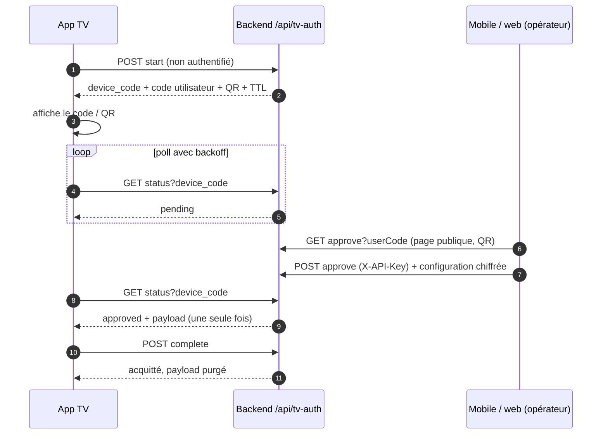
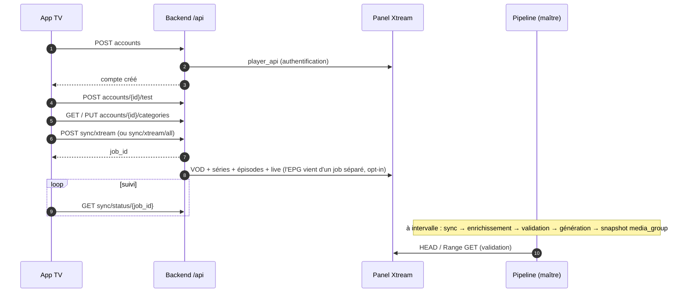
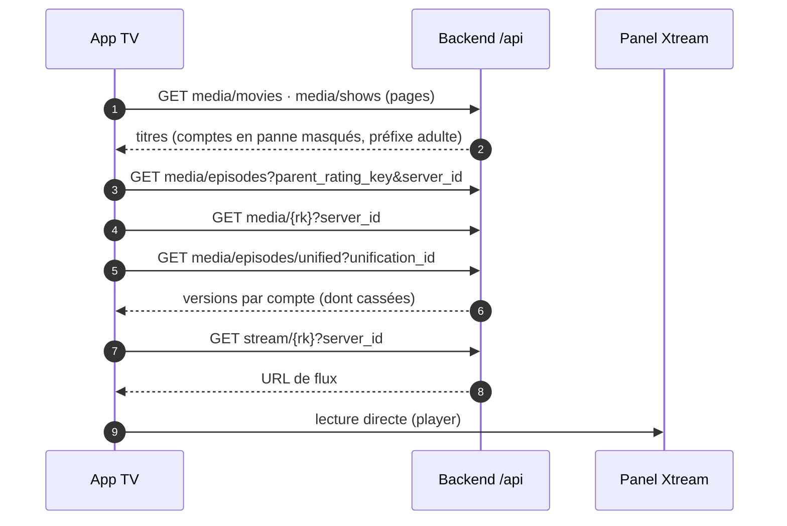
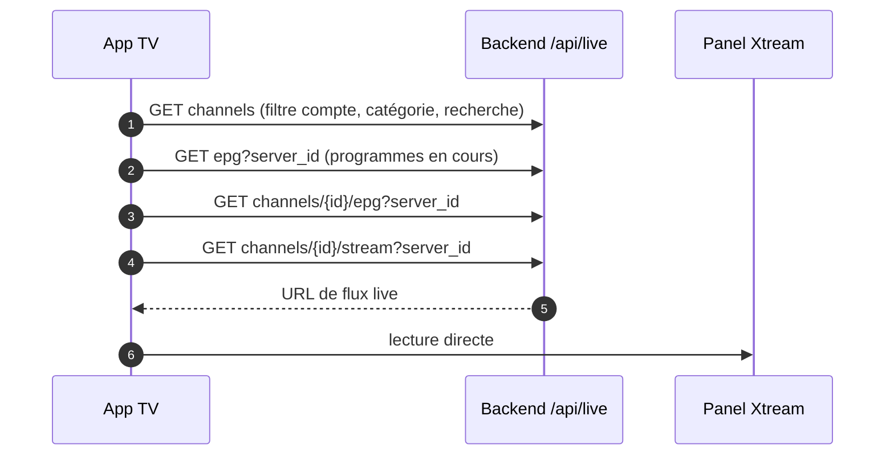
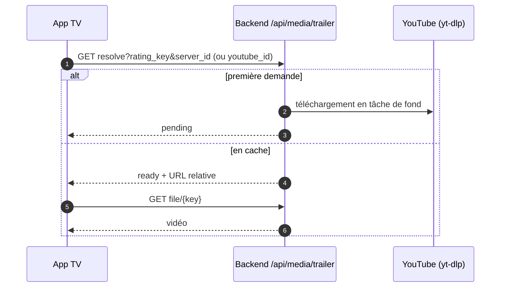
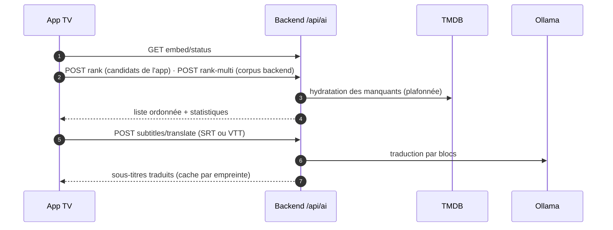
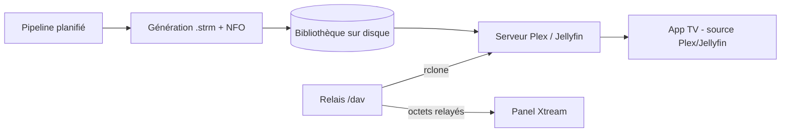

# Rétro-spec fonctionnelle — carte des capacités (PlexHub Backend)

> Produit par `/retro-spec carte` le 2026-09-25 (backend v1.10.9). Sources : l'inventaire généré [`../_genere/inventaire.md`](../_genere/inventaire.md) (114 endpoints `/api` + `/admin`, 8 tâches planifiées, 7 workers ; recalé au Lot 10, 2026-10-02), `CLAUDE.md` (§2, §5), les PRD `docs/10-prd-*.md`, l'ADR 0005 ; côté TV (lecture seule), les interfaces Retrofit de PlexHubTV et ses parcours `.maestro/`.
> **Pas d'exigence (FR) à ce stade** : les FR-BE-### naissent dans les fiches `CAP-BE-nn-<slug>.md`. Les endpoints ne sont pas recopiés un par un : chaque ligne renvoie à un **groupe de l'inventaire**, avec une preuve d'entrée.

## Personas

| Persona | Qui | Canal |
|---|---|---|
| **Spectateur TV** | utilisateur de l'app Android TV PlexHubTV | API JSON `/api/*` (en-tête `X-API-Key`), `tv-auth` non authentifié |
| **Opérateur** | l'administrateur du homelab | UI HTML/HTMX `/admin*` (Basic Auth), miroirs JSON `/api/admin/*` (clé maître), CLI `python -m app.cli` |
| **Appareil d'appairage** | téléphone ou navigateur qui valide le code affiché par la TV | `POST /api/tv-auth/approve` (authentifié) |
| **Serveur média** | Plex / Jellyfin (via rclone pour `/dav`) qui lit la bibliothèque générée | système de fichiers `.strm`/NFO, WebDAV `/dav` (Basic Auth dédiée) |
| **Supervision** | Docker healthcheck, Prometheus | `/api/health` (public), `/metrics` (Basic Auth dédiée) |
| **Planificateur** | APScheduler du worker maître | tâches cron/intervalle (`app/main.py:361`) |

## Tableau des capacités

Taille estimée = écrans admin + endpoints + workers/tâches planifiées : **S** ≤ 4 · **M** 5–10 · **L** ≥ 11.
Colonne « TV » : **oui** = PlexHubTV appelle directement un endpoint de la capacité (preuve `tv:`) · **indirect** = l'app en voit l'effet (champ de réponse, bibliothèque Plex/Jellyfin) sans appel dédié · **non** = aucun appel trouvé dans le code de l'app.

| CAP-id | Capacité | Persona | Écrans / routes (admin) | Endpoints (renvoi inventaire) | Workers / tâches | Taille | PRD existant | Parcours Maestro (tv:) | TV consomme ? |
|---|---|---|---|---|---|---|---|---|---|
| CAP-BE-01 | Santé & supervision | Supervision, Spectateur TV | — | `/api/health` (`app/api/health.py:14`), `/metrics` (`app/main.py:761`), `/docs` + `/openapi.json` (Basic admin) | — | S (4) | — | aucun | **oui** — `tv:core/network/src/main/java/com/chakir/plexhubtv/core/network/backend/BackendApiService.kt:11` |
| CAP-BE-02 | Clés API & authentification | Opérateur | `/admin/keys` (page `keys.html`) — `app/api/admin.py:862` | groupe `/admin/keys*` (4) + `/api/admin/keys*` (4, `app/api/api_keys.py:68`) | — | M (9) | — | aucun | **indirect** — l'app envoie `X-API-Key` sur tout `/api/*`, ne gère pas les clés |
| CAP-BE-03 | Appairage TV (device-flow) | Spectateur TV, Appareil d'appairage | — | groupe `/api/tv-auth/*` (5) : start `app/api/tv_auth.py:243`, page d'approbation (GET approve, publique) `:436`, status `:547`, complete `:653`, approve (POST, gardé) `:476` | — | S (5) | — | aucun | **oui** (start/status/complete) — `tv:core/network/src/main/java/com/chakir/plexhubtv/core/network/tvauth/TvAuthApiService.kt:26` ; `approve` est appelé par la page d'approbation servie par le backend (`GET /api/tv-auth/approve`, ouverte depuis le QR) ou par un mobile/web (`tv:core/network/src/main/java/com/chakir/plexhubtv/core/network/tvauth/TvAuthApiService.kt:20`) |
| CAP-BE-04 | Comptes Xtream & catégories | Spectateur TV, Opérateur | — | groupe `/api/accounts*` (5, `app/api/accounts.py:23`) + `/api/accounts/{id}/categories*` (3, `app/api/categories.py:27`) ; auto-provision au boot | — | M (8) | — | aucun | **oui** — catégories seulement (CRUD et test des comptes retiré au Lot 6 A (TV `d12ec586`, 2026-10-03)), `tv:core/network/src/main/java/com/chakir/plexhubtv/core/network/backend/BackendApiService.kt:75` à `:90` |
| CAP-BE-05 | Synchronisation Xtream & pipeline planifié | Spectateur TV, Opérateur, Planificateur | — | groupe `/api/sync/*` hors enrichment/validate (6) : xtream `app/api/sync.py:29`, xtream/all `:48`, status `:181`, jobs `:209`, cancel `:71`, full-pipeline `:129` | `sync_worker` ; tâche `sync_enrich_generate` (`app/main.py:361`) | M (8) | — | aucun | **oui** — `tv:core/network/src/main/java/com/chakir/plexhubtv/core/network/backend/BackendApiService.kt:64`, `:69`, `:92` |
| CAP-BE-06 | Enrichissement métadonnées (TMDB + OMDb) | Opérateur, Planificateur | — | `/api/sync/enrichment` (`app/api/sync.py:83`), `/api/admin/enrichment/*` (2, `app/api/enrichment.py:69`), `PATCH /api/media/{rk}` (`app/api/media.py:518`), `POST /api/media/{rk}/rescrape` (`app/api/media.py:540`) | `enrichment_worker`, `enrichment_backfill_worker` | M (7) | — (plan `docs/plans/2026-07-20-omdb-rating-enrichment-design.md`, ADR 0003) | aucun | **indirect** — notes, résumés, ids arrivent dans les réponses catalogue |
| CAP-BE-07 | Validation des flux | Planificateur, Opérateur | — | `/api/sync/validate-streams` (`app/api/sync.py:106`) | `health_check_worker` ; tâche `health_check` (`app/main.py:370`) | S (3) | — | aucun | **indirect** — état « cassé » des versions (popup de sources) |
| CAP-BE-08 | Panne fournisseur prolongée (masquage) | Planificateur | — | aucun endpoint dédié (masquage appliqué aux lectures catalogue) | `health_check_worker` (strikes), `account_outage_service` | S (1) | — | aucun | **indirect** — les titres d'un compte en panne disparaissent des listes |
| CAP-BE-09 | Catalogue VOD & séries (lecture, dédup unifiée) | Spectateur TV | — | groupe `/api/media/*` en lecture (8) : movies `app/api/media.py:128`, movies/stats `:164`, shows `:172`, episodes `:205`, movies/unified `:266`, shows/unified `:333`, episodes/unified `:394`, `{rk}` `:506` | lit le snapshot `media_group` (reconstruit en fin de pipeline) | M (8) | — | `tv:.maestro/legacy/13_multi_server_source.yaml:3` (sélecteur de source), `tv:.maestro/legacy/11_browse_tvshows.yaml:3` (non spécifique au backend) | **oui** — movies, shows, episodes, `{rk}`, episodes/unified : `tv:core/network/src/main/java/com/chakir/plexhubtv/core/network/backend/BackendApiService.kt:17` à `:59` ; **non** pour movies/unified et shows/unified |
| CAP-BE-10 | Résolution d'URL de lecture | Spectateur TV | — | `/api/stream/{rk}` (`app/api/stream.py:13`) | — | S (1) | — | `tv:.maestro/legacy/06_play_movie.yaml:3` (non spécifique au backend) | **oui** — `tv:core/network/src/main/java/com/chakir/plexhubtv/core/network/backend/BackendApiService.kt:48` |
| CAP-BE-11 | TV en direct & EPG | Spectateur TV | — | groupe `/api/live/*` (5) : channels `app/api/live.py:28`, channel `:86`, stream `:105`, epg chaîne `:143`, epg courant `:201` | synchro Live dans `sync_worker` ; tâche `epg_cleanup` (`app/main.py:379`) ; job `epg_sync` opt-in, désactivé par défaut (`app/main.py:441-462`) | M (6) | — | `tv:.maestro/legacy/16_iptv.yaml:3` | **oui** — `tv:core/network/src/main/java/com/chakir/plexhubtv/core/network/backend/BackendApiService.kt:96` à `:118` |
| CAP-BE-12 | Bandes-annonces | Spectateur TV | — | `/api/media/trailer/resolve` (`app/api/media.py:440`), `/api/media/trailer/file/{key}` (`app/api/media.py:475`) | téléchargement yt-dlp en tâche de fond ; tâche `trailer_cache_purge` (`app/main.py:414`) | S (3) | — | aucun | **oui** — `tv:core/network/src/main/java/com/chakir/plexhubtv/core/network/backend/BackendApiService.kt:134` ; le fichier est lu via l'URL renvoyée (`tv:data/src/main/java/com/chakir/plexhubtv/data/repository/BackendRepositoryImpl.kt:809`) |
| CAP-BE-13 | Recommandations IA vectorielles & recherche sémantique | Spectateur TV, Opérateur | — | rank `app/api/ai.py:320`, rank-multi `:401`, search `:499`, embed/rebuild `:713`, embed/jobs `:729`, embed/status `:745` | `embedding_worker` | M (7) | — | aucun | **oui** (rank, rank-multi, embed/status) — `tv:core/network/src/main/java/com/chakir/plexhubtv/core/network/ai/AiRecommendationApi.kt:26` ; **non** pour search et rebuild |
| CAP-BE-14 | Génération LLM & assistant (Ollama) | Opérateur (aucun client TV) | — | describe `app/api/ai.py:860`, chat `:883`, llm/status `:909`, assistant `:622`, blurb POST `:1091`, blurb GET `:1214` | — | M (6) | — | aucun | **non** — aucun appel dans l'app (candidat au statut `mort` côté produit, à confirmer dans la fiche) |
| CAP-BE-15 | Traduction de sous-titres | Spectateur TV | — | `/api/ai/subtitles/translate` (`app/api/ai.py:946`) | tâche `subtitle_cache_cleanup` (`app/main.py:394`) | S (2) | — | `tv:.maestro/legacy/08_audio_subtitle_tracks.yaml:3` (pistes, pas la traduction) | **oui** — `tv:core/network/src/main/java/com/chakir/plexhubtv/core/network/ai/AiRecommendationApi.kt:56` |
| CAP-BE-16 | Génération de bibliothèque Plex/Jellyfin (.strm + NFO) | Opérateur, Planificateur, Serveur média | — | `/api/plex/generate` (`app/api/plex.py:80`) ; CLI `generate` | génération auto en fin de pipeline (`sync_enrich_generate`) | S (3) | — (plan `docs/new_feature_xtream_To_Plex.md`) | aucun | **indirect** — la TV lit ces titres via ses sources Plex/Jellyfin |
| CAP-BE-17 | Relais WebDAV `/dav` | Serveur média | — | `/dav` OPTIONS/PROPFIND/HEAD/GET (`app/api/dav.py:79`, routes `app/api/dav.py:319`) — absent de l'inventaire généré (route ajoutée par `add_api_route`) | — | S (4) | — (runbook `docs/30-ops-plex-webdav.md`) | aucun | **indirect** — via Plex |
| CAP-BE-18 | Téléchargement physique Xtream | Opérateur | `/admin/downloads` (page `downloads.html`) — `app/api/admin_downloads.py:156` | groupe `/admin/downloads*` (11) + `/api/admin/downloads*` (2, `app/api/downloads.py:40`) | `download_worker` (maître seul) | L (15) | **`docs/10-prd-media-download.md`** (+ ADR 0002, testplan 40) | aucun | **non** |
| CAP-BE-19 | Téléchargement Plex (« Télécharger Plex ») | Opérateur | `/admin/plex-downloads` (page `plex_downloads.html`) — `app/api/admin_plex_downloads.py:171` | groupe `/admin/plex-downloads*` (9) + `/api/admin/plex-downloads/*` (3, `app/api/plex_downloads.py:53`) | `download_worker` (partagé) ; tâche `plex_catalogue_sync` (`app/main.py:486`) | L (15) | **`docs/10-prd-plex-download.md`** | aucun | **non** |
| CAP-BE-20 | Écran de téléchargement unifié | Opérateur | `/admin/unified-downloads` (page `unified_downloads.html`) — `app/api/admin_unified_downloads.py:97` | groupe `/admin/unified-downloads*` (3) | — (réutilise CAP-BE-18/19) | S (4) | — | aucun | **non** |
| CAP-BE-21 | Console admin du catalogue | Opérateur | `/admin` (page `index.html`) — `app/api/admin.py:125` | `/admin`, `/admin/`, `/admin/catalogue` (`app/api/admin.py:149`), `/admin/stats` (`:167`), `/admin/movies/{rk}/ids` (`:174`), `/admin/movies/{rk}/rescrape` (`:222`) | — | M (9) | — | aucun | **non** |
| CAP-BE-22 | Scraper manuel, file « À vérifier » & lot de scraping | Opérateur | tiroir modal dans `/admin` (`_scrape_panel.html`) — `app/api/admin.py:495` | groupe `/admin/media/{sid}/{rk}/*` (8, dont apply `app/api/admin.py:260`) + `/admin/review*` (3, `:618`) + `/admin/scrape-batch*` (3, `:710`) | `manual_scrape_batch_worker` | L (15) | — (**ADR 0005** `docs/architecture/adr/0005-manual-scraper-poster-match.md`) | aucun | **indirect** — identités corrigées visibles dans le catalogue |
| CAP-BE-23 | Import de métadonnées NFO | Opérateur | `/admin/import-nfo` (page `import_nfo.html`) — `app/api/admin.py:759` | GET + POST `/admin/import-nfo` (`app/api/admin.py:776`) | — | S (3) | — | aucun | **indirect** |
| CAP-BE-24 | Sauvegarde & maintenance de la base | Planificateur, Opérateur | — | aucun | tâche `db_backup` (`app/main.py:431`) ; `ANALYZE`/`PRAGMA optimize` en fin de pipeline | S (2) | — | aucun | **non** |

**Écarts relevés en construisant la carte** (à reprendre dans les fiches, pas encore des FR) :
- L'inventaire généré ne voit ni `/dav` (routes posées par `add_api_route`) ni `/metrics`, `/docs`, `/openapi.json` (montés hors routers) → à corriger dans `tools/retro-spec/inventaire.py`, pas à la main.
- L'inventaire marque `public ?` les miroirs `/api/admin/*` (garde module-level `verify_master_key`) : ce sont des faux positifs de l'outil, à confirmer dans les fiches CAP-BE-02/18/19. Depuis le Lot 10 il distingue `GET /api/tv-auth/approve` (page publique) de `POST /api/tv-auth/approve` (garde `X-API-Key`).
- Aucun parcours Maestro n'appartient au backend (pas d'UI TV) ; les parcours `tv:` cités exercent le backend **seulement** quand la source de l'app est le backend — seul `16_iptv.yaml` en dépend réellement.
- CAP-BE-14 (LLM) et les endpoints unifiés films/séries de CAP-BE-09 n'ont aucun appelant dans l'app TV.

## Ordre de rédaction proposé

Règle : **le pilote d'abord** (imposé par la skill : une capacité avec PRD, pour mesurer l'écart fiche ↔ PRD), puis **dépendances d'abord**, et à dépendance égale **les petites d'abord**.

| # | CAP-id | Capacité | Taille | Pourquoi à ce rang |
|---|---|---|---|---|
| 0 | CAP-BE-18 | Téléchargement physique Xtream | L | **pilote obligatoire** (PRD `10-prd-media-download.md`) |
| 1 | CAP-BE-01 | Santé & supervision | S | socle, aucune dépendance |
| 2 | CAP-BE-03 | Appairage TV | S | point d'entrée de la TV, autonome |
| 3 | CAP-BE-02 | Clés API & authentification | M | garde de tout `/api/*` |
| 4 | CAP-BE-04 | Comptes Xtream & catégories | M | prérequis de la synchro |
| 5 | CAP-BE-05 | Synchronisation & pipeline | M | alimente tout le catalogue |
| 6 | CAP-BE-07 | Validation des flux | S | étape du pipeline |
| 7 | CAP-BE-08 | Panne fournisseur | S | dépend de la validation |
| 8 | CAP-BE-06 | Enrichissement | M | étape du pipeline, précède le catalogue |
| 9 | CAP-BE-10 | URL de lecture | S | petite, dépend des comptes |
| 10 | CAP-BE-12 | Bandes-annonces | S | petite, dépend du catalogue enrichi |
| 11 | CAP-BE-09 | Catalogue VOD & séries | M | consomme 05/06/07/08 |
| 12 | CAP-BE-11 | TV en direct & EPG | M | dépend de 04/05 |
| 13 | CAP-BE-15 | Traduction de sous-titres | S | IA la plus isolée |
| 14 | CAP-BE-13 | Recommandations IA | M | dépend du catalogue enrichi |
| 15 | CAP-BE-14 | Génération LLM & assistant | M | réutilise 13 (search/assistant) |
| 16 | CAP-BE-16 | Génération de bibliothèque | S | dépend du catalogue unifié |
| 17 | CAP-BE-17 | Relais WebDAV | S | dépend de 16 (mêmes chemins) |
| 18 | CAP-BE-23 | Import NFO | S | écrit l'identité, avant le scraper |
| 19 | CAP-BE-24 | Sauvegarde & maintenance | S | transverse |
| 20 | CAP-BE-21 | Console admin du catalogue | M | hôte du scraper |
| 21 | CAP-BE-22 | Scraper manuel & « À vérifier » | L | dépend de 06, 21, 23 |
| 22 | CAP-BE-19 | Téléchargement Plex | L | réutilise le worker de 18 |
| 23 | CAP-BE-20 | Écran de téléchargement unifié | S | assemble 18 et 19 |

## Parcours de bout en bout TV ↔ Backend

> Détail des flux côté backend : `docs/architecture/flux-cles.md` (§5.x) — on y renvoie, on ne les recopie pas.

### P1 — Appairage de la TV (CAP-BE-03)

### P2 — Ajout d'un compte Xtream depuis la TV puis synchronisation (CAP-BE-04, 05, 06, 07, 16)

### P3 — Parcourir et lire un film ou un épisode (CAP-BE-09, 10, 08)

### P4 — TV en direct et guide (CAP-BE-11)

### P5 — Bande-annonce d'un média non-Plex (CAP-BE-12)

### P6 — IA côté TV : recommandations et sous-titres (CAP-BE-13, 15)

### P7 — Chemin indirect : bibliothèque générée lue par la TV via Plex/Jellyfin (CAP-BE-16, 17)

