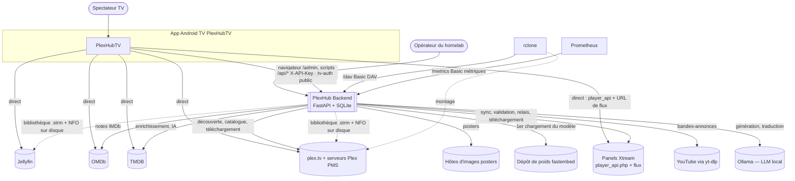
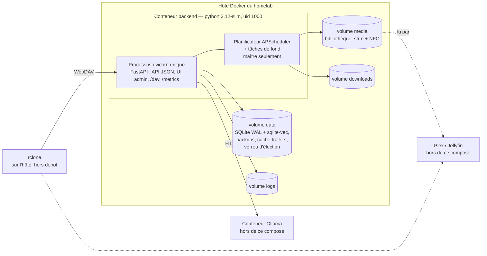
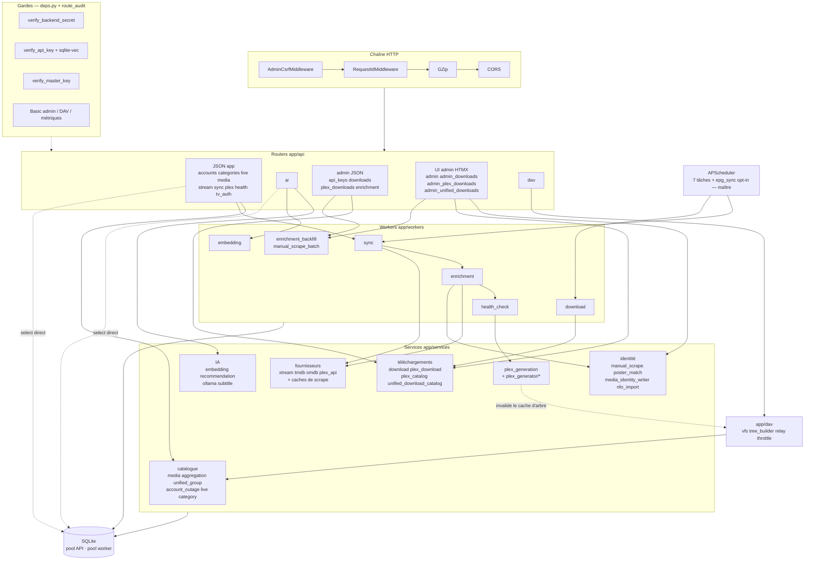

# Architecture C4 — PlexHub Backend (niveaux 1 à 3)

**Reconstitué le** : 2026-09-26 · recalé le 2026-10-02 (Lot 10) · **HEAD** : `aa3270f` (branche `develop`, backend v1.10.9) · **Méthode** : `/retro-spec technique c4` — 3 lecteurs en lecture seule (contexte et conteneurs backend, composants backend, app TV), rédaction et vérification des preuves par la session principale (11 preuves rouvertes dans le code, dont une affirmation de lecteur corrigée : ordre des middlewares, §3.3).
**Sources** : le code, l'inventaire généré [`../_genere/inventaire.md`](../_genere/inventaire.md), la carte [`../fonctionnel/00-carte.md`](../fonctionnel/00-carte.md) et les fiches CAP-BE, le [contrat d'API](contrat-api.md) ; côté TV (lecture seule, preuves `tv:`) PlexHubTV.
**Règle** : ce volet décrit la structure. Les comportements sont dans les fiches CAP-BE (on y renvoie), les flux pas à pas dans `docs/architecture/flux-cles.md` (§5.x), le schéma de base dans `db/` (généré). Aucun secret, aucune valeur de configuration, aucune adresse privée : les hôtes sont nommés par leur **variable**.

---

## 1. Niveau 1 — Contexte

### 1.1 Acteurs et systèmes entrants

| Acteur | Surface | Garde | Capacités | Preuve |
|---|---|---|---|---|
| App TV (API JSON) | `/api/accounts`, `categories`, `live`, `media`, `stream`, `sync`, `plex` | `X-API-Key` | CAP-BE-04, 05, 09, 10, 11, 12 | `app/main.py:665-671` ; `tv:core/network/src/main/java/com/chakir/plexhubtv/core/network/backend/BackendApiService.kt:11` |
| App TV (IA) | `/api/ai/*` | `X-API-Key` + garde sqlite-vec | CAP-BE-13, 15 | `app/main.py:735` ; `tv:core/network/src/main/java/com/chakir/plexhubtv/core/network/ai/AiRecommendationApi.kt:26` |
| App TV (appairage) | `/api/tv-auth` start/status/complete + page `GET approve` (publique) | public (seul `POST approve` gardé) | CAP-BE-03 | `app/main.py:674` |
| Opérateur | `/admin*`, `/docs`, `/openapi.json` | Basic Auth admin + CSRF | CAP-BE-02, 18-23 | `app/main.py:680-695` |
| Opérateur / scripts | `/api/admin/*` | clé maître seule | CAP-BE-02, 06, 18, 19 | `app/main.py:736-739` |
| rclone (pour Plex/Jellyfin) | `/dav` | Basic Auth DAV dédiée | CAP-BE-17 | `app/main.py:749` |
| Prometheus | `/metrics` | Basic Auth métriques | CAP-BE-01 | `app/main.py:761` |
| Healthcheck Docker | `/api/health` | public | CAP-BE-01 | `app/main.py:662`, `Dockerfile:62` |

Détail des gardes et de l'assertion de boot : [contrat-api §1.1](contrat-api.md) et [CAP-BE-02](../fonctionnel/CAP-BE-02-cles-api-authentification.md).

### 1.2 Systèmes externes appelés par le backend

| Système | Client | Protocole | Hôte configuré par | Garde SSRF | Capacités | Preuve |
|---|---|---|---|---|---|---|
| Panels Xtream (API) | `xtream_service` | httpx async, timeout 30 s, retries | compte en base (`XTREAM_*` pour l'auto-provision) | **non** | CAP-BE-04, 05, 11 | `app/services/xtream_service.py:29` |
| Panels Xtream (validation des flux) | `health_check_worker` | httpx HEAD puis Range GET | URL de flux reconstruite | oui (`event_hooks`) | CAP-BE-07, 08 | `app/workers/health_check_worker.py:43` |
| Panels Xtream (téléchargement, relais DAV) | `download_service`, `app/dav/relay.py` | httpx, **redirections suivies à la main** | URL de flux reconstruite | oui (vérif. à chaque saut) | CAP-BE-17, 18 | `app/services/download_service.py:452`, `app/dav/relay.py:126` |
| TMDB | `tmdb_service` | httpx, clé en paramètre de requête | constante | **non** | CAP-BE-06, 13, 22 | `app/services/tmdb_service.py:250` |
| OMDb | `omdb_service` | httpx, clé en paramètre de requête | constante | **non** | CAP-BE-06, 22 | `app/services/omdb_service.py:174` |
| plex.tv + PMS | `plex_api_service`, `plex_download_service` | httpx, jeton en en-tête | constante + adresses découvertes | **non** (découverte) / oui (téléchargement) | CAP-BE-19 | `app/services/plex_api_service.py:35`, `app/services/plex_api_service.py:210` |
| Ollama | `ollama_service` | httpx, **client éphémère par appel**, 120 s / 5 s | `OLLAMA_URL`, `OLLAMA_MODEL` | **non** | CAP-BE-14, 15 | `app/services/ollama_service.py:21`, `app/config.py:206` |
| YouTube | `trailer_service` | bibliothèque `yt_dlp` en thread | constante | sans objet | CAP-BE-12 | `app/services/trailer_service.py:409` |
| Poids fastembed | `embedding_service` | téléchargement interne à la bibliothèque | `AI_EMBED_MODEL`, `AI_EMBED_CACHE_DIR` | sans objet | CAP-BE-13 | `app/services/embedding_service.py:61-62` |
| Hôtes d'images | `plex_generator/storage.py`, `poster_match_service` | httpx (sync en pool de threads / async dédié sans paramètres) | URL fournie par la source | oui | CAP-BE-16, 22 | `app/plex_generator/storage.py:64`, `app/services/poster_match_service.py:359` |

### 1.3 Ce que la TV fait sans le backend

L'app n'est pas un simple client du backend : c'est un **agrégateur multi-sources** (`SourceType` PLEX / JELLYFIN / XTREAM / BACKEND, `tv:core/model/src/main/java/com/chakir/plexhubtv/core/model/SourceType.kt:7`). Le backend n'est qu'une source parmi quatre.

| Constat | Preuve |
|---|---|
| L'app appelle `player_api.php` des panels Xtream **en direct** (authentification + catalogue d'un compte « natif ») | `tv:core/network/src/main/java/com/chakir/plexhubtv/core/network/xtream/XtreamApiService.kt:9` |
| Pour la lecture, l'URL Xtream directe est essayée **avant** l'URL résolue par le backend | `tv:app/src/main/java/com/chakir/plexhubtv/feature/player/url/DirectStreamUrlBuilder.kt:37-38` |
| Même quand elle passe par `GET /api/stream/{rk}`, la lecture des octets se fait **de la TV vers le panel** (le backend ne relaie pas, sauf `/dav`) | [CAP-BE-10](../fonctionnel/CAP-BE-10-resolution-url-lecture.md) |
| L'app a ses propres clients TMDB et OMDb (enrichissement dupliqué côté client) | `tv:core/network/src/main/java/com/chakir/plexhubtv/core/network/NetworkModule.kt:593`, `tv:core/network/src/main/java/com/chakir/plexhubtv/core/network/NetworkModule.kt:635` |
| Plex et Jellyfin sont interrogés en direct ; le backend ne leur parle que par la bibliothèque générée ou `/dav` | `tv:core/network/src/main/java/com/chakir/plexhubtv/core/network/NetworkModule.kt:553` |
| `X-API-Key` n'est posé que sur les hôtes enregistrés comme backend (jamais vers Xtream, Plex, Jellyfin) | `tv:core/network/src/main/java/com/chakir/plexhubtv/core/network/backend/BackendApiKeyInterceptor.kt:47` |
| Autres services tiers de l'app (sous-titres, marqueurs d'intro, Trakt, Crashlytics) : hors périmètre du backend | `tv:core/network/src/main/java/com/chakir/plexhubtv/core/network/trakt/TraktNetworkModule.kt:41` |
| Aucun appel de l'app vers `/dav` ni `/admin` (vérifié par recherche dans les fichiers Kotlin) | — |

---

## 2. Niveau 2 — Conteneurs

| Élément | Fait | Preuve |
|---|---|---|
| Image | `python:3.12-slim`, ffmpeg installé (yt-dlp), utilisateur non root | `Dockerfile:1`, `Dockerfile:65` |
| Processus | **un seul** processus uvicorn (pas de `--workers`) | `Dockerfile:67` |
| Healthcheck | sur `/api/health`, dans l'image et dupliqué dans le compose | `Dockerfile:62` |
| Compose | un seul service applicatif ; configuration par `env_file` (optionnel) ; limite mémoire 2 Go | `docker-compose.yml:40`, `docker-compose.yml:76` |
| Ollama, Plex, Jellyfin, rclone | **aucun** n'est dans le compose : dépendances externes. L'hôte Ollama par défaut désigne un conteneur d'une autre pile | `app/config.py:206` |
| Base | SQLite (fichier sous `DATA_DIR`), accès async, extension sqlite-vec chargée à chaque connexion | `app/db/database.py:4` ; schéma : [`db/`](db/) |
| Deux pools de connexions | pool API (20 + 30) et `worker_engine` dédié (2 + 2) | `app/db/database.py:20`, `app/db/database.py:35-39` |
| Élection du maître | verrou `fcntl.flock` non bloquant sur un fichier de `DATA_DIR` ; seul le maître lance planificateur et tâches de fond | `app/main.py:308` |

> Déploiement réel du homelab (compose propre, tag flottant) : hors dépôt ; le runbook non-root est `docs/32-ops-docker-nonroot.md`, le runbook WebDAV `docs/30-ops-plex-webdav.md`. Build et release : volet `build-release` (à écrire).

---

## 3. Niveau 3 — Composants du conteneur backend

### 3.1 Routers → services

| Groupe | Routers | Services / workers appelés | Preuve (imports) |
|---|---|---|---|
| JSON app | `accounts`, `categories`, `live`, `media`, `stream`, `sync`, `plex`, `health`, `tv_auth` | `account_service`, `category_service`, `live_service` + `xtream_service` (+ `epg_sync_service` pour la synchro EPG opt-in du master), `media_service` + `aggregation_service` + `trailer_service`, `stream_service`, `job_registry` + workers (sync) ; `plex` n'importe aucun service ; `tv_auth` **n'a pas de service** | `app/api/accounts.py:15`, `app/api/media.py:24-28`, `app/api/live.py:18-19`, `app/api/tv_auth.py:57` |
| IA | `ai` | `embedding_service`, `recommendation_service`, `tmdb_service`, `embedding_worker`, puis (import différé) `ollama_service`, `subtitle_service` | `app/api/ai.py:38-48`, `app/api/ai.py:794-796` |
| Admin JSON | `api_keys`, `downloads`, `plex_downloads`, `enrichment` | `api_key_service`, `download_service`, `plex_catalog_service`, `enrichment_backfill_worker` (sans service) | `app/api/api_keys.py:17`, `app/api/enrichment.py:29` |
| UI admin | `admin`, `admin_downloads`, `admin_plex_downloads`, `admin_unified_downloads` | `media_service`, `account_outage_service`, `api_key_service`, `manual_scrape_service`, `nfo_import_service`, `poster_match_service`, `manual_scrape_batch_worker`, services de téléchargement | `app/api/admin.py:24-34`, `app/api/admin_plex_downloads.py:48` |
| WebDAV | `dav` | `app/dav/*` + `stream_service` | `app/api/dav.py:65-70` |

Fiches correspondantes : catalogue [CAP-BE-09](../fonctionnel/CAP-BE-09-catalogue-vod-series.md), IA [CAP-BE-13](../fonctionnel/CAP-BE-13-recommandations-ia-recherche-semantique.md) / [14](../fonctionnel/CAP-BE-14-generation-llm-assistant.md) / [15](../fonctionnel/CAP-BE-15-traduction-sous-titres.md), admin [CAP-BE-21](../fonctionnel/CAP-BE-21-console-admin-catalogue.md) / [22](../fonctionnel/CAP-BE-22-scraper-manuel-a-verifier.md), téléchargements [CAP-BE-18](../fonctionnel/CAP-BE-18-telechargement-physique-xtream.md) / [19](../fonctionnel/CAP-BE-19-telechargement-plex.md) / [20](../fonctionnel/CAP-BE-20-ecran-telechargement-unifie.md), WebDAV [CAP-BE-17](../fonctionnel/CAP-BE-17-relais-webdav.md).

### 3.2 Workers, planificateur et tâches de fond

| Worker | Déclenché par | Maître seul ? | Pool DB | Capacité |
|---|---|---|---|---|
| `sync_worker` | tâche `sync_enrich_generate` + boot ; **aussi** `POST /api/sync/*` et création de compte | non (endpoints sur tout processus) | API | [CAP-BE-05](../fonctionnel/CAP-BE-05-synchronisation-xtream-pipeline.md) |
| `enrichment_worker` | pipeline + `POST /api/sync/enrichment` | non | API | [CAP-BE-06](../fonctionnel/CAP-BE-06-enrichissement-tmdb-omdb.md) |
| `health_check_worker` | tâche `health_check` + pipeline + endpoint | non | **worker** | [CAP-BE-07](../fonctionnel/CAP-BE-07-validation-des-flux.md), [08](../fonctionnel/CAP-BE-08-panne-fournisseur-prolongee.md) |
| `download_worker` | boucle de fond lancée au boot | **oui** | API | CAP-BE-18, 19 |
| `embedding_worker` | `POST /api/ai/embed/rebuild` uniquement (jamais au boot) | non | API | CAP-BE-13 |
| `enrichment_backfill_worker`, `manual_scrape_batch_worker` | endpoint admin / UI admin | non | API | CAP-BE-06, 22 |

| Tâche planifiée (maître) | Déclencheur | Preuve |
|---|---|---|
| `sync_enrich_generate` (sync → enrichissement → validation → génération → snapshot) | intervalle `SYNC_INTERVAL_HOURS` | `app/main.py:361-365` |
| `health_check` | cron nocturne | `app/main.py:370-374` |
| `epg_cleanup` | cron nocturne | `app/main.py:379-383` |
| `epg_sync` (`epg_sync_service`, XMLTV en masse) | intervalle `EPG_SYNC_INTERVAL_HOURS`, **seulement si `EPG_SYNC_ENABLED=true`** (désactivé par défaut), premier tir à boot + 5 min | `app/main.py:441-462` |
| `subtitle_cache_cleanup` | cron nocturne | `app/main.py:394-398` |
| `trailer_cache_purge` | cron nocturne | `app/main.py:414-418` |
| `db_backup` (snapshot atomique + `integrity_check` ; la restauration est un script hors planificateur, `app/scripts/restore_db.py`) | cron `BACKUP_HOUR`, si activé | `app/main.py:431-435` |
| `plex_catalogue_sync` | intervalle, si jeton Plex configuré | `app/main.py:486-490` |
| Tâches de fond au boot : drain des téléchargements, reprise du statut de sync Plex, pipeline initial | `create_background_task` | `app/main.py:524`, `app/main.py:547`, `app/main.py:569` |

Seuls `health_check_worker` et `account_outage_service` utilisent le pool worker (recherche de `worker_session_factory` dans `app/` : 3 fichiers, dont la définition). L'enchaînement du pipeline est détaillé dans `docs/architecture/flux-cles.md` (« Pipeline planifié »).

### 3.3 Couche transverse

| Composant | Rôle | Preuve |
|---|---|---|
| Middlewares | ajoutés dans l'ordre CORS, GZip, RequestId, CSRF ; Starlette enveloppe dans l'ordre inverse, donc **CSRF est le plus externe** | `app/main.py:627-642` |
| Gardes | 6 dépendances d'authentification | `app/api/deps.py:64`, `app/api/deps.py:191` |
| Assertion de boot | refuse le démarrage si une route `/api/*` n'a pas de garde | `app/main.py:755`, `app/api/route_audit.py:66-99` |
| SSRF | vérification d'hôte par `event_hooks` httpx (async et sync) | `app/utils/ssrf.py:182-189` |
| Retry d'écriture | `write_with_retry` (session neuve par tentative) | `app/utils/db_retry.py` — cf. piège 8 de `CLAUDE.md` |
| Arrêt propre | fermeture des clients Xtream, TMDB, health-check, relais DAV, posters | `app/main.py:594-602` |

---

## 4. Écarts et risques

| # | Écart / risque | Nature | Impact | Preuve |
|---|---|---|---|---|
| E1 | `CLAUDE.md` §2 annonce encore `APP_VERSION = "1.10.0"` alors que le code porte 1.10.9 ; §1, §2, §3, §9 citent des lignes de `main.py` périmées (flock « main.py:226-227 », montage « main.py:398-438 », CORS « main.py:548-549 », DAV « main.py:657 »), ainsi que config.py:60-62 pour Ollama et docker-compose.yml:39 pour la mémoire | doc périmée | un agent qui suit `CLAUDE.md` ouvre la mauvaise ligne | `app/main.py:39`, `app/main.py:308`, `app/config.py:206`, `docker-compose.yml:76` |
| E2 | `omdb_service` et `plex_api_service` ont un `close()` qui n'est jamais appelé à l'arrêt, contrairement à Xtream et TMDB | fuite de ressource | connexions httpx non fermées au shutdown (avertissements, sockets pendants) | `app/services/omdb_service.py:197`, `app/services/plex_api_service.py:220`, `app/main.py:594-602` |
| E3 | `CLAUDE.md` présente le pool worker comme celui « des workers » ; en réalité seuls la validation et le service de panne l'utilisent. Sync, enrichissement, téléchargements et lots de scraping partagent le **pool API** | isolation partielle | un pipeline lourd peut encore concurrencer les lectures de la TV sur le même pool | `app/db/database.py:35` ; recherche `worker_session_factory` (3 fichiers) |
| E4 | Règle « la logique vit dans les services » non tenue : `tv_auth` n'a aucun service, `live`, `accounts`, `stream`, `health`, `ai`, `dav` font des `select()` directs | dette d'architecture | logique métier non testable hors HTTP, duplication de requêtes | `app/api/tv_auth.py:57`, `app/api/accounts.py:25`, `app/api/stream.py:26` |
| E5 | Dépendance croisée `services` ↔ `dav` : `plex_generation_service` importe `app.dav.vfs` (différé) et `app/dav/tree_builder.py` importe `stream_service` | couplage | un refactor d'un côté casse l'autre ; import différé = dépendance cachée | `app/services/plex_generation_service.py:144`, `app/dav/tree_builder.py:32` |
| E6 | 5 clients sortants sans garde SSRF (Xtream API, TMDB, OMDb, Ollama, plex.tv) | risque sécurité accepté (piège 19e) | un hôte de compte Xtream saisi pointant vers le réseau interne est appelé sans contrôle | `app/services/xtream_service.py:29`, `app/services/ollama_service.py:21` |
| E7 | Ollama, Plex, Jellyfin et rclone sont hors du compose ; l'hôte Ollama par défaut dépend d'une autre pile Docker | dépendance externe implicite | backend démarré seul : endpoints LLM en 503, sans signal au boot | `app/config.py:206` |
| E8 | Le cache des poids fastembed est dans le home du conteneur, pas dans un volume, si `AI_EMBED_CACHE_DIR` n'est pas posé | risque d'exploitation | chaque recréation du conteneur retélécharge le modèle (cold start du 1ᵉʳ `/rank`) | `app/services/embedding_service.py:61-62` |
| E9 | La TV contourne le backend pour Xtream (API et URL de flux essayées en premier), TMDB et OMDb | duplication fonctionnelle | deux chemins de lecture et d'enrichissement divergent (masquage de panne, validation, identité corrigée ne s'appliquent qu'au chemin backend) | `tv:app/src/main/java/com/chakir/plexhubtv/feature/player/url/DirectStreamUrlBuilder.kt:37-38` |
| E10 | Planificateur, élection et sémaphores DAV supposent un processus unique ; rien n'empêche `--workers N` hors de l'image | hypothèse non gardée | plafond de connexions Xtream multiplié, jobs lancés sur des processus non maîtres via les endpoints | `Dockerfile:67` |
| E11 | Les endpoints `POST /api/sync/*` lancent sync, enrichissement et validation sur **n'importe quel** processus, hors du verrou du pipeline maître | concurrence | en multi-processus, un pipeline manuel et le pipeline planifié peuvent tourner ensemble | [CAP-BE-05](../fonctionnel/CAP-BE-05-synchronisation-xtream-pipeline.md) |
| E12 | `app/main.py` (734 lignes), `app/api/ai.py` (1 248), `app/api/admin.py` (958) concentrent logique et câblage | dette (CR-A05) | zones de conflit et de revue difficiles | mesure `wc -l` |
| E13 | L'inventaire généré ne voit pas `/dav`, `/metrics`, `/docs`, `/openapi.json` (déjà relevé par la carte) | outillage | le C4 ne peut pas se reposer uniquement sur l'inventaire | [00-carte](../fonctionnel/00-carte.md) |

## 5. Questions ouvertes (à vérifier par test)

1. **E2** — un test de cycle de vie (`TestClient` en contexte) émet-il un `ResourceWarning` ou laisse-t-il des connexions ouvertes pour les clients OMDb et plex.tv après un appel ?
2. **E3** — sous charge (pipeline complet + lecture TV paginée en parallèle), le pool API atteint-il `QueuePool limit` ? Mesure avec `/benchmark`.
3. **E8** — après `docker compose up --force-recreate` sans `AI_EMBED_CACHE_DIR`, le premier `POST /api/ai/rank` retélécharge-t-il le modèle ? (mesurer la durée et le trafic).
4. **E7** — Ollama injoignable : `/api/health` reste-t-il 200 et `/api/ai/llm/status` renvoie-t-il bien l'état dégradé sans bloquer au-delà du timeout de 5 s ?
5. **E9** — pour un `serverId` préfixé `xtream_` d'un compte **aussi** synchronisé par le backend, quelle URL la TV joue-t-elle ? (test unitaire de `DirectStreamUrlBuilder` côté TV).
6. **E10/E11** — deux processus uvicorn sur le même `DATA_DIR` : un seul devient maître (attendu) ; un `POST /api/sync/full-pipeline` sur le non-maître pendant le pipeline planifié produit-il deux pipelines concurrents ?
7. **E6** — un compte Xtream dont l'hôte résout vers une adresse privée : l'appel `player_api` part-il ? (test respx sur `xtream_service`).
