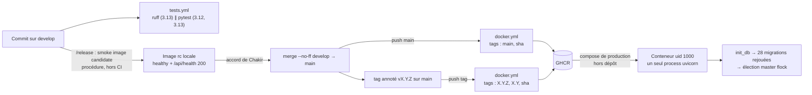
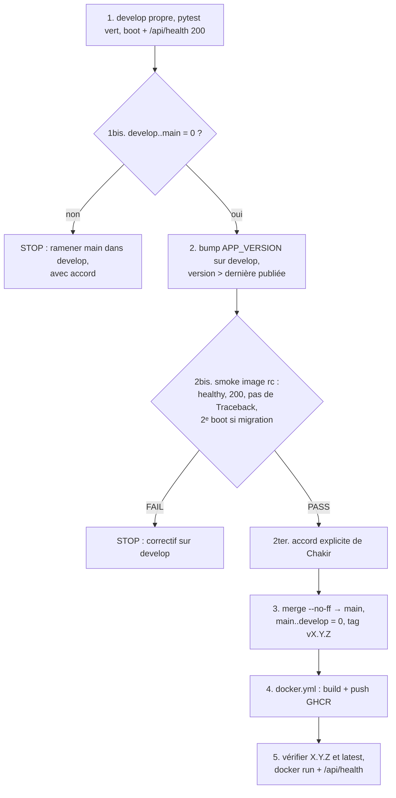
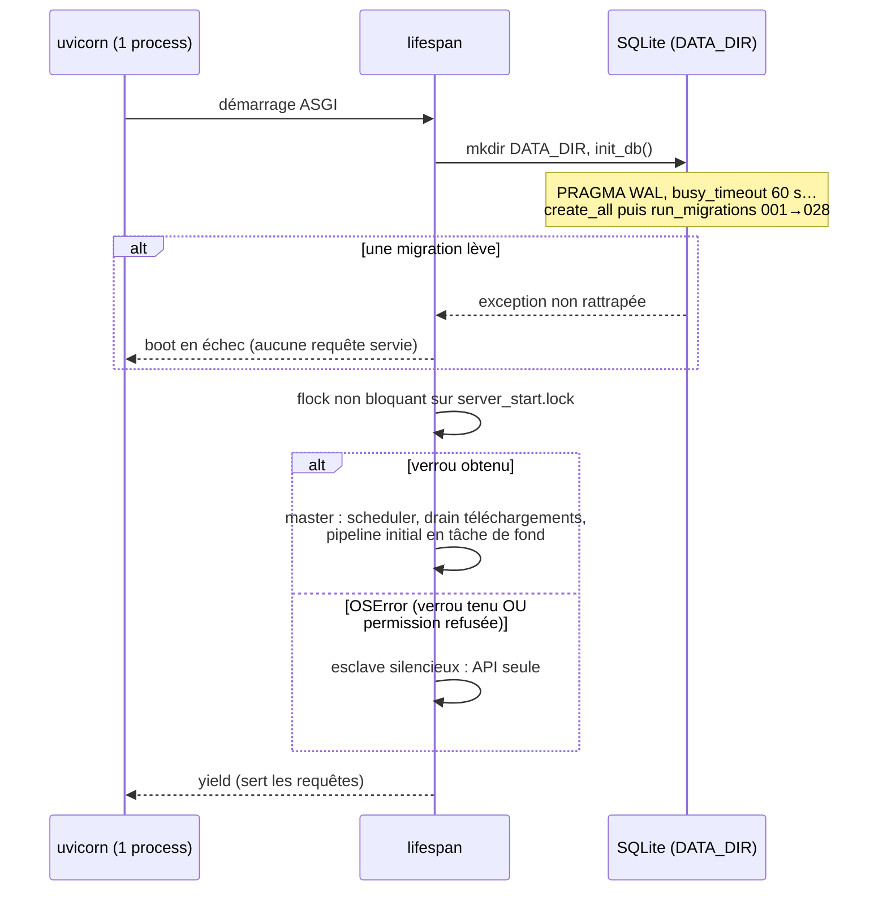

# Build, release et déploiement — PlexHub Backend

**Reconstitué le** : 2026-09-26 · recalé le 2026-10-02 (Lot 10) · **HEAD** : `aa3270f` (branche `develop`, backend v1.10.9) · **Méthode** : `/retro-spec technique build-release` — 2 lecteurs `Explore` (`sonnet`) en lecture seule (image, CI, versionnage, branches ; migrations, démarrage, sauvegardes), rédaction par la session principale. **Preuves rouvertes par la session principale** : Dockerfile (utilisateur, HEALTHCHECK, CMD), `docker-compose.yml` en entier, `.github/workflows/docker.yml` en entier, `run_migrations` et la migration 008, l'élection master dans `lifespan`, `.claude/commands/release.md` phases 1bis à 5, `APP_VERSION` et sa lecture par `/api/health`, les deux preuves `tv:`. Mesures git faites par la session principale (un lecteur n'avait pas le droit de lancer `git`). **Deux affirmations de lecteur corrigées** : les lignes `versionCode`/`versionName` de la TV sont 129-130 et non 30-35 ; le retard de `develop` sur `main` annoncé par le bandeau de `CLAUDE.md` n'existe plus (§7).
**Sources** : le code et la configuration du dépôt, l'inventaire [`../_genere/inventaire.md`](../_genere/inventaire.md), les fiches [CAP-BE-01](../fonctionnel/CAP-BE-01-sante-supervision.md) (santé, `isMaster`) et [CAP-BE-24](../fonctionnel/CAP-BE-24-sauvegarde-maintenance-base.md) (sauvegardes, maintenance) auxquelles on renvoie, le [C4](00-c4.md) et le volet [sécurité](securite.md) §9 ; côté TV (lecture seule) PlexHubTV, preuves `tv:`.
**Règle** : aucune valeur secrète, aucune adresse privée, aucune donnée réelle. Les variables sont nommées, jamais valorisées (sauf défauts non secrets du code).

---

## 1. Vue d'ensemble

Il n'existe **aucun lien automatique** entre `tests.yml` et `docker.yml` : les deux workflows sont indépendants, sans `needs:` (§4).

## 2. Image (`Dockerfile`)

| Élément | Comportement | Preuve |
|---|---|---|
| Base | `python:3.12-slim` | Dockerfile, ligne 1 |
| Paquets système | `ffmpeg` seul, sans recommandations, cache apt purgé | Dockerfile, lignes 9-11 |
| Dépendances Python | `requirements.txt` seul ; les outils de dev ne sont pas dans l'image | Dockerfile, lignes 12-13 |
| Code copié | `app/` uniquement (ni `tests/`, ni `.env`, ni `scripts/`) | Dockerfile, ligne 14 |
| Utilisateur | `plexhub`, uid/gid 1000, avec répertoire personnel (cache fastembed) ; `chown` des seuls dossiers internes à l'image | Dockerfile, lignes 45-47, 65 |
| Variables figées | `PYTHONUNBUFFERED`, `APP_PORT` (défaut 8000) | Dockerfile, lignes 49-51 |
| HEALTHCHECK | `python -c urllib…/api/health`, port lu à l'exécution ; 30 s / 10 s / démarrage 60 s / 3 essais | Dockerfile, lignes 62-63 |
| Commande | `exec uvicorn app.main:app` **sans `--workers`** → un seul process, ce qui tient la contrainte des sémaphores DAV process-local (CLAUDE.md §9 piège 18c) | Dockerfile, ligne 67 |
| `VOLUME`, `ENTRYPOINT`, plateformes | absents | — |

Le HEALTHCHECK cible le seul endpoint `/api/*` public (FR-BE-037) ; il ne prouve **que** la réponse HTTP : `/api/health` renvoie `status: "ok"` en dur (FR-BE-038, *partiel*) et reste vert sur une instance tombée esclave (§8).

## 3. Composition locale (`docker-compose.yml`)

- **Un seul service** `backend`, construit localement (`build: .`), **pas** tiré de GHCR — `docker-compose.yml:2-3`. Le bloc `cloudflared` est entièrement commenté — `docker-compose.yml:84-92`.
- **Configuration** : `env_file` (`.env`, facultatif) puis `environment:` qui **l'emporte** ; ce dernier ne verrouille que `APP_PORT`, `PLEX_LIBRARY_DIR`, `DOWNLOAD_DIR`, `TZ` — `docker-compose.yml:32-50`. Sans `.env`, l'API reste fail-closed (401/503), aucune valeur permissive n'est injectée — `docker-compose.yml:17-23`.
- **Volumes** : `data`, `logs`, bibliothèque générée, téléchargements — `docker-compose.yml:61-65` ; prérequis `chown 1000:1000` rappelé en commentaire — `docker-compose.yml:51-60`.
- **Exploitation** : `restart: unless-stopped`, healthcheck calqué sur celui de l'image, **2 Go / 1 CPU**, journaux `json-file` 10 Mo × 5 — `docker-compose.yml:66-82`.
- Aucun réseau déclaré (réseau par défaut de Compose).

Le compose de **production** n'est pas dans ce dépôt : ce fichier décrit un déploiement de référence, pas celui qui tourne (voir Écarts).

## 4. Intégration continue

### 4.1 `tests.yml`

| Job | Python | Contenu | Preuve |
|---|---|---|---|
| `lint` | 3.13 | `ruff check .` — seul gate de style | `.github/workflows/tests.yml:20`, `.github/workflows/tests.yml:30` |
| `pytest` | matrice **3.12 et 3.13**, `fail-fast: false` | `pytest -v` ; la couverture minimale 70 % vient de `addopts` | `.github/workflows/tests.yml:42`, `.github/workflows/tests.yml:61`, `pyproject.toml:30` |

Déclencheurs : `push` et `pull_request` sur `main` et `develop` — `.github/workflows/tests.yml:3-7`. Cache `pip`. Aucun secret, aucun bloc `permissions`. `mypy` est configuré mais explicitement hors CI — `pyproject.toml:127-128` ; `black` reste installé par `requirements-dev.txt` sans être appelé (gate retiré, `pyproject.toml:111-122`).

### 4.2 `docker.yml`

Déclencheurs : `push` sur `main`, `push` de tags `v*`, `pull_request` vers `main` — `.github/workflows/docker.yml:3-8`. Un seul job, `contents: read` / `packages: write`, authentification GHCR par le jeton du dépôt (`GITHUB_TOKEN`) — `.github/workflows/docker.yml:15-34`. Cache de build GitHub Actions — `.github/workflows/docker.yml:54-55`. Aucun paramètre de plateforme (image mono-architecture, celle du runner).

| Événement | Poussée | Tags d'image produits (`.github/workflows/docker.yml:41-45`) |
|---|---|---|
| PR vers `main` | **non** (build seul) — `.github/workflows/docker.yml:29`, `.github/workflows/docker.yml:51` | — |
| push sur `main` | oui | `main` (flottant), SHA court |
| push du tag `vX.Y.Z` | oui | `X.Y.Z`, `X.Y` (sans `v`), SHA court |
| `latest` | non déclaré dans le fichier | dépend du comportement implicite de `docker/metadata-action` (question ouverte) |

**Aucune étape de smoke** dans `docker.yml` (build puis push) et **aucune dépendance** vers `tests.yml` : une image peut être publiée sur un commit dont les tests sont rouges.

## 5. Dépendances et outillage

- **Plages, pas de verrou** : aucun fichier de verrouillage (`poetry.lock`, `uv.lock`, `requirements.lock`…) ; deux builds du même commit peuvent embarquer des versions différentes.
- **Bornes liées volontairement** : FastAPI `<0.116` et l'instrumentation Prometheus `<8` — `requirements.txt:1-6`, `requirements.txt:16` (incident de production documenté dans le fichier).
- **Sans borne haute** : `yt-dlp` (choix assumé : suivre les changements de YouTube) — `requirements.txt:26-31` ; Pillow épinglée explicitement bien que transitive — `requirements.txt:32-36`.
- **pytest** : mode asyncio automatique, `testpaths = tests` — `pyproject.toml:4`, `pyproject.toml:10` ; ruff `E/F/W/I` avec cible `py312` — `pyproject.toml:51`, `pyproject.toml:58`.

## 6. Versionnage

- **Source unique** : `APP_VERSION` — `app/main.py:39` (1.10.9 à ce HEAD), passée à `FastAPI(version=…)` — `app/main.py:611`, relue par `/api/health` via `request.app.version` — `app/api/health.py:34` (FR-BE-039). `pyproject.toml` n'a pas de table `[project]` : aucune seconde version à désynchroniser.
- **Tag git** `vX.Y.Z` annoté sur `main` ; tag d'image **sans `v`** (motif semver de `docker.yml`). Dernier tag : `v1.10.9` → commit `d00da2b`.
- Le bump se fait **sur `develop`** avant le merge (procédure `/release`, `.claude/commands/release.md:18`) ; rien dans la CI ne vérifie que le tag et `APP_VERSION` coïncident.

## 7. Branches et procédure de release

Modèle en vigueur (`.claude/WORKFLOWS.md:5`) : développement direct sur `develop`, pas de branche par tâche ; `main` = releases, atteinte par merge `--no-ff` + tag ; exception `hotfix/<version>` depuis `main` pour un correctif de production urgent (mentionnée, sans procédure détaillée). `docs/23-git-strategy.md` n'existe pas.

Preuves : `.claude/commands/release.md:16-28` ; garde-fous (pas de tag sans smoke, jamais d'écrasement de tag ou d'image) — `.claude/commands/release.md:31-35` ; retour arrière = redéployer la version précédente, restaurer la sauvegarde prise **avant** toute version qui migre, corriger en avant en X.Y.Z+1 — `.claude/commands/release.md:37-42`.

**État mesuré à `913374b`** : `git rev-list --count develop..main` = **0** (tout `main` est dans `develop` ; `main` pointe sur `5ed2617`) et `main..develop` = **43** (commits en attente de release, dont la rétro-spec). La précondition 1bis est donc satisfaite ; le bandeau de CLAUDE.md qui annonce 9 commits de retard est périmé.

Ce processus est **entièrement procédural** (commande `/release` exécutée par un agent) : aucune protection de branche ni règle de CI du dépôt ne l'impose. Deux hooks aident à la discipline documentaire sans rien bloquer : `.claude/hooks/post-commit` (avertit si un commit touche code/dépendances/Docker sans `CLAUDE.md`) et `.claude/hooks/session-start.js` (compare HEAD au bandeau de `CLAUDE.md`).

## 8. Démarrage et migrations

- **Rejeu intégral à chaque boot** : `run_migrations` appelle les 28 migrations en séquence (028 : dédoublonnage de `epg_entries` et index unique `uix_epg_dedup`, Lot 10, qui lève en cas d'échec au lieu de l'avaler) — `app/db/migrations.py:20-65` ; 008 sur une connexion dédiée pour charger sqlite-vec — `app/db/migrations.py:37-42`. **Aucun registre** de migrations appliquées ni migration descendante : l'« application unique » repose sur l'idempotence de chaque migration (`IF NOT EXISTS`, sonde `_column_exists` — `app/db/migrations.py:68-83`), couverte par `tests/test_migrations_no_duplicate_warning.py:93`.
- **Migrations exécutées par chaque process, avant l'élection** — `app/main.py:289` précède `app/main.py:305-317` ; sans conséquence en pratique puisque l'image ne lance qu'un process.
- **Échec = boot interrompu** : pas de `try/except` autour de `init_db()` — `app/main.py:285-290`.
- **Migration 008 non gardée** : `CREATE VIRTUAL TABLE … USING vec0` sans `try/except` ni lecture de l'indicateur de chargement — `app/db/migrations.py:319-343` —, alors que l'échec de chargement de sqlite-vec est, lui, avalé pour dégrader l'IA en 503 (CLAUDE.md §9 piège 2). Si l'extension manque, c'est tout le boot qui tombe, pas seulement `/api/ai`.
- **Migration 023 (`ANALYZE`)** : garde one-shot sur `sqlite_stat1` (incident de démarrage de 14 min documenté dans la docstring) — détail FR-BE-870.
- **Élection master** : `OSError` générique → esclave, sans distinguer verrou tenu et permission refusée — `app/main.py:312-317` ; l'état est publié tel quel (`isMaster`, gauge `plexhub_is_master`, FR-BE-043 / FR-BE-057). Le runbook `docs/32-ops-docker-nonroot.md` décrit ce piège (volumes à `chown 1000:1000`). Câblage couvert avec `fcntl` simulé — `tests/test_startup_wiring.py:196`.

## 9. Sauvegardes et maintenance

Détail exigence par exigence dans [CAP-BE-24](../fonctionnel/CAP-BE-24-sauvegarde-maintenance-base.md) (FR-BE-855 à FR-BE-879). Ce qui compte pour le déploiement :

- Job quotidien `db_backup`, **master seul** et seulement si `BACKUP_ENABLED` — `app/main.py:424-435` (FR-BE-855) ; variables `BACKUP_ENABLED`, `BACKUP_DIR`, `BACKUP_RETENTION_DAYS`, `BACKUP_HOUR` — `app/config.py:162-165`.
- **Destination par défaut sous `./data/backups`** — `app/config.py:163` —, donc dans le même volume que la base : la perte du volume emporte base et sauvegardes (aucune copie hors hôte, FR-BE-878 *absent*).
- **Restauration outillée depuis le Lot 10** (FR-BE-874 *implémenté*) : `python -m app.scripts.restore_db <fichier> [--apply]`, dry-run par défaut, application arrêtée (verrou master), source vérifiée par `integrity_check`, base courante conservée en `plexhub.pre-restore-*.db`, WAL/SHM supprimés, remplacement atomique ; runbook `docs/ops-backup-restore.md`. Le retour arrière d'une release qui migre reste une restauration de sauvegarde, à prendre avant déploiement (`.claude/commands/release.md:39`). Les sauvegardes sont écrites de façon atomique et vérifiées (FR-BE-875, FR-BE-876).
- Copies de sécurité des scripts correctifs (`--apply`) hors rétention (FR-BE-868) ; `ANALYZE` + `PRAGMA optimize` en fin de pipeline planifié, jamais fatals (FR-BE-870 à FR-BE-873).

## 10. Côté app TV (lecture seule)

- La TV lit le champ `version` de `/api/health` pour l'afficher dans les informations de connexion — `tv:data/src/main/java/com/chakir/plexhubtv/data/repository/BackendRepositoryImpl.kt:133`, `tv:data/src/main/java/com/chakir/plexhubtv/data/repository/BackendRepositoryImpl.kt:120`. **Aucune version minimale** de backend n'est exigée (pas de comparaison trouvée) : la compatibilité TV ↔ backend n'est garantie que par la discipline de contrat ([contrat d'API](contrat-api.md)).
- Versionnage TV indépendant : `versionCode = major×10000 + minor×100 + patch`, `versionName` dérivé — `tv:app/build.gradle.kts:129-130`. Les deux dépôts n'ont aucun numéro de version commun.

---

## Écarts et risques

| # | Constat | Preuve | Nature | Gravité |
|---|---|---|---|---|
| 1 | Tout push sur `main` publie une image `main` + SHA **sans smoke ni dépendance aux tests** ; le smoke n'existe que dans la procédure `/release`. Un déploiement qui suit le tag flottant `main` récupère donc une image jamais démarrée. | `.github/workflows/docker.yml:3-8`, `.github/workflows/docker.yml:41-55` | risque release | haute |
| 2 | Migration 008 sans garde : sqlite-vec absent ⇒ **boot en échec** au lieu du 503 IA prévu ; non testé. | `app/db/migrations.py:319-343` | risque disponibilité | haute |
| 3 | Sauvegardes par défaut dans le volume de la base, sans copie hors hôte ni contrôle d'espace libre ; l'atomicité, le contrôle d'intégrité et la restauration outillée sont faits au Lot 10. | `app/config.py:163` ; FR-BE-877, FR-BE-878 | risque données | moyenne |
| 4 | Aucun registre de migrations ni migration descendante : retour arrière d'un schéma = restauration d'une sauvegarde manuelle. | `app/db/migrations.py:20-65` | risque release | moyenne |
| 5 | Élection master : permission refusée confondue avec verrou tenu ⇒ esclave silencieux, healthcheck vert. | `app/main.py:312-317` | risque exploitation (documenté) | moyenne |
| 6 | Pas de fichier de verrouillage des dépendances, `yt-dlp` sans borne haute : build non reproductible. | `requirements.txt:26-31` | risque build | moyenne |
| 7 | `latest` attendu par la procédure (phase 5) mais non déclaré dans `docker.yml`. | `.claude/commands/release.md:28`, `.github/workflows/docker.yml:41-45` | doc ↔ config | basse |
| 8 | Bandeau de CLAUDE.md : « develop a 9 commits de retard sur main » — périmé, mesuré 0 à `913374b`. | mesure git §7 | doc périmée | basse |
| 9 | CLAUDE.md §2 annonce APP_VERSION 1.10.0 (main.py:38) ; le code porte 1.10.9. CLAUDE.md §3 annonce « CI : Python 3.13 » alors que pytest tourne en 3.12 et 3.13. | `app/main.py:39`, `.github/workflows/tests.yml:42` | doc périmée | basse |
| 10 | Le compose du dépôt construit localement (`build: .`) ; le compose de production, hors dépôt, n'est ni versionné ni vérifiable ici (source des différences d'injection de configuration). | `docker-compose.yml:3` | écart dépôt ↔ prod | moyenne |
| 11 | Aucune protection automatique du modèle de branches ni de concordance tag ↔ `APP_VERSION` : tout repose sur `/release`. | `.claude/commands/release.md:16-28` | risque release | moyenne |
| 12 | `black` installé en CI sans être appelé ; `mypy` hors CI ; `docs/23-git-strategy.md` absent. | `pyproject.toml:111-128` | dette outillage | basse |
| 13 | Image mono-architecture (pas de `platforms`). | `.github/workflows/docker.yml:47-55` | contrainte | basse |
| 14 | La TV n'exige aucune version minimale de backend. | `tv:data/src/main/java/com/chakir/plexhubtv/data/repository/BackendRepositoryImpl.kt:133` | risque compatibilité | basse |

## Questions ouvertes (à vérifier par test)

1. **Tag `latest`** : un push de `vX.Y.Z` produit-il `latest` sur GHCR avec la configuration actuelle ? Vérifier la liste des tags du paquet après la prochaine release.
2. **Boot sans sqlite-vec** : démarrer sur une base neuve avec l'extension indisponible (chargement simulé en échec) — boot en échec (écart 2) ou dégradation 503 attendue ?
3. **Test de restauration** : restaurer une sauvegarde `db_backup` sur une copie avec `restore_db` (sous Linux : le test du vrai verrou est ignoré sous Windows), démarrer l'image, `/api/health` 200 et deuxième boot sans avertissement de migration.
4. **Permission refusée sur `server_start.lock`** : volume non inscriptible par l'uid 1000 → vérifier `isMaster: false` et l'absence d'alerte ; faut-il distinguer `EACCES` de `EWOULDBLOCK` ?
5. **Reproductibilité** : deux builds du même commit à quelques jours d'écart produisent-ils le même `pip freeze` ?
6. **Architecture cible** : l'hôte de production est-il bien `amd64` (image mono-architecture) ?
7. **Rouge en CI, image publiée** : un push sur `main` avec des tests rouges publie-t-il bien l'image `main` (écart 1) ? À confirmer sur l'historique des workflows.
8. **pytest 3.12 et 3.13** : les deux entrées de la matrice sont-elles vertes sur le dernier run de `develop` ?
