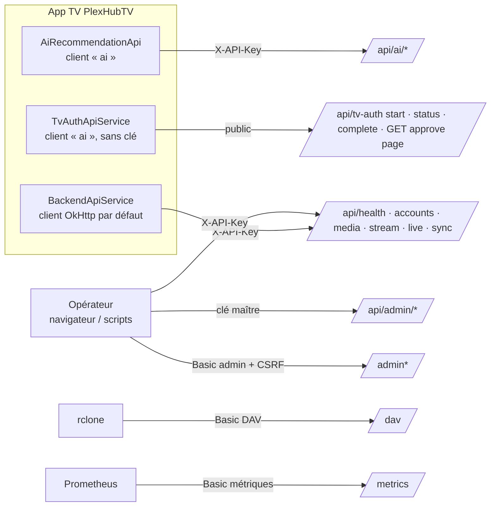

# Contrat d'API — PlexHub Backend (source unique)

**Corrigé le 2026-09-26 d'après le volet TV** (`..\AndroidStudioProjects\PlexHubTV\docs\retro-spec\technique\contrat-api.md`, §4 et §8, preuves re-vérifiées dans le code TV) : **24 routes réellement appelées, pas 29** — `POST /api/accounts`, `DELETE /api/accounts/{id}`, `POST /api/accounts/{id}/test`, `POST /api/sync/xtream` et `PUT /api/accounts/{id}/categories` sont implémentés dans le dépôt TV mais n'ont **aucun déclencheur** ; les références /v1/... périmées sont dans les DTO IA, pas dans l'interface ; aucun poster n'est servi sous `/api` (question 1 tranchée).

**Reconstitué le** : 2026-09-26 · recalé le 2026-10-02 (Lot 10 : page d'approbation `GET /api/tv-auth/approve`, champs de requête et routes admin retirés) · **HEAD** : `aa3270f` (branche `develop`, backend v1.10.9) · **Méthode** : `/retro-spec technique contrat-api` — 5 lecteurs en lecture seule (routes JSON, routes transverses/auth, IA + miroirs admin + DAV, UI admin, appelants TV), rédaction et vérification des preuves par la session principale.
**Sources** : le code (`app/api/*.py`, `app/api/deps.py`, `app/main.py`, `app/models/schemas.py`), l'inventaire généré [`../_genere/inventaire.md`](../_genere/inventaire.md) (119 lignes d'endpoints, régénéré au Lot 10), les fiches [`../fonctionnel/`](../fonctionnel/00-carte.md) ; côté TV (lecture seule, preuves `tv:`) les interfaces Retrofit de PlexHubTV et leurs appelants.
**Règle** : ce volet ne redéfinit aucune exigence. Chaque endpoint renvoie aux FR-BE des fiches de capacité ; le comportement détaillé (règles métier, tests) est dans la fiche. Aucun secret, aucune valeur de configuration, aucune URL privée.

## 0. Vue d'ensemble

| Surface | Lignes d'inventaire | Garde | Clients |
|---|---|---|---|
| API JSON `/api/*` (hors `/api/admin/*`) | 54 | `X-API-Key` (5 couples (méthode, chemin) publics, dont la page d'approbation) | app TV (24 routes appelées, 8 déclarées sans déclencheur), opérateur |
| Miroirs JSON `/api/admin/*` | 11 | clé maître seule | opérateur, scripts |
| UI admin `/admin*` (HTML/HTMX) | 49 (dont 6 doublons avec `/` final) | Basic Auth admin + CSRF | navigateur de l'opérateur |
| `/dav`, `/dav/{path}` | 2 | Basic Auth DAV dédiée | rclone → Plex/Jellyfin |
| `/docs`, `/openapi.json`, `/metrics` | 3 | Basic Auth admin / Basic Auth métriques | opérateur, Prometheus |



## 1. Conventions transverses

### 1.1 Montage et gardes

Trois conventions de montage coexistent (dette CR-A04, cf. [CAP-BE-02](../fonctionnel/CAP-BE-02-cles-api-authentification.md)) ; l'assertion de boot `assert_api_routes_authenticated` (`app/main.py:755`) refuse le démarrage si une route `/api/*` hors liste publique n'a aucune garde reconnue. Liste publique figée à 5 couples (méthode, chemin) — `GET /api/health`, `POST /api/tv-auth/start`, `GET /api/tv-auth/status`, `POST /api/tv-auth/complete`, `GET /api/tv-auth/approve` (page d'approbation, Lot 10) : `app/api/route_audit.py:66-99`.

| Convention | Routers | Preuve |
|---|---|---|
| A — garde au montage (`dependencies=_guard`) | `accounts`, `categories`, `live`, `media`, `stream`, `sync`, `plex` | `app/main.py:660-671` |
| B — public au montage | `health` (public), `tv_auth` (seul `POST /approve` gardé à l'endpoint ; `GET /approve` est la page publique) | `app/main.py:662`, `app/main.py:674` |
| C — préfixe et garde déclarés dans le module | `ai`, `api_keys`, `downloads`, `plex_downloads`, `enrichment`, `dav` | `app/main.py:735-749`, `app/api/ai.py:52`, `app/api/dav.py:79` |
| Garde au montage, hors `/api` | `admin`, `admin_downloads`, `admin_plex_downloads`, `admin_unified_downloads` | `app/main.py:680-695` |

| Garde | Lit | Échec | Particularité | Preuve |
|---|---|---|---|---|
| `verify_backend_secret` | en-tête `X-API-Key` : secret maître **ou** clé utilisateur active | 401 « Invalid API key » | comparaison `secrets.compare_digest` ; secret maître non configuré → 401 aussi | `app/api/deps.py:64-73`, `app/api/deps.py:47-51` |
| `verify_api_key` (`/api/ai/*`) | idem | **503 « AI vector storage unavailable » AVANT le contrôle de clé**, puis 401 | un appelant sans clé reçoit 503 si sqlite-vec n'est pas chargé | `app/api/deps.py:76-90` |
| `verify_master_key` (`/api/admin/*`) | `X-API-Key` = secret maître seul | 503 si secret maître non configuré ; 401 « Master key required » | une clé utilisateur est refusée | `app/api/deps.py:93-107` |
| `verify_admin_basic_auth` | HTTP Basic admin | 503 si mot de passe non configuré ; 401 + `WWW-Authenticate` | aussi `/docs` et `/openapi.json` | `app/api/deps.py:113-145` |
| `verify_dav_basic_auth` | HTTP Basic DAV dédiée | 503 si mot de passe non configuré ; 401 | `DAV_ENABLED=false` → 503 dans le handler, après l'auth | `app/api/deps.py:151-185`, `app/api/dav.py:288-289` |
| `verify_metrics_basic_auth` | HTTP Basic métriques | 503 si mot de passe non configuré ; 401 | `METRICS_PUBLIC=true` → aucun contrôle | `app/api/deps.py:191-234` |

```mermaid
flowchart TD
    R[Requête] --> RID[RequestIdMiddleware<br/>en-tête X-Request-ID]
    RID --> CSRF{POST/PUT/PATCH/DELETE<br/>sur /admin* ?}
    CSRF -->|Sec-Fetch-Site: cross-site| E403[403]
    CSRF -->|sinon| GZ[GZip ≥ 1000 o<br/>sauf Content-Encoding: identity]
    GZ --> RT{Route}
    RT -->|inconnue / verbe non routé| E404[404 / 405 Starlette]
    RT --> G{Garde}
    G -->|/api/ai/* et sqlite-vec absent| E503v[503 vector storage]
    G -->|clé ou Basic invalide| E401[401]
    G -->|secret non configuré sur master/Basic| E503c[503]
    G -->|ok| V{Validation Pydantic}
    V -->|KO| E422[422 detail[]]
    V -->|ok| H[Handler → HTTPException 400/404/409/410/413/429/503 ou réponse]
    H -->|exception non gérée| E500[500 par défaut — aucun exception handler global]
```

### 1.2 Format des échanges

- **Réponses JSON en camelCase** : les schémas Pydantic déclarent `alias_generator=to_camel` et FastAPI sérialise par alias par défaut ; `response_model_by_alias=True` est explicite dans `sync`, `tv_auth`, `ai` et sur `categories/refresh`, implicite ailleurs (même effet). Les listes de films/séries/épisodes passent par une sérialisation en une passe (`app/api/media.py:41-57`).
- **Corps de requête** : camelCase **et** snake_case acceptés (`populate_by_name=True`) — `app/api/ai.py:63`, `app/api/api_keys.py:26`, `app/api/enrichment.py:39`, schémas `AccountCreate`/`MediaUpdate`/`SyncRequest` de `app/models/schemas.py`.
- **Paramètres de requête (query) en snake_case** (`server_id`, `parent_rating_key`, `unification_id`, `category_id`, `rating_key`, `youtube_id`), sans alias — seules exceptions : `GET /api/tv-auth/status` accepte `deviceCode` **et** `device_code` (`app/api/tv_auth.py:552-557`), `GET /api/ai/blurb/{tmdb_id}` exige `mediaType` (alias). L'app TV envoie bien du snake_case en query et lit du camelCase.
- **Erreurs** : corps FastAPI `{"detail": "<message>"}` ; 422 de validation `{"detail": [ … ]}`. Aucun `exception_handler` global : toute exception non prévue donne un 500 non enveloppé.
- **Identifiants** : un média est identifié par le couple `(rating_key, server_id)` ; `server_id` d'un compte Xtream = `xtream_<id>`. Un `parent_rating_key` de série n'est unique que par compte (d'où le 400 sur `episodes` sans `server_id`, [CAP-BE-09](../fonctionnel/CAP-BE-09-catalogue-vod-series.md) FR-BE-473).
- **Pagination** : `limit`/`offset` + `total`/`hasMore` ; curseur keyset optionnel `cursor` → `nextCursor` sur `movies`/`shows`/`episodes` (FR-BE-477, FR-BE-478).
- **Traitements longs** : 202 + `jobId` puis sondage (`/api/sync/*`, `/api/ai/embed/rebuild`, `/api/admin/enrichment/omdb-backfill`). Les jobs de synchro et d'enrichissement OMDb et de reconstruction d'embeddings vivent **en mémoire du processus** : un `jobId` émis avant un redémarrage donne 404.
- **En-têtes** : `X-Request-ID` renvoyé sur toute réponse (écho ou généré) ; CORS méthodes `GET/POST/PUT/PATCH/DELETE/OPTIONS`, en-têtes `X-API-Key`/`Content-Type`/`Authorization` (`app/main.py:627-636`) ; `Content-Encoding: identity` sur les flux binaires (bande-annonce, relais DAV, proxy de poster) pour neutraliser GZip.

### 1.3 Clients TV (mécanisme, jamais de valeur)

| Client | Interfaces | Pose de `X-API-Key` | Timeouts | Mapping d'erreurs |
|---|---|---|---|---|
| OkHttp par défaut | `BackendApiService` (base URL par serveur backend enregistré) | intercepteur limité aux hôtes backend connus — `tv:core/network/src/main/java/com/chakir/plexhubtv/core/network/backend/BackendApiKeyInterceptor.kt:44-60` | connect 3 s, read/call 30 s — `tv:core/network/src/main/java/com/chakir/plexhubtv/core/network/NetworkModule.kt:539-542` ; `safeApiCall` borne chaque appel (5 s trailer, 4 s clé YouTube) | 401/403 → Unauthorized, 404 → NotFound, 5xx → ServerError, **400 → Unknown** ; retry sur 5xx/429 — `tv:core/network/src/main/java/com/chakir/plexhubtv/core/network/util/SafeApiCall.kt:70-79`, `tv:core/network/src/main/java/com/chakir/plexhubtv/core/network/util/SafeApiCall.kt:134-140` |
| OkHttp « ai » | `AiRecommendationApi`, `TvAuthApiService` (une URL unique saisie dans les Réglages) | intercepteur sans filtrage d'hôte — `tv:core/network/src/main/java/com/chakir/plexhubtv/core/network/ai/AiAuthInterceptor.kt:28-35` | connect 5 s, read 15 s — `tv:core/network/src/main/java/com/chakir/plexhubtv/core/network/ai/AiNetworkModule.kt:54-55` ; sous-titres : read 180 s, call illimité — `tv:data/src/main/java/com/chakir/plexhubtv/data/repository/AiRetrofitFactory.kt:88-92` | 401 → Unauthorized, **503 → ServiceDisabled**, autre → Unexpected — `tv:data/src/main/java/com/chakir/plexhubtv/data/repository/AiResultMappers.kt:33-48` ; appairage : 404/410 sur `status` → Expired — `tv:data/src/main/java/com/chakir/plexhubtv/data/repository/TvPairingRepositoryImpl.kt:72-79` |

## 2. Endpoints `/api/*`

Colonnes : **Garde** (§1.1) · **Paramètres** (Q = query, P = path, B = body) · **Réponse** (schéma, camelCase) · **Erreurs** métier (hors 401/422/500 génériques) · **Preuve** (décorateur) · **FR** (fiche) · **Appelant TV** (appel réel, ou « aucun appelant »).

### 2.1 Santé — [CAP-BE-01](../fonctionnel/CAP-BE-01-sante-supervision.md)

| Méthode | Chemin | Garde | Paramètres | Réponse | Erreurs | Preuve | FR | Appelant TV |
|---|---|---|---|---|---|---|---|---|
| GET | `/api/health` | public | — | `HealthResponse` (`status`, `version`, compteurs, `isMaster`…) | aucune ; base indisponible → 500 brut | `app/api/health.py:14` | FR-BE-037, FR-BE-046 | `tv:data/src/main/java/com/chakir/plexhubtv/data/repository/BackendRepositoryImpl.kt:83` (ajout de serveur), `:119` (test), `:139` (infos) |

### 2.2 Appairage TV — [CAP-BE-03](../fonctionnel/CAP-BE-03-appairage-tv.md)

| Méthode | Chemin | Garde | Paramètres | Réponse | Erreurs | Preuve | FR | Appelant TV |
|---|---|---|---|---|---|---|---|---|
| POST | `/api/tv-auth/start` | public, limité en débit | B `StartRequest{deviceName?}` (≤ 120) | 201 `StartResponse` (`deviceCode`, `userCode`, `verificationUri`, `expiresIn`, `interval`) | 503 appairage non configuré ; **429 + `Retry-After`** (deux fenêtres par IP, plafond global de sessions en attente) ; 503 code non allouable | `app/api/tv_auth.py:243` | FR-BE-065…074 | `tv:data/src/main/java/com/chakir/plexhubtv/data/repository/TvPairingRepositoryImpl.kt:52` |
| GET | `/api/tv-auth/status` | public, **jamais limité** | Q `deviceCode` ou `device_code` (16-128) | `StatusResponse` (`status`, `expiresIn`, `payload` livré **une seule fois**) | 422 code absent ; 404 code inconnu ; expirée → **200** `status=expired` ; 503 charge indéchiffrable | `app/api/tv_auth.py:547` | FR-BE-082…086 | `tv:data/src/main/java/com/chakir/plexhubtv/data/repository/TvPairingRepositoryImpl.kt:69` (envoie `device_code`) |
| POST | `/api/tv-auth/complete` | public | B `CompleteRequest{deviceCode}` | `CompleteResponse{status}` | 404 ; **410** expirée ; **409** déjà complétée ou pas encore approuvée | `app/api/tv_auth.py:653` | FR-BE-087…089 | `tv:data/src/main/java/com/chakir/plexhubtv/data/repository/TvPairingRepositoryImpl.kt:92` |
| GET | `/api/tv-auth/approve` | **public**, limité en débit par IP (30 / 60 s par défaut) | Q `userCode` facultatif (rempli seulement s'il respecte le format `ABCD-EFGH`) | page HTML `pairing/approve.html` (hors schéma OpenAPI) avec en-têtes `Content-Security-Policy` à nonce, `X-Frame-Options: DENY`, `Cache-Control: no-store`, `Referrer-Policy: no-referrer`, `X-Content-Type-Options: nosniff` | **429 + `Retry-After`** au-delà du limiteur ; aucune dépendance à la base ni à la clé de chiffrement | `app/api/tv_auth.py:436-469`, `app/api/tv_auth.py:417-433` | FR-BE-075 ; RG-BE-03.8…11 | aucun appelant : page ouverte depuis le QR affiché par la TV (`tv:app/src/main/java/com/chakir/plexhubtv/feature/pairing/PairingViewModel.kt:90`) |
| POST | `/api/tv-auth/approve` | `X-API-Key` (alias de `verify_backend_secret`) | B `ApproveRequest{userCode (4-16), payload: objet libre}` | `ApproveResponse` | 503 chiffrement non configuré ; 422 charge vide ; 404 ; 410 ; 409 | `app/api/tv_auth.py:476` | FR-BE-075…081 | aucun appelant TV : appelé par `fetch` depuis la page `GET /api/tv-auth/approve` (clé saisie, envoyée en en-tête `X-API-Key` uniquement), ou par un mobile/web — `tv:core/network/src/main/java/com/chakir/plexhubtv/core/network/tvauth/TvAuthApiService.kt:20` ; **aucun limiteur de débit sur ce POST** |

### 2.3 Comptes Xtream et catégories — [CAP-BE-04](../fonctionnel/CAP-BE-04-comptes-xtream-categories.md)

| Méthode | Chemin | Garde | Paramètres | Réponse | Erreurs | Preuve | FR | Appelant TV |
|---|---|---|---|---|---|---|---|---|
| GET | `/api/accounts` | X-API-Key | — | `list[AccountResponse]` (jamais de mot de passe) | — | `app/api/accounts.py:23` | FR-BE-139 | `tv:data/src/main/java/com/chakir/plexhubtv/data/repository/BackendRepositoryImpl.kt:768` |
| POST | `/api/accounts` | X-API-Key | B `AccountCreate{label, baseUrl, port=80, username, password}` | 201 `AccountResponse` | 409 compte existant ; 400 authentification fournisseur échouée ; 400 réponse fournisseur malformée | `app/api/accounts.py:29` | FR-BE-141…145 | aucun déclencheur (appel Retrofit dans le dépôt `tv:data/src/main/java/com/chakir/plexhubtv/data/repository/BackendRepositoryImpl.kt:615`, méthode `createXtreamAccount` sans appelant de production) |
| PUT | `/api/accounts/{account_id}` | X-API-Key | P `account_id` ; B `AccountUpdate` (tout optionnel, dont `isActive`) | `AccountResponse` | 404 | `app/api/accounts.py:63` | FR-BE-146…148 | aucun appelant (déclaré `tv:core/network/src/main/java/com/chakir/plexhubtv/core/network/backend/BackendApiService.kt:81`, jamais invoqué) |
| DELETE | `/api/accounts/{account_id}` | X-API-Key | P `account_id` | 204 sans corps | 404 | `app/api/accounts.py:88` | FR-BE-149, FR-BE-150 | aucun déclencheur (dépôt seul `tv:data/src/main/java/com/chakir/plexhubtv/data/repository/BackendRepositoryImpl.kt:638`, `deleteXtreamAccount` sans appelant) |
| POST | `/api/accounts/{account_id}/test` | X-API-Key | P `account_id` | `AccountTestResponse` | 404 ; 400 authentification ; 400 réponse malformée | `app/api/accounts.py:109` | FR-BE-151 | aucun déclencheur (dépôt seul `tv:data/src/main/java/com/chakir/plexhubtv/data/repository/BackendRepositoryImpl.kt:652`, `testXtreamAccount` sans appelant) |
| GET | `/api/accounts/{account_id}/categories` | X-API-Key | P `account_id` | `CategoryListResponse` (`items[]`, `filterMode`) | **compte inconnu → 200**, pas 404 ; 500 générique | `app/api/categories.py:27` | FR-BE-157, FR-BE-158 | `tv:data/src/main/java/com/chakir/plexhubtv/data/repository/BackendRepositoryImpl.kt:692` |
| PUT | `/api/accounts/{account_id}/categories` | X-API-Key | B `CategoryUpdateRequest{filterMode, categories: list[dict] non typé}` | **dict brut** `{message}` (pas de `response_model`) | 400 ; 500 générique | `app/api/categories.py:50` | FR-BE-163, FR-BE-164, FR-BE-166 | aucun déclencheur : appel Retrofit dans le dépôt `tv:data/src/main/java/com/chakir/plexhubtv/data/repository/BackendRepositoryImpl.kt:720`, mais l'écran de catégories passe par `HybridCategoryRepository`, qui **enregistre toujours en local** pour un compte backend (liste blanche serveur préservée) — `tv:data/src/main/java/com/chakir/plexhubtv/data/repository/HybridCategoryRepository.kt:57-72` |
| POST | `/api/accounts/{account_id}/categories/refresh` | X-API-Key | P `account_id` | `CategoryRefreshResponse` (`message`, `vodCount`, `seriesCount`, `total`) | 404 ; 500 générique | `app/api/categories.py:82` | FR-BE-159…162 | `tv:data/src/main/java/com/chakir/plexhubtv/data/repository/BackendRepositoryImpl.kt:747` |

### 2.4 Synchronisation et enrichissement déclenchés — [CAP-BE-05](../fonctionnel/CAP-BE-05-synchronisation-xtream-pipeline.md), [CAP-BE-06](../fonctionnel/CAP-BE-06-enrichissement-tmdb-omdb.md), [CAP-BE-07](../fonctionnel/CAP-BE-07-validation-des-flux.md)

| Méthode | Chemin | Garde | Paramètres | Réponse | Erreurs | Preuve | FR | Appelant TV |
|---|---|---|---|---|---|---|---|---|
| POST | `/api/sync/xtream` | X-API-Key | B `SyncRequest{accountId}` (le champ `force`, jamais lu, a été retiré au Lot 10 ; une clé inconnue est ignorée, sans 422) | 202 `JobIdResponse{jobId}` | — | `app/api/sync.py:29` | FR-BE-189, FR-BE-192 | aucun déclencheur (dépôt seul `tv:data/src/main/java/com/chakir/plexhubtv/data/repository/BackendRepositoryImpl.kt:678`, `triggerAccountSync` sans appelant) |
| POST | `/api/sync/xtream/all` | X-API-Key | — | 202 `JobIdResponse` | échec → job `failed` | `app/api/sync.py:48` | FR-BE-190 | `tv:data/src/main/java/com/chakir/plexhubtv/data/repository/BackendRepositoryImpl.kt:664`, déclenché par « Synchroniser tout » `tv:app/src/main/java/com/chakir/plexhubtv/feature/settings/SettingsViewModel.kt:1206` (`jobId` jamais relu) |
| GET | `/api/sync/status/{job_id}` | X-API-Key | P `job_id` | `SyncStatusResponse` (`status`, `phase`, dates, `error`) | 404 job inconnu (dont après redémarrage) | `app/api/sync.py:181` | FR-BE-195 | aucun appelant (déclaré `tv:core/network/src/main/java/com/chakir/plexhubtv/core/network/backend/BackendApiService.kt:70`, jamais invoqué ; le `jobId` reçu est ignoré) |
| GET | `/api/sync/jobs` | X-API-Key | — | `SyncJobListResponse` (éléments plus pauvres que `status`) | — | `app/api/sync.py:209` | FR-BE-196, FR-BE-197, FR-BE-199 | aucun appelant |
| DELETE | `/api/sync/cancel/{task_name}` | X-API-Key | P `task_name` | `MessageResponse` | 404 aucune tâche de ce nom | `app/api/sync.py:71` | FR-BE-191, FR-BE-203 | aucun appelant |
| POST | `/api/sync/full-pipeline` | X-API-Key | — | 202 `JobIdResponse` | échec → job `failed` | `app/api/sync.py:129` | FR-BE-193, FR-BE-194 | aucun appelant |
| POST | `/api/sync/enrichment` | X-API-Key | — | 202 `JobIdResponse` | — | `app/api/sync.py:83` | voir CAP-BE-06 | aucun appelant |
| POST | `/api/sync/validate-streams` | X-API-Key | — | 202 `JobIdResponse` | — | `app/api/sync.py:106` | voir CAP-BE-07 | aucun appelant |

### 2.5 Catalogue VOD et séries — [CAP-BE-09](../fonctionnel/CAP-BE-09-catalogue-vod-series.md) (écriture : [CAP-BE-06](../fonctionnel/CAP-BE-06-enrichissement-tmdb-omdb.md))

Ordre de déclaration contractuel : `trailer/*` et `episodes/unified` **avant** le fourre-tout `GET /{rating_key}` (`app/api/media.py:433-437`).

| Méthode | Chemin | Garde | Paramètres | Réponse | Erreurs | Preuve | FR | Appelant TV |
|---|---|---|---|---|---|---|---|---|
| GET | `/api/media/movies` | X-API-Key | Q `limit` 500 (1-5000), `offset`, `sort` (défaut `added_desc`), `server_id`, `search`, `genre`, `year`, `missing_imdb`, `missing_tmdb`, `cursor` | `MediaListResponse` (`items`, `total`, `hasMore`, `nextCursor`) | 400 curseur illisible | `app/api/media.py:128` | FR-BE-470, FR-BE-476…479 | `tv:data/src/main/java/com/chakir/plexhubtv/data/repository/BackendRepositoryImpl.kt:187` (pages de 500 par `offset`) |
| GET | `/api/media/movies/stats` | X-API-Key | — | `MediaStatsResponse` (`total`, `missingImdb`, `missingTmdb`) — ignore catégorie et panne | — | `app/api/media.py:164` | FR-BE-472 | aucun appelant |
| GET | `/api/media/shows` | X-API-Key | comme `movies` sans `missing_*` | `MediaListResponse` | 400 curseur | `app/api/media.py:172` | FR-BE-471 | `tv:data/src/main/java/com/chakir/plexhubtv/data/repository/BackendRepositoryImpl.kt:231` |
| GET | `/api/media/episodes` | X-API-Key | Q `parent_rating_key` (requis), **`server_id` (requis par contrôle manuel)**, `limit`, `offset`, `cursor` ; pas de `sort` | `MediaListResponse` | **400 `server_id` absent** (+ WARNING + métrique) ; 400 curseur | `app/api/media.py:205` | FR-BE-473…475 | `tv:data/src/main/java/com/chakir/plexhubtv/data/repository/BackendRepositoryImpl.kt:274` (synchro), `:549` (à la demande) |
| GET | `/api/media/movies/unified` | X-API-Key | Q `limit` 200 (1-2000), `offset`, `search`, `genre`, `year`, `unification_id` | `UnifiedMediaListResponse` (1 titre + `versions[]`) | `unification_id` inconnu → **200 vide** | `app/api/media.py:266` | FR-BE-480, FR-BE-482, FR-BE-483 | aucun appelant |
| GET | `/api/media/shows/unified` | X-API-Key | idem | `UnifiedMediaListResponse` | idem | `app/api/media.py:333` | FR-BE-481, FR-BE-482 | aucun appelant |
| GET | `/api/media/episodes/unified` | X-API-Key | Q `unification_id` (requis) | `UnifiedEpisodeListResponse` (créneaux `(saison, épisode)` + `versions[]`) | **404** aucune série | `app/api/media.py:394` | FR-BE-484 | `tv:data/src/main/java/com/chakir/plexhubtv/data/repository/BackendRepositoryImpl.kt:445` (repli réseau du sélecteur de source) |
| GET | `/api/media/{rating_key}` | X-API-Key | P `rating_key` ; Q `server_id` (requis) | `MediaResponse` (dont `youtubeTrailer`) — ignore catégorie et panne | 404 | `app/api/media.py:506` | FR-BE-510 | `tv:data/src/main/java/com/chakir/plexhubtv/data/repository/BackendRepositoryImpl.kt:593` (détail), `:986` (clé YouTube) |
| PATCH | `/api/media/{rating_key}` | X-API-Key | Q `server_id` ; B `MediaUpdate{imdbId ^tt\d{7,10}$, tmdbId}` — autres champs ignorés | `MediaResponse` | 404 ; 422 format d'id | `app/api/media.py:518` | FR-BE-342 | aucun appelant |
| POST | `/api/media/{rating_key}/rescrape` | X-API-Key | Q `server_id` | 202 **dict brut** `{status: "queued"}` | 404 ; **409 verrou manuel** | `app/api/media.py:540` | FR-BE-340, FR-BE-341 | aucun appelant |

### 2.6 Bandes-annonces — [CAP-BE-12](../fonctionnel/CAP-BE-12-bandes-annonces.md)

| Méthode | Chemin | Garde | Paramètres | Réponse | Erreurs | Preuve | FR | Appelant TV |
|---|---|---|---|---|---|---|---|---|
| GET | `/api/media/trailer/resolve` | X-API-Key | Q `youtube_id` **ou** (`rating_key` + `server_id`) — `youtube_id` prioritaire | `TrailerResolveResponse{status: ready\|pending\|none, url}` ; `pending` = téléchargement lancé (toujours 200) | 400 aucun des deux modes | `app/api/media.py:440` | FR-BE-421, FR-BE-422, FR-BE-430 | `tv:data/src/main/java/com/chakir/plexhubtv/data/repository/BackendRepositoryImpl.kt:937` (mode id), `:943` (mode clé) |
| GET | `/api/media/trailer/file/{cache_key}` | X-API-Key | P `cache_key` = id YouTube (11 car.) | `FileResponse` `video/mp4`, Range 206/416 natif, pas de `response_model` | 404 « Trailer not found » (3 origines) | `app/api/media.py:475` | FR-BE-447, FR-BE-448 | pas d'appel Retrofit : l'URL relative renvoyée par `resolve` (`app/services/trailer_service.py:140`) est rendue absolue puis lue par le lecteur — `tv:data/src/main/java/com/chakir/plexhubtv/data/repository/BackendRepositoryImpl.kt:958-966` |

### 2.7 URL de lecture — [CAP-BE-10](../fonctionnel/CAP-BE-10-resolution-url-lecture.md)

| Méthode | Chemin | Garde | Paramètres | Réponse | Erreurs | Preuve | FR | Appelant TV |
|---|---|---|---|---|---|---|---|---|
| GET | `/api/stream/{rating_key}` | X-API-Key | P `rating_key` ; Q `server_id` (requis, préfixe `xtream_`) | `StreamResponse{url, expiresAt}` — `expiresAt` toujours `null` | 400 `server_id` mal formé ; 404 compte ; 400 URL non constructible | `app/api/stream.py:13` | FR-BE-393…396, FR-BE-410 | `tv:data/src/main/java/com/chakir/plexhubtv/data/repository/BackendRepositoryImpl.kt:411` |

### 2.8 TV en direct et EPG — [CAP-BE-11](../fonctionnel/CAP-BE-11-tv-en-direct-epg.md)

| Méthode | Chemin | Garde | Paramètres | Réponse | Erreurs | Preuve | FR | Appelant TV |
|---|---|---|---|---|---|---|---|---|
| GET | `/api/live/channels` | X-API-Key | Q `limit` 500 (1-5000), `offset`, `sort` (`name_asc`), `server_id`, `category_id`, `search` | `LiveChannelListResponse` | `server_id` mal formé → **200 vide** | `app/api/live.py:28` | FR-BE-532, FR-BE-533, FR-BE-536 | `tv:data/src/main/java/com/chakir/plexhubtv/data/repository/BackendRepositoryImpl.kt:801` (sans `server_id`) |
| GET | `/api/live/channels/{stream_id}` | X-API-Key | P `stream_id` (int) ; Q `server_id` | `LiveChannelResponse` | 404 chaîne | `app/api/live.py:86` | FR-BE-537, FR-BE-538 | aucun appelant (déclaré `tv:core/network/src/main/java/com/chakir/plexhubtv/core/network/backend/BackendApiService.kt:129`, jamais invoqué) |
| GET | `/api/live/channels/{stream_id}/stream` | X-API-Key | idem | `StreamResponse` | 400 `server_id` ; 404 compte ; 404 chaîne | `app/api/live.py:105` | FR-BE-411, FR-BE-412, FR-BE-539 | `tv:data/src/main/java/com/chakir/plexhubtv/data/repository/BackendRepositoryImpl.kt:864` |
| GET | `/api/live/channels/{stream_id}/epg` | X-API-Key | idem | `EpgListResponse` | 400 `server_id` ; 404 compte | `app/api/live.py:143` | FR-BE-540, FR-BE-541, FR-BE-545 | `tv:data/src/main/java/com/chakir/plexhubtv/data/repository/BackendRepositoryImpl.kt:837` |
| GET | `/api/live/epg` | X-API-Key | Q `server_id` (requis, non validé), `limit` 500 (1-5000), `offset` | `EpgListResponse` (programmes en cours) | `server_id` inconnu → **200 vide** | `app/api/live.py:201` | FR-BE-550…552 | `tv:data/src/main/java/com/chakir/plexhubtv/data/repository/BackendRepositoryImpl.kt:880` (`limit=5000`, borne max) |

### 2.9 Génération de bibliothèque — [CAP-BE-16](../fonctionnel/CAP-BE-16-generation-bibliotheque-plex-jellyfin.md)

| Méthode | Chemin | Garde | Paramètres | Réponse | Erreurs | Preuve | FR | Appelant TV |
|---|---|---|---|---|---|---|---|---|
| POST | `/api/plex/generate` | X-API-Key (toute clé utilisateur active) | B `GenerateRequest{accountId, outputDir, strmOnly, dryRun, forceRefreshMetadata}` (`allAccounts`, jamais lu, retiré au Lot 10) | `GenerateResponse` — **synchrone**, pas de `jobId` | 400 `outputDir` absent / refusé / hors bibliothèque ; échec de génération → 500 | `app/api/plex.py:80` | FR-BE-697…701, FR-BE-703 | aucun appelant |

### 2.10 IA — [CAP-BE-13](../fonctionnel/CAP-BE-13-recommandations-ia-recherche-semantique.md), [CAP-BE-14](../fonctionnel/CAP-BE-14-generation-llm-assistant.md), [CAP-BE-15](../fonctionnel/CAP-BE-15-traduction-sous-titres.md)

Garde de tout le router : `verify_api_key` (`app/api/ai.py:52-56`) → 503 sqlite-vec **avant** 401, y compris pour les endpoints LLM qui n'utilisent aucun vecteur. Trois motifs 503 distincts : stockage vectoriel (garde), « AI model unavailable » (fastembed), LLM `_ollama_503`.

| Méthode | Chemin | Paramètres (B sauf mention) | Réponse | Erreurs | Preuve | FR | Appelant TV |
|---|---|---|---|---|---|---|---|
| POST | `/api/ai/rank` | `RankRequest{ref, candidates[], limit 1-200 (20), mediaType movie\|tv, explain}` | `RankResponse` (`ranked[]` + compteurs de cache) ; `explain` en échec → `explanation=null`, jamais 503 | 422 référence non résolue / sans embedding ; 503 modèle | `app/api/ai.py:320` | FR-BE-611, FR-BE-614, FR-BE-616, FR-BE-618 | `tv:data/src/main/java/com/chakir/plexhubtv/data/repository/AiRecommendationRepositoryImpl.kt:104` |
| POST | `/api/ai/rank-multi` | `RankMultiRequest{refs[], candidates[], limit, mediaType, excludeRefs (true), explain}` | `RankResponse` | 422 refs vides / non résolues / sans embedding ; 503 modèle | `app/api/ai.py:401` | FR-BE-619…622 | `tv:data/src/main/java/com/chakir/plexhubtv/data/repository/AiRecommendationRepositoryImpl.kt:134` |
| POST | `/api/ai/search` | `SearchRequest{query, mediaType?, limit 1-50}` | `SearchResponse{results[], queryUsed, model}` ; reformulation LLM en échec → dégradation silencieuse | 503 modèle | `app/api/ai.py:499` | FR-BE-639…641, FR-BE-643 | aucun appelant |
| POST | `/api/ai/assistant` | `AssistantRequest{message, mediaType?, history[], limit 1-10}` | `AssistantResponse{reply, sources[], model}` | 503 modèle ; 503 LLM | `app/api/ai.py:622` | FR-BE-673…675, FR-BE-679 | aucun appelant |
| POST | `/api/ai/embed/rebuild` | — | 202 `RebuildResponse{jobId}` | — | `app/api/ai.py:713` | FR-BE-645 | aucun appelant |
| GET | `/api/ai/embed/jobs/{job_id}` | P `job_id` | `JobStatusResponse` | 404 (dont après redémarrage) | `app/api/ai.py:729` | FR-BE-645, FR-BE-646 | aucun appelant |
| GET | `/api/ai/embed/status` | — | `EmbedStatus` (compteurs, `rssMb`, `vecLoaded`) | — | `app/api/ai.py:745` | FR-BE-651 | `tv:data/src/main/java/com/chakir/plexhubtv/data/repository/AiRecommendationRepositoryImpl.kt:150` (bouton « Tester la connexion », clé transitoire) ; la lecture de statut `:161` n'a aucun appelant |
| POST | `/api/ai/describe` | `DescribeRequest{title, overview?, genres[], year?, language fr\|en}` | `DescribeResponse` | 503 LLM | `app/api/ai.py:860` | FR-BE-659…661 | aucun appelant |
| POST | `/api/ai/chat` | `ChatRequest{messages[], stream}` | non-stream `ChatResponse` ; stream `text/event-stream` terminé par `data: [DONE]` ou **`data: [ERROR]` sous un 200 déjà émis** | 503 LLM (non-stream seulement) | `app/api/ai.py:883` | FR-BE-656, FR-BE-662…664, FR-BE-666 | aucun appelant |
| GET | `/api/ai/llm/status` | — | `LlmStatus` — toujours 200 (mais 503 de la garde si sqlite-vec absent) | — | `app/api/ai.py:909` | FR-BE-669, FR-BE-672 | aucun appelant |
| POST | `/api/ai/subtitles/translate` | `SubtitleTranslateRequest{content, targetLang (fr), format?, sourceLang?}` (`mediaId`/`ratingKey`, inertes, retirés au Lot 10) | `SubtitleTranslateResponse{translatedContent, format, cueCount, cached, model, durationSeconds}` | **422** format ; **413** taille / nombre de répliques ; 503 LLM ou délai | `app/api/ai.py:946` | FR-BE-570, FR-BE-572…574, FR-BE-593…595 | `tv:data/src/main/java/com/chakir/plexhubtv/data/repository/SubtitleTranslationRepositoryImpl.kt:77` |
| POST | `/api/ai/blurb` | `BlurbRequest{tmdbId, mediaType, lang, title?, overview?, genres?, force}` | `BlurbResponse{summary, tags[], cached, model}` | 422 aucun texte source ; 503 LLM | `app/api/ai.py:1091` | FR-BE-681, FR-BE-682, FR-BE-684 | aucun appelant |
| GET | `/api/ai/blurb/{tmdb_id}` | P `tmdb_id` ; Q `mediaType` (alias, requis), `lang` | `BlurbResponse` | 404 | `app/api/ai.py:1214` | FR-BE-689 | aucun appelant |

### 2.11 Miroirs JSON opérateur `/api/admin/*` — clé maître seule

Aucun appelant TV sur tout ce groupe (surface opérateur).

| Méthode | Chemin | Paramètres | Réponse | Erreurs | Preuve | FR / CAP |
|---|---|---|---|---|---|---|
| GET | `/api/admin/keys` | — | `list[ApiKeyOut]` | — | `app/api/api_keys.py:68` | FR-BE-116, FR-BE-119 — [CAP-BE-02](../fonctionnel/CAP-BE-02-cles-api-authentification.md) |
| POST | `/api/admin/keys` | B `ApiKeyCreate{label 1-120, expiresInDays? 1-3650}` | 201 `ApiKeyCreated` (clé en clair **une seule fois**) | 422 bornes | `app/api/api_keys.py:74` | FR-BE-116, FR-BE-117 |
| POST | `/api/admin/keys/{key_id}/revoke` | P `key_id` | `ApiKeyOut` | 404 | `app/api/api_keys.py:91` | FR-BE-118 |
| DELETE | `/api/admin/keys/{key_id}` | P `key_id` — révocation douce, pas de suppression | `ApiKeyOut` | 404 | `app/api/api_keys.py:100` | FR-BE-118 |
| GET | `/api/admin/downloads` | Q `state?`, `limit` 1-1000 (200), `offset` | `DownloadJobListResponse` (persisté en base) | — | `app/api/downloads.py:40` | FR-BE-030 — [CAP-BE-18](../fonctionnel/CAP-BE-18-telechargement-physique-xtream.md) |
| GET | `/api/admin/downloads/{job_id}` | P `job_id` | `DownloadJobResponse` | 404 | `app/api/downloads.py:56` | FR-BE-030 |
| POST | `/api/admin/enrichment/omdb-backfill` | B `OmdbBackfillRequest{mediaType movie\|show\|all, recomputeDisplayRating, limit?}` | 202 `OmdbBackfillJobResponse` (job en mémoire) | **409** un backfill tourne déjà ; 500 enregistrement impossible | `app/api/enrichment.py:69` | FR-BE-383, FR-BE-384 — [CAP-BE-06](../fonctionnel/CAP-BE-06-enrichissement-tmdb-omdb.md) |
| GET | `/api/admin/enrichment/jobs/{job_id}` | P `job_id` | `OmdbBackfillJobResponse` | 404 (dont après redémarrage) | `app/api/enrichment.py:104` | FR-BE-387, FR-BE-388 |
| GET | `/api/admin/plex-downloads/servers` | — | `PlexServerListResponse` (jamais de jeton ni d'URI) | — | `app/api/plex_downloads.py:53` | FR-BE-1031 — [CAP-BE-19](../fonctionnel/CAP-BE-19-telechargement-plex.md) |
| GET | `/api/admin/plex-downloads/catalog` | Q `type` (movie\|show, **valeur invalide → movie, jamais 422**), `search`, `limit` 1-1000, `offset` | `PlexCatalogResponse` (`sources` vides en liste) | — | `app/api/plex_downloads.py:78` | FR-BE-1032 |
| GET | `/api/admin/plex-downloads/catalog/{type}/{unification_id:path}` | P `type`, `unification_id` (contient `://`) | `PlexUnifiedItemResponse` (sources hydratées) | 404 type inconnu ; 404 id inconnu | `app/api/plex_downloads.py:113` | FR-BE-1033, FR-BE-1038 |

## 3. Hors `/api` : WebDAV, supervision, documentation

| Méthode | Chemin | Garde | Contrat | Erreurs | Preuve | FR / CAP | Appelant TV |
|---|---|---|---|---|---|---|---|
| OPTIONS | `/dav`, `/dav/{path}` | Basic DAV | 204, `Allow` + `DAV: 1` | — | `app/api/dav.py:293-297` | [CAP-BE-17](../fonctionnel/CAP-BE-17-relais-webdav.md) | aucun appelant (client : rclone) |
| PROPFIND | idem | Basic DAV | en-tête `Depth` 0 ou 1 ; 207 XML multistatus | 404 ; **403** `Depth` autre | `app/api/dav.py:89-115` | FR-BE-753…757 | aucun appelant |
| HEAD | idem | Basic DAV | servi depuis l'arbre en mémoire, zéro appel amont | 404 ; 405 sur répertoire | `app/api/dav.py:121-130` | FR-BE-759, FR-BE-769 | aucun appelant |
| GET | idem | Basic DAV | relais d'octets, `Range` transmis (200/206/416 de l'amont), `Content-Encoding: identity` | 404 ; 405 répertoire ; **503 + `Retry-After`** file d'attente ; **504** délai amont ; **502** erreur amont | `app/api/dav.py:165-271` | FR-BE-770…777, FR-BE-780 | aucun appelant |
| autres verbes | idem | — | 405 par le routage, sans exécuter la garde | — | `app/api/dav.py:319-320` | FR-BE-754 | — |
| GET | `/metrics` | Basic métriques | format Prometheus | 401 ; 503 non configuré | `app/main.py:761` | [CAP-BE-01](../fonctionnel/CAP-BE-01-sante-supervision.md) | aucun appelant |
| GET | `/docs` | Basic admin | Swagger UI | 401 ; 503 | `app/main.py:706` | CAP-BE-01 | aucun appelant |
| GET | `/openapi.json` | Basic admin | schéma OpenAPI (hors `/dav`, `/docs`, `/metrics`) | 401 ; 503 | `app/main.py:711` | CAP-BE-01 | aucun appelant |

## 4. UI admin `/admin*` (HTML/HTMX)

Garde : Basic Auth admin au montage + CSRF `Sec-Fetch-Site` (`app/api/csrf.py:98-113`, 403 si `cross-site`, en-tête absent accepté) sur toute écriture. Réponses = gabarits Jinja2 ou fragments HTMX, pilotage par en-tête `HX-Trigger`. htmx 1.x ne remplace le DOM sur 4xx que pour **409 et 422** (opt-in de `base.html`). **Aucun appelant TV sur tout ce groupe.** Détail des paramètres et règles : fiches citées.

| Méthode | Chemin | Réponse / erreurs notables | Preuve | FR / CAP |
|---|---|---|---|---|
| GET | `/admin`, `/admin/` | page `index.html` (onglets catalogue / à vérifier) | `app/api/admin.py:125-126` | FR-BE-887 — [CAP-BE-21](../fonctionnel/CAP-BE-21-console-admin-catalogue.md) |
| GET | `/admin/catalogue` | fragment `_media_table.html` (filtre `ids`) | `app/api/admin.py:149` | FR-BE-894 |
| GET | `/admin/stats` | fragment `_stats.html` (les alias `GET /admin/movies` et `GET /admin/movies/stats`, morts côté gabarits, ont été retirés au Lot 10) | `app/api/admin.py:167-171` | FR-BE-903, FR-BE-918, FR-BE-919 |
| POST | `/admin/movies/{rating_key}/ids` | ligne `_media_row.html` ; `server_id` en **champ de formulaire** (pas dans l'URL) ; 404, 422 | `app/api/admin.py:174` | FR-BE-906…909 |
| POST | `/admin/movies/{rating_key}/rescrape` | ligne ; 404 | `app/api/admin.py:222` | FR-BE-957 |
| GET | `/admin/media/{server_id}/{rating_key}/scrape` | tiroir modal `_scrape_panel.html` ; 404 | `app/api/admin.py:495` | FR-BE-924 — [CAP-BE-22](../fonctionnel/CAP-BE-22-scraper-manuel-a-verifier.md) |
| GET | `/admin/media/{server_id}/{rating_key}/candidates` | `_scrape_candidates.html` ; 404 | `app/api/admin.py:527` | FR-BE-925 |
| POST | `/admin/media/{server_id}/{rating_key}/lookup` | `_scrape_candidates.html` ; 404, 422 | `app/api/admin.py:561` | FR-BE-926, FR-BE-933 |
| POST | `/admin/media/{server_id}/{rating_key}/apply` | ligne + `HX-Trigger` fermeture du tiroir ; 404, 422, **409** (conflit, base verrouillée, `skipped_locked`) | `app/api/admin.py:260` | FR-BE-945…951 |
| POST | `/admin/media/{server_id}/{rating_key}/unlock` | ligne ; 404 | `app/api/admin.py:382` | FR-BE-955 |
| POST | `/admin/media/{server_id}/{rating_key}/clear` | ligne ; 404 | `app/api/admin.py:401` | FR-BE-956 |
| POST | `/admin/media/{server_id}/{rating_key}/rescrape` | ligne ; 404 | `app/api/admin.py:423` | FR-BE-957 |
| GET | `/admin/media/{server_id}/{rating_key}/poster` | image proxifiée (URL lue en base, jamais du client), `nosniff`, SVG refusé ; 404 | `app/api/admin.py:453` | FR-BE-921…923 |
| GET | `/admin/review` | `_review_list.html` | `app/api/admin.py:618` | FR-BE-969 |
| POST | `/admin/review/{server_id}/{rating_key}/apply` | 200 vide + `HX-Trigger` ; 404, **422** (dont `skipped_locked`), 409 conflit | `app/api/admin.py:633` | FR-BE-971 |
| POST | `/admin/review/{server_id}/{rating_key}/dismiss` | 200 vide ; 404 | `app/api/admin.py:691` | FR-BE-972 |
| POST | `/admin/scrape-batch` | 202 `_scrape_batch_status.html` ; **409** lot en cours | `app/api/admin.py:710` | FR-BE-975 |
| GET | `/admin/scrape-batch/status` | statut du lot | `app/api/admin.py:737` | FR-BE-976 |
| POST | `/admin/scrape-batch/{job_id}/cancel` | statut ; 404 | `app/api/admin.py:748` | FR-BE-977 |
| GET | `/admin/import-nfo` | `import_nfo.html` | `app/api/admin.py:759` | FR-BE-804 — [CAP-BE-23](../fonctionnel/CAP-BE-23-import-metadonnees-nfo.md) |
| POST | `/admin/import-nfo` | **200 toujours** (erreurs en bandeau) ; l'en-tête `HX-Trigger` sans auditeur a été retiré au Lot 10 (FR-BE-815 *retiré*) | `app/api/admin.py:776` | FR-BE-806…808, FR-BE-815 |
| GET | `/admin/keys`, `/admin/keys/table` | page / tableau des clés | `app/api/admin.py:862`, `app/api/admin.py:869` | FR-BE-120 — CAP-BE-02 |
| POST | `/admin/keys` | clé en clair une fois ; 422 libellé vide | `app/api/admin.py:876` | FR-BE-120, FR-BE-121 |
| POST | `/admin/keys/{key_id}/revoke` | tableau ; id inconnu ignoré | `app/api/admin.py:908` | FR-BE-122 |
| GET | `/admin/downloads`, `/`, `/list` | page / liste du catalogue Xtream téléchargeable | `app/api/admin_downloads.py:156-157`, `app/api/admin_downloads.py:183` | FR-BE-001, FR-BE-002 — [CAP-BE-18](../fonctionnel/CAP-BE-18-telechargement-physique-xtream.md) |
| GET | `/admin/downloads/{type}/{unification_id:path}/versions` | versions ; 404 type / id | `app/api/admin_downloads.py:220` | FR-BE-003…005 |
| GET | `/admin/downloads/{type}/{unification_id:path}/episodes` | épisodes d'une saison (Q `season` requis) ; 404 | `app/api/admin_downloads.py:288` | FR-BE-006 |
| POST | `/admin/downloads`, `/admin/downloads/` | file `_downloads_queue.html`, **200 toujours** (erreur en ligne) | `app/api/admin_downloads.py:377-378` | FR-BE-007, FR-BE-009 |
| GET | `/admin/downloads/queue` | file | `app/api/admin_downloads.py:440` | FR-BE-019 |
| POST | `/admin/downloads/{job_id}/cancel`, `/retry`, `/admin/downloads/clear-finished` | file ; id inconnu sans erreur | `app/api/admin_downloads.py:447`, `app/api/admin_downloads.py:457`, `app/api/admin_downloads.py:467` | FR-BE-019…021 |
| GET | `/admin/plex-downloads`, `/`, `/list` | page / liste Plex | `app/api/admin_plex_downloads.py:171-172`, `app/api/admin_plex_downloads.py:204` | FR-BE-1004…1007 — [CAP-BE-19](../fonctionnel/CAP-BE-19-telechargement-plex.md) |
| GET | `/admin/plex-downloads/{type}/{unification_id:path}/versions`, `/episodes` | 404 type / id | `app/api/admin_plex_downloads.py:234`, `app/api/admin_plex_downloads.py:278` | FR-BE-1012…1014 |
| POST | `/admin/plex-downloads`, `/admin/plex-downloads/` | file, **200 toujours** | `app/api/admin_plex_downloads.py:360-361` | FR-BE-1017…1023 |
| POST / GET | `/admin/plex-downloads/sync`, `/sync/status` | statut de synchro Plex | `app/api/admin_plex_downloads.py:422`, `app/api/admin_plex_downloads.py:454` | FR-BE-1004, FR-BE-1005 |
| GET | `/admin/unified-downloads`, `/`, `/list` | écran unifié (lecture seule, délègue l'enqueue) | `app/api/admin_unified_downloads.py:97-98`, `app/api/admin_unified_downloads.py:120` | FR-BE-1044…1047 — [CAP-BE-20](../fonctionnel/CAP-BE-20-ecran-telechargement-unifie.md) |

## 5. Matrice de couverture TV

**Bilan** (corrigé d'après le volet TV) : 64 routes `/api/*`. L'app en déclare 31 (3 interfaces Retrofit) et en lit une 32ᵉ par URL (`trailer/file`) :

| Statut côté TV | Nombre |
|---|---|
| **Appelé** (un déclencheur utilisateur ou système atteint l'appel, dont `trailer/file` par URL) | **24** |
| Déclaré et implémenté dans un dépôt, **sans déclencheur** | 5 (`POST /api/accounts`, `DELETE /api/accounts/{id}`, `POST /api/accounts/{id}/test`, `POST /api/sync/xtream`, `PUT /api/accounts/{id}/categories`) |
| **Déclaré seul**, aucune implémentation de dépôt | 3 (`PUT /api/accounts/{id}`, `GET /api/sync/status/{id}`, `GET /api/live/channels/{id}`) |
| Aucune déclaration côté TV | 32 (dont les 11 miroirs `/api/admin/*`, l'IA générative, les unifiés films/séries, la plupart des `/api/sync/*`) |

La précédente version comptait 29 appelés : elle prenait l'appel Retrofit dans le dépôt pour un appel réel. Les 5 méthodes de dépôt concernées n'ont aucun appelant de production (ports `tv:domain/src/main/java/com/chakir/plexhubtv/domain/repository/BackendRepository.kt:108`, `tv:domain/src/main/java/com/chakir/plexhubtv/domain/repository/BackendRepository.kt:117`, `tv:domain/src/main/java/com/chakir/plexhubtv/domain/repository/BackendRepository.kt:122`, `tv:domain/src/main/java/com/chakir/plexhubtv/domain/repository/BackendRepository.kt:129` ; `updateCategories` du dépôt backend n'est jamais invoqué, cf. §2.3).

| Déclaration TV | Endpoint | Statut |
|---|---|---|
| `tv:core/network/src/main/java/com/chakir/plexhubtv/core/network/backend/BackendApiService.kt:12` | `GET /api/health` | appelé |
| `tv:core/network/src/main/java/com/chakir/plexhubtv/core/network/backend/BackendApiService.kt:15` | `GET /api/accounts` | appelé |
| `tv:core/network/src/main/java/com/chakir/plexhubtv/core/network/backend/BackendApiService.kt:18` | `GET /api/media/movies` (envoie `sort=added_desc`, jamais `cursor`) | appelé |
| `tv:core/network/src/main/java/com/chakir/plexhubtv/core/network/backend/BackendApiService.kt:25` | `GET /api/media/shows` | appelé |
| `tv:core/network/src/main/java/com/chakir/plexhubtv/core/network/backend/BackendApiService.kt:31` | `GET /api/media/episodes` (`server_id` non nullable côté app) | appelé |
| `tv:core/network/src/main/java/com/chakir/plexhubtv/core/network/backend/BackendApiService.kt:43` | `GET /api/media/{rating_key}` | appelé |
| `tv:core/network/src/main/java/com/chakir/plexhubtv/core/network/backend/BackendApiService.kt:49` | `GET /api/stream/{rating_key}` | appelé |
| `tv:core/network/src/main/java/com/chakir/plexhubtv/core/network/backend/BackendApiService.kt:60` | `GET /api/media/episodes/unified` | appelé |
| `tv:core/network/src/main/java/com/chakir/plexhubtv/core/network/backend/BackendApiService.kt:65` | `POST /api/sync/xtream` | **déclaré, sans déclencheur** (dépôt seul) |
| `tv:core/network/src/main/java/com/chakir/plexhubtv/core/network/backend/BackendApiService.kt:70` | `GET /api/sync/status/{job_id}` | **déclaré seul** |
| `tv:core/network/src/main/java/com/chakir/plexhubtv/core/network/backend/BackendApiService.kt:76` | `POST /api/accounts` | **déclaré, sans déclencheur** (dépôt seul) |
| `tv:core/network/src/main/java/com/chakir/plexhubtv/core/network/backend/BackendApiService.kt:81` | `PUT /api/accounts/{account_id}` | **déclaré seul** |
| `tv:core/network/src/main/java/com/chakir/plexhubtv/core/network/backend/BackendApiService.kt:87` | `DELETE /api/accounts/{account_id}` | **déclaré, sans déclencheur** (dépôt seul) |
| `tv:core/network/src/main/java/com/chakir/plexhubtv/core/network/backend/BackendApiService.kt:92` | `POST /api/accounts/{account_id}/test` | **déclaré, sans déclencheur** (dépôt seul) |
| `tv:core/network/src/main/java/com/chakir/plexhubtv/core/network/backend/BackendApiService.kt:98` | `GET /api/accounts/{account_id}/categories` | appelé |
| `tv:core/network/src/main/java/com/chakir/plexhubtv/core/network/backend/BackendApiService.kt:103` | `PUT /api/accounts/{account_id}/categories` | **déclaré, sans déclencheur** (enregistrement toujours local) |
| `tv:core/network/src/main/java/com/chakir/plexhubtv/core/network/backend/BackendApiService.kt:109` | `POST /api/accounts/{account_id}/categories/refresh` | appelé |
| `tv:core/network/src/main/java/com/chakir/plexhubtv/core/network/backend/BackendApiService.kt:115` | `POST /api/sync/xtream/all` | appelé |
| `tv:core/network/src/main/java/com/chakir/plexhubtv/core/network/backend/BackendApiService.kt:119` | `GET /api/live/channels` | appelé |
| `tv:core/network/src/main/java/com/chakir/plexhubtv/core/network/backend/BackendApiService.kt:129` | `GET /api/live/channels/{stream_id}` | **déclaré seul** |
| `tv:core/network/src/main/java/com/chakir/plexhubtv/core/network/backend/BackendApiService.kt:135` | `GET /api/live/channels/{stream_id}/stream` | appelé |
| `tv:core/network/src/main/java/com/chakir/plexhubtv/core/network/backend/BackendApiService.kt:141` | `GET /api/live/channels/{stream_id}/epg` | appelé |
| `tv:core/network/src/main/java/com/chakir/plexhubtv/core/network/backend/BackendApiService.kt:147` | `GET /api/live/epg` | appelé |
| `tv:core/network/src/main/java/com/chakir/plexhubtv/core/network/backend/BackendApiService.kt:163` | `GET /api/media/trailer/resolve` | appelé |
| (pas de déclaration — URL renvoyée par `resolve`) | `GET /api/media/trailer/file/{cache_key}` | lu par le lecteur |
| `tv:core/network/src/main/java/com/chakir/plexhubtv/core/network/tvauth/TvAuthApiService.kt:26` | `POST /api/tv-auth/start` | appelé |
| `tv:core/network/src/main/java/com/chakir/plexhubtv/core/network/tvauth/TvAuthApiService.kt:35` | `GET /api/tv-auth/status` (forme héritée `device_code`) | appelé |
| `tv:core/network/src/main/java/com/chakir/plexhubtv/core/network/tvauth/TvAuthApiService.kt:41` | `POST /api/tv-auth/complete` | appelé |
| `tv:core/network/src/main/java/com/chakir/plexhubtv/core/network/ai/AiRecommendationApi.kt:26` | `POST /api/ai/rank` | appelé |
| `tv:core/network/src/main/java/com/chakir/plexhubtv/core/network/ai/AiRecommendationApi.kt:35` | `POST /api/ai/rank-multi` | appelé |
| `tv:core/network/src/main/java/com/chakir/plexhubtv/core/network/ai/AiRecommendationApi.kt:43` | `GET /api/ai/embed/status` | appelé (test de connexion seulement) |
| `tv:core/network/src/main/java/com/chakir/plexhubtv/core/network/ai/AiRecommendationApi.kt:56` | `POST /api/ai/subtitles/translate` | appelé |

## Écarts et risques

| # | Écart / risque | Preuve | Gravité | Piste |
|---|---|---|---|---|
| 1 | **`/api/ai/*` répond 503 avant 401** : sans clé, un appelant reçoit « AI vector storage unavailable » si sqlite-vec manque ; les endpoints LLM purs (`describe`, `chat`, `llm/status`, `subtitles`) sont bloqués par une dépendance qu'ils n'utilisent pas. Côté TV, le chemin IA mappe 503 en « service désactivé » : une panne sqlite-vec y ressemble à une IA coupée volontairement (la traduction de sous-titres, elle, ne le mappe pas : repli silencieux sur l'original, cf. question 11). | `app/api/deps.py:81-90`, `tv:data/src/main/java/com/chakir/plexhubtv/data/repository/AiResultMappers.kt:33-48` | moyenne | garde sqlite-vec au niveau des seuls endpoints vectoriels (FR-BE-658) |
| 2 | **Aucun exception handler global** : toute exception non prévue (santé avec base indisponible, génération, catégories) donne un 500 non enveloppé ; l'app TV le traite comme ServerError avec retry. | `app/api/health.py:14`, `app/api/plex.py:80` | moyenne | enveloppe d'erreur homogène + test |
| 3 | **Codes incohérents pour un même concept** : id inconnu → 200 vide (`movies/unified`, `shows/unified`) mais 404 (`episodes/unified`) ; `server_id` invalide → 200 vide (`live/channels`, `live/epg`) mais 400 (`live/.../stream`, `.../epg`, `/api/stream`) ; compte inconnu → 200 (`GET categories`) mais 404 ailleurs ; session expirée → 200 (`status`) mais 410 (`complete`, `approve`) ; `skipped_locked` → 409 (scraper) mais 422 (« À vérifier ») ; `type` invalide → repli silencieux (`plex-downloads/catalog`) mais 404 (détail). | `app/api/media.py:394`, `app/api/live.py:201`, `app/api/categories.py:27`, `app/api/tv_auth.py:575-576`, `app/api/plex_downloads.py:78` | moyenne | table de codes par concept, puis alignement |
| 4 | **Champs acceptés mais jamais lus** : `SyncRequest.force`, `GenerateRequest.allAccounts` et `SubtitleTranslateRequest.mediaId`/`ratingKey` ont été **retirés au Lot 10** (`tests/test_legacy_request_fields.py` : un ancien client qui les envoie ne reçoit pas de 422) ; reste **champ annoncé jamais rempli** : `StreamResponse.expiresAt`. | `app/api/sync.py:29`, `app/api/plex.py:80`, `app/api/stream.py:13` | faible | retirer ou implémenter `expiresAt` |
| 5 | **Réponses sans `response_model`** : `PUT categories` (dict `{message}`), `POST media/{rk}/rescrape` (dict `{status}`), `trailer/file` (binaire) ; body `CategoryUpdateRequest.categories` en `list[dict]` non typé (élément incomplet ignoré en silence). | `app/api/categories.py:50`, `app/api/media.py:540`, `app/api/media.py:475` | faible | schémas explicites |
| 6 | **Jobs en mémoire** (synchro, embeddings, backfill OMDb) : `jobId` perdu au redémarrage → 404 ; invisible d'un autre processus. Le backfill OMDb ne partage pas le verrou du pipeline planifié. | `app/api/sync.py:181`, `app/api/ai.py:729`, `app/api/enrichment.py:104` | faible (mono-processus) | documenté ; persister si multi-workers |
| 7 | **Surface morte côté TV : 8 routes** — 3 déclarées seules (`PUT /api/accounts/{id}`, `GET /api/sync/status/{id}`, `GET /api/live/channels/{id}`) et 5 implémentées dans un dépôt sans déclencheur (création, suppression et test de compte, synchro d'un seul compte, mise à jour des catégories — cette dernière court-circuitée par un enregistrement local) ; la lecture de statut IA n'a aucun appelant. Le `jobId` de synchro est ignoré : l'app ne peut pas savoir qu'une synchro a échoué côté serveur. | `tv:core/network/src/main/java/com/chakir/plexhubtv/core/network/backend/BackendApiService.kt:70`, `tv:data/src/main/java/com/chakir/plexhubtv/data/repository/HybridCategoryRepository.kt:57-72`, `tv:data/src/main/java/com/chakir/plexhubtv/data/repository/AiRecommendationRepositoryImpl.kt:161` | faible | décider : brancher ou retirer |
| 8 | **Surface backend sans client** : `movies/unified`, `shows/unified`, `movies/stats`, tout le LLM (`describe`, `chat`, `assistant`, `blurb`), `search`, `PATCH`/`rescrape` média, `plex/generate`, 5 routes `/api/sync/*`. Contrat maintenu sans consommateur TV ni test de bout en bout. | `app/api/media.py:266`, `app/api/ai.py:622` | faible | statut produit à trancher (cf. CAP-BE-14) |
| 9 | **Timeout TV vs démarrage à froid IA** : le client « ai » lit 15 s alors que le premier `/rank` charge le modèle d'embeddings (~30 s, CLAUDE.md §9 piège 1) ; l'hydratation TMDB plafonnée ajoute du temps. | `tv:core/network/src/main/java/com/chakir/plexhubtv/core/network/ai/AiNetworkModule.kt:54-55`, `app/api/ai.py:320` | moyenne | préchauffage au boot ou timeout client plus long |
| 10 | **Retry TV sur 5xx/429 appliqué aux écritures non idempotentes** : le seul POST de ce type réellement déclenché est `POST /api/sync/xtream/all` — un 500 après création du job peut en lancer un second. `POST /api/accounts` et `POST /api/sync/xtream` sont sans déclencheur : risque latent seulement. | `tv:core/network/src/main/java/com/chakir/plexhubtv/core/network/util/SafeApiCall.kt:70-79`, `tv:data/src/main/java/com/chakir/plexhubtv/data/repository/BackendRepositoryImpl.kt:664` | moyenne | pas de retry sur POST, ou clé d'idempotence |
| 11 | **Visibilité liste ≠ détail** : `GET /api/media/{rk}` et `movies/stats` ignorent catégories et comptes en panne alors que les listes les masquent. | `app/api/media.py:506`, `app/api/media.py:164` | faible | acté (FR-BE-510) ; à documenter côté client |
| 12 | **Conventions d'erreur multiples sur `/admin*`** : 409/422 swappés (scraper), 200 + message en ligne (enqueue des téléchargements), 200 + bandeau (import NFO), ids inconnus ignorés (cancel/retry/revoke). Routes héritées mortes (`/admin/movies`, `/admin/movies/stats`) retirées au Lot 10 ; doublons avec `/` final. | `app/api/admin.py:176`, `app/api/admin_downloads.py:377-378`, `app/api/admin.py:776` | faible | une règle par type d'action |
| 13 | **Trois conventions de montage des gardes** : seule l'assertion de boot garantit qu'aucune route `/api/*` n'est publiée sans garde ; elle ne couvre ni `/admin*` ni `/dav`. | `app/main.py:660-749`, `app/api/route_audit.py:66-99` | faible | CR-A04 |
| 14 | **Dérive de documentation TV** : l'interface `AiRecommendationApi` est propre (annotations `api/ai/*`) ; ce sont les KDoc des **DTO** IA qui citent encore /v1/rank, /v1/rank-multi, /v1/embed/status. Le KDoc du seeder d'hôtes annonce des posters « sous /api/… » alors qu'aucune route d'image n'existe (cf. question 1). Deux URL backend configurables indépendamment (média vs IA/appairage) sans contrôle croisé. | `tv:core/network/src/main/java/com/chakir/plexhubtv/core/network/ai/dto/RankRequestDto.kt:7`, `tv:core/network/src/main/java/com/chakir/plexhubtv/core/network/ai/dto/RankMultiRequestDto.kt:9`, `tv:core/network/src/main/java/com/chakir/plexhubtv/core/network/ai/dto/EmbedStatusDto.kt:7`, `tv:data/src/main/java/com/chakir/plexhubtv/data/network/BackendHostSeeder.kt:14-18` | faible | corriger les KDoc côté TV |
| 15 | **`POST /api/tv-auth/approve` sans limiteur de débit** (le code l'avoue en docstring : l'espace de codes fait 31^8 et une clé valide est exigée) et **page d'approbation qui n'impose pas HTTPS** : la clé saisie circule en clair si l'adresse affichée par la TV est en `http://`. Observations ouvertes au Lot 10, non corrigées. | `app/api/tv_auth.py:476-491`, `app/templates/pairing/approve.html:240-246` | faible | limiteur par IP sur le POST ; avertissement ou refus hors HTTPS |

## Questions ouvertes (à vérifier par test)

1. ~~**Posters sous `/api/…`**~~ — **tranché par lecture (2026-09-26)** : aucun poster n'est servi sous `/api`. Le backend remplit `resolved_thumb_url` avec la vignette fournisseur brute (`app/workers/sync_worker.py:207`, `app/workers/sync_worker.py:252`, `app/workers/sync_worker.py:358`) ou une URL TMDB à l'enrichissement ; aucune route d'image n'existe sous `/api` (seul proxy d'image : `/admin/.../poster`, hors `/api`). Le KDoc du seeder TV (`tv:data/src/main/java/com/chakir/plexhubtv/data/network/BackendHostSeeder.kt:14-18`) est périmé ; le seed reste utile pour l'hôte. Reste à tester : la clé `X-API-Key` ne part-elle jamais vers ces hôtes tiers (filtrage d'hôte de l'intercepteur) ?
2. **Alignement champ à champ des DTO TV** : les lecteurs n'ont relevé aucun écart de nom, mais aucun test de contrat ne le prouve. Test : générer `/openapi.json` et le confronter aux DTO Kotlin (`BackendMediaItemDto`, `BackendSyncStatusResponse`, `TvAuthStatusResponseDto`…).
3. ~~**`SyncRequest.force`**~~ — **tranché au Lot 10** : le champ est retiré et un ancien client qui l'envoie ne reçoit pas de 422 (`tests/test_legacy_request_fields.py:11-14`).
4. **Retry TV sur `POST /api/sync/xtream/all`** (remplace la question sur `POST /api/accounts`, sans déclencheur) : un 500 renvoyé après création du job produit-il deux jobs ? Test : faux serveur 500 puis 202, compter les requêtes reçues.
5. **`/api/tv-auth/status` renvoie-t-il un jour 410 ?** L'app mappe 404/410 en « expiré », le backend répond 200 `expired`. Test : session expirée → vérifier que l'app arrête bien le sondage sur 200 `expired`.
6. **Démarrage à froid IA** : `/rank` au premier appel dépasse-t-il 15 s sur la cible Docker ? Test : chronométrer un `/rank` juste après boot.
7. **Pagination par `offset` de la TV sur un catalogue qui change** : la synchro TV pagine `movies` par pages de 500 sans `cursor` pendant qu'un sync backend insère ; des titres sont-ils sautés ou dupliqués ? Test : insertion concurrente entre deux pages.
8. **403 CSRF via le tunnel** : un navigateur derrière le reverse-proxy envoie-t-il `Sec-Fetch-Site: same-origin` sur les POST HTMX ? Test : POST `/admin/keys` à travers l'ingress réel.
9. **Relais DAV** : un `Range` ignoré par le panel donne-t-il bien un 206 synthétique cohérent (shim) plutôt qu'un 200 complet ? Test : faux amont sans support `Range`.
10. **`/openapi.json` exhaustif ?** Les routes `/dav` (`include_in_schema=False`), `/docs`, `/metrics` en sont absentes ; les réponses dict brutes n'y ont pas de schéma. Test : comparer le schéma à l'inventaire généré (120 lignes).
11. ~~**Traduction de sous-titres et 503**~~ — **tranché par lecture côté TV** : non mappé en « service désactivé » ; 413/422/503 tombent dans un `catch` générique (`Result.failure`, seul le type d'exception est journalisé) et l'appelant conserve le sous-titre original (`tv:data/src/main/java/com/chakir/plexhubtv/data/repository/SubtitleTranslationRepositoryImpl.kt:85-91`).
