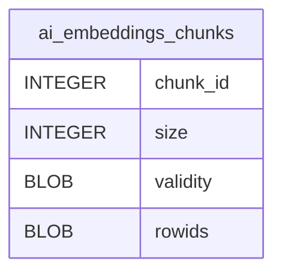

# ai_embeddings_chunks

## Description

<details>
<summary><strong>Table Definition</strong></summary>

```sql
CREATE TABLE "ai_embeddings_chunks"(chunk_id INTEGER PRIMARY KEY AUTOINCREMENT,size INTEGER NOT NULL,validity BLOB NOT NULL,rowids BLOB NOT NULL)
```

</details>

## Columns

| Name     | Type    | Default | Nullable | Children | Parents | Comment |
| -------- | ------- | ------- | -------- | -------- | ------- | ------- |
| chunk_id | INTEGER |         | true     |          |         |         |
| size     | INTEGER |         | false    |          |         |         |
| validity | BLOB    |         | false    |          |         |         |
| rowids   | BLOB    |         | false    |          |         |         |

## Constraints

| Name     | Type        | Definition             |
| -------- | ----------- | ---------------------- |
| chunk_id | PRIMARY KEY | PRIMARY KEY (chunk_id) |

## Relations



---

> Generated by [tbls](https://github.com/k1LoW/tbls)
