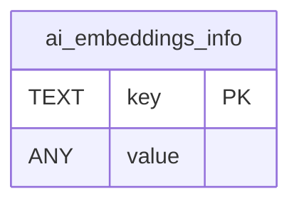

# ai_embeddings_info

## Description

<details>
<summary><strong>Table Definition</strong></summary>

```sql
CREATE TABLE "ai_embeddings_info" (key text primary key, value any)
```

</details>

## Columns

| Name  | Type | Default | Nullable | Children | Parents | Comment |
| ----- | ---- | ------- | -------- | -------- | ------- | ------- |
| key   | TEXT |         | true     |          |         |         |
| value | ANY  |         | true     |          |         |         |

## Constraints

| Name                                  | Type        | Definition        |
| ------------------------------------- | ----------- | ----------------- |
| key                                   | PRIMARY KEY | PRIMARY KEY (key) |
| sqlite_autoindex_ai_embeddings_info_1 | PRIMARY KEY | PRIMARY KEY (key) |

## Indexes

| Name                                  | Definition        |
| ------------------------------------- | ----------------- |
| sqlite_autoindex_ai_embeddings_info_1 | PRIMARY KEY (key) |

## Relations



---

> Generated by [tbls](https://github.com/k1LoW/tbls)
