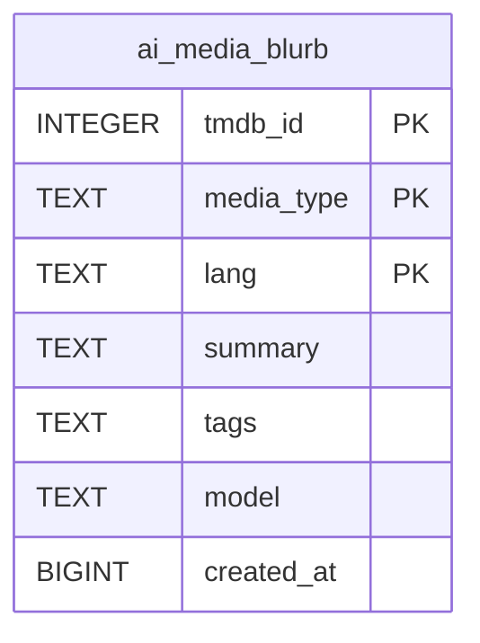

# ai_media_blurb

## Description

<details>
<summary><strong>Table Definition</strong></summary>

```sql
CREATE TABLE ai_media_blurb (
	tmdb_id INTEGER NOT NULL, 
	media_type TEXT NOT NULL, 
	lang TEXT NOT NULL, 
	summary TEXT NOT NULL, 
	tags TEXT NOT NULL, 
	model TEXT NOT NULL, 
	created_at BIGINT NOT NULL, 
	PRIMARY KEY (tmdb_id, media_type, lang)
)
```

</details>

## Columns

| Name       | Type    | Default | Nullable | Children | Parents | Comment |
| ---------- | ------- | ------- | -------- | -------- | ------- | ------- |
| tmdb_id    | INTEGER |         | false    |          |         |         |
| media_type | TEXT    |         | false    |          |         |         |
| lang       | TEXT    |         | false    |          |         |         |
| summary    | TEXT    |         | false    |          |         |         |
| tags       | TEXT    |         | false    |          |         |         |
| model      | TEXT    |         | false    |          |         |         |
| created_at | BIGINT  |         | false    |          |         |         |

## Constraints

| Name                              | Type        | Definition                              |
| --------------------------------- | ----------- | --------------------------------------- |
| tmdb_id                           | PRIMARY KEY | PRIMARY KEY (tmdb_id)                   |
| media_type                        | PRIMARY KEY | PRIMARY KEY (media_type)                |
| lang                              | PRIMARY KEY | PRIMARY KEY (lang)                      |
| sqlite_autoindex_ai_media_blurb_1 | PRIMARY KEY | PRIMARY KEY (tmdb_id, media_type, lang) |

## Indexes

| Name                              | Definition                                                  |
| --------------------------------- | ----------------------------------------------------------- |
| ix_media_blurb_tmdb               | CREATE INDEX ix_media_blurb_tmdb ON ai_media_blurb(tmdb_id) |
| ix_media_blurb_lang               | CREATE INDEX ix_media_blurb_lang ON ai_media_blurb(lang)    |
| sqlite_autoindex_ai_media_blurb_1 | PRIMARY KEY (tmdb_id, media_type, lang)                     |

## Relations



---

> Generated by [tbls](https://github.com/k1LoW/tbls)
