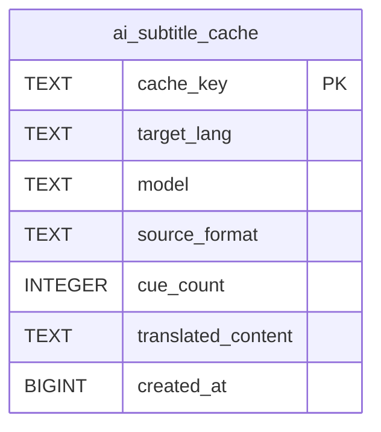

# ai_subtitle_cache

## Description

<details>
<summary><strong>Table Definition</strong></summary>

```sql
CREATE TABLE ai_subtitle_cache (
	cache_key TEXT NOT NULL, 
	target_lang TEXT NOT NULL, 
	model TEXT NOT NULL, 
	source_format TEXT NOT NULL, 
	cue_count INTEGER NOT NULL, 
	translated_content TEXT NOT NULL, 
	created_at BIGINT NOT NULL, 
	PRIMARY KEY (cache_key)
)
```

</details>

## Columns

| Name               | Type    | Default | Nullable | Children | Parents | Comment |
| ------------------ | ------- | ------- | -------- | -------- | ------- | ------- |
| cache_key          | TEXT    |         | false    |          |         |         |
| target_lang        | TEXT    |         | false    |          |         |         |
| model              | TEXT    |         | false    |          |         |         |
| source_format      | TEXT    |         | false    |          |         |         |
| cue_count          | INTEGER |         | false    |          |         |         |
| translated_content | TEXT    |         | false    |          |         |         |
| created_at         | BIGINT  |         | false    |          |         |         |

## Constraints

| Name                                 | Type        | Definition              |
| ------------------------------------ | ----------- | ----------------------- |
| cache_key                            | PRIMARY KEY | PRIMARY KEY (cache_key) |
| sqlite_autoindex_ai_subtitle_cache_1 | PRIMARY KEY | PRIMARY KEY (cache_key) |

## Indexes

| Name                                 | Definition                                                              |
| ------------------------------------ | ----------------------------------------------------------------------- |
| ix_subtitle_cache_lang               | CREATE INDEX ix_subtitle_cache_lang ON ai_subtitle_cache(target_lang)   |
| ix_subtitle_cache_created            | CREATE INDEX ix_subtitle_cache_created ON ai_subtitle_cache(created_at) |
| sqlite_autoindex_ai_subtitle_cache_1 | PRIMARY KEY (cache_key)                                                 |

## Relations



---

> Generated by [tbls](https://github.com/k1LoW/tbls)
