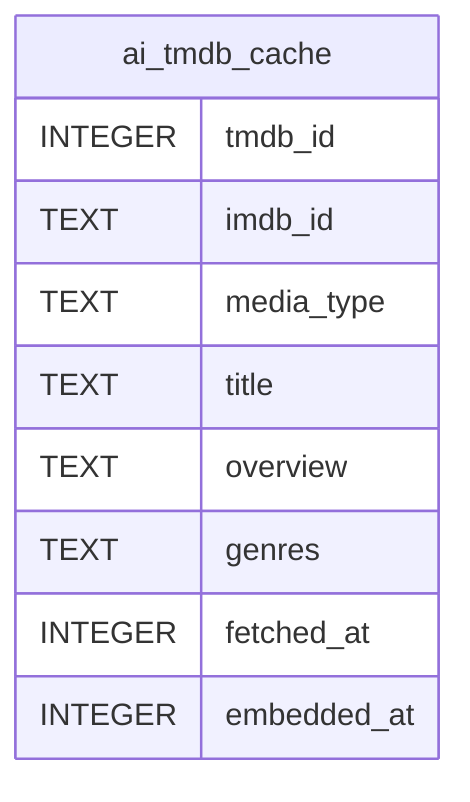

# ai_tmdb_cache

## Description

<details>
<summary><strong>Table Definition</strong></summary>

```sql
CREATE TABLE ai_tmdb_cache (
            tmdb_id INTEGER PRIMARY KEY,
            imdb_id TEXT,
            media_type TEXT NOT NULL CHECK(media_type IN ('movie','tv')),
            title TEXT,
            overview TEXT,
            genres TEXT,
            fetched_at INTEGER NOT NULL,
            embedded_at INTEGER
        )
```

</details>

## Columns

| Name        | Type    | Default | Nullable | Children | Parents | Comment |
| ----------- | ------- | ------- | -------- | -------- | ------- | ------- |
| tmdb_id     | INTEGER |         | true     |          |         |         |
| imdb_id     | TEXT    |         | true     |          |         |         |
| media_type  | TEXT    |         | false    |          |         |         |
| title       | TEXT    |         | true     |          |         |         |
| overview    | TEXT    |         | true     |          |         |         |
| genres      | TEXT    |         | true     |          |         |         |
| fetched_at  | INTEGER |         | false    |          |         |         |
| embedded_at | INTEGER |         | true     |          |         |         |

## Constraints

| Name    | Type        | Definition                          |
| ------- | ----------- | ----------------------------------- |
| tmdb_id | PRIMARY KEY | PRIMARY KEY (tmdb_id)               |
| -       | CHECK       | CHECK(media_type IN ('movie','tv')) |

## Indexes

| Name                         | Definition                                                              |
| ---------------------------- | ----------------------------------------------------------------------- |
| ix_ai_tmdb_cache_imdb_id     | CREATE INDEX ix_ai_tmdb_cache_imdb_id ON ai_tmdb_cache(imdb_id)         |
| ix_ai_tmdb_cache_embedded_at | CREATE INDEX ix_ai_tmdb_cache_embedded_at ON ai_tmdb_cache(embedded_at) |

## Relations



---

> Generated by [tbls](https://github.com/k1LoW/tbls)
