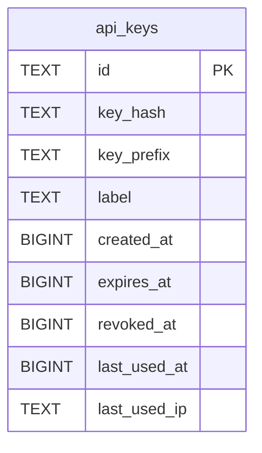

# api_keys

## Description

<details>
<summary><strong>Table Definition</strong></summary>

```sql
CREATE TABLE api_keys (
	id TEXT NOT NULL, 
	key_hash TEXT NOT NULL, 
	key_prefix TEXT NOT NULL, 
	label TEXT NOT NULL, 
	created_at BIGINT NOT NULL, 
	expires_at BIGINT, 
	revoked_at BIGINT, 
	last_used_at BIGINT, 
	last_used_ip TEXT, 
	PRIMARY KEY (id), 
	UNIQUE (key_hash)
)
```

</details>

## Columns

| Name         | Type   | Default | Nullable | Children | Parents | Comment |
| ------------ | ------ | ------- | -------- | -------- | ------- | ------- |
| id           | TEXT   |         | false    |          |         |         |
| key_hash     | TEXT   |         | false    |          |         |         |
| key_prefix   | TEXT   |         | false    |          |         |         |
| label        | TEXT   |         | false    |          |         |         |
| created_at   | BIGINT |         | false    |          |         |         |
| expires_at   | BIGINT |         | true     |          |         |         |
| revoked_at   | BIGINT |         | true     |          |         |         |
| last_used_at | BIGINT |         | true     |          |         |         |
| last_used_ip | TEXT   |         | true     |          |         |         |

## Constraints

| Name                        | Type        | Definition        |
| --------------------------- | ----------- | ----------------- |
| id                          | PRIMARY KEY | PRIMARY KEY (id)  |
| sqlite_autoindex_api_keys_2 | UNIQUE      | UNIQUE (key_hash) |
| sqlite_autoindex_api_keys_1 | PRIMARY KEY | PRIMARY KEY (id)  |

## Indexes

| Name                        | Definition                                               |
| --------------------------- | -------------------------------------------------------- |
| ix_api_keys_key_hash        | CREATE INDEX ix_api_keys_key_hash ON api_keys (key_hash) |
| sqlite_autoindex_api_keys_2 | UNIQUE (key_hash)                                        |
| sqlite_autoindex_api_keys_1 | PRIMARY KEY (id)                                         |

## Relations



---

> Generated by [tbls](https://github.com/k1LoW/tbls)
