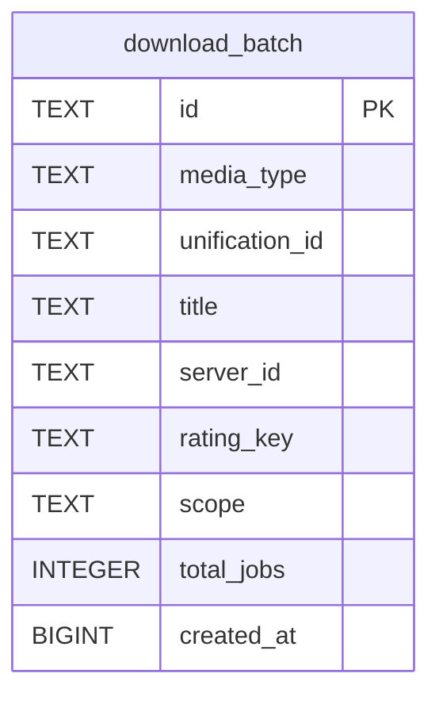

# download_batch

## Description

<details>
<summary><strong>Table Definition</strong></summary>

```sql
CREATE TABLE download_batch (
	id TEXT NOT NULL, 
	media_type TEXT NOT NULL, 
	unification_id TEXT, 
	title TEXT NOT NULL, 
	server_id TEXT NOT NULL, 
	rating_key TEXT NOT NULL, 
	scope TEXT NOT NULL, 
	total_jobs INTEGER NOT NULL, 
	created_at BIGINT NOT NULL, 
	PRIMARY KEY (id)
)
```

</details>

## Columns

| Name           | Type    | Default | Nullable | Children | Parents | Comment |
| -------------- | ------- | ------- | -------- | -------- | ------- | ------- |
| id             | TEXT    |         | false    |          |         |         |
| media_type     | TEXT    |         | false    |          |         |         |
| unification_id | TEXT    |         | true     |          |         |         |
| title          | TEXT    |         | false    |          |         |         |
| server_id      | TEXT    |         | false    |          |         |         |
| rating_key     | TEXT    |         | false    |          |         |         |
| scope          | TEXT    |         | false    |          |         |         |
| total_jobs     | INTEGER |         | false    |          |         |         |
| created_at     | BIGINT  |         | false    |          |         |         |

## Constraints

| Name                              | Type        | Definition       |
| --------------------------------- | ----------- | ---------------- |
| id                                | PRIMARY KEY | PRIMARY KEY (id) |
| sqlite_autoindex_download_batch_1 | PRIMARY KEY | PRIMARY KEY (id) |

## Indexes

| Name                              | Definition       |
| --------------------------------- | ---------------- |
| sqlite_autoindex_download_batch_1 | PRIMARY KEY (id) |

## Relations



---

> Generated by [tbls](https://github.com/k1LoW/tbls)
