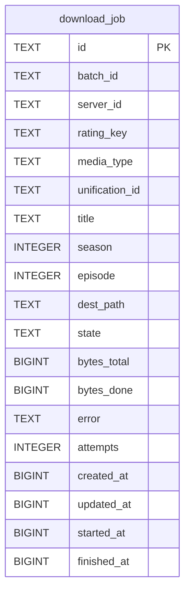

# download_job

## Description

<details>
<summary><strong>Table Definition</strong></summary>

```sql
CREATE TABLE download_job (
	id TEXT NOT NULL, 
	batch_id TEXT, 
	server_id TEXT NOT NULL, 
	rating_key TEXT NOT NULL, 
	media_type TEXT NOT NULL, 
	unification_id TEXT, 
	title TEXT NOT NULL, 
	season INTEGER, 
	episode INTEGER, 
	dest_path TEXT NOT NULL, 
	state TEXT NOT NULL, 
	bytes_total BIGINT, 
	bytes_done BIGINT NOT NULL, 
	error TEXT, 
	attempts INTEGER NOT NULL, 
	created_at BIGINT NOT NULL, 
	updated_at BIGINT NOT NULL, 
	started_at BIGINT, 
	finished_at BIGINT, 
	PRIMARY KEY (id)
)
```

</details>

## Columns

| Name           | Type    | Default | Nullable | Children | Parents | Comment |
| -------------- | ------- | ------- | -------- | -------- | ------- | ------- |
| id             | TEXT    |         | false    |          |         |         |
| batch_id       | TEXT    |         | true     |          |         |         |
| server_id      | TEXT    |         | false    |          |         |         |
| rating_key     | TEXT    |         | false    |          |         |         |
| media_type     | TEXT    |         | false    |          |         |         |
| unification_id | TEXT    |         | true     |          |         |         |
| title          | TEXT    |         | false    |          |         |         |
| season         | INTEGER |         | true     |          |         |         |
| episode        | INTEGER |         | true     |          |         |         |
| dest_path      | TEXT    |         | false    |          |         |         |
| state          | TEXT    |         | false    |          |         |         |
| bytes_total    | BIGINT  |         | true     |          |         |         |
| bytes_done     | BIGINT  |         | false    |          |         |         |
| error          | TEXT    |         | true     |          |         |         |
| attempts       | INTEGER |         | false    |          |         |         |
| created_at     | BIGINT  |         | false    |          |         |         |
| updated_at     | BIGINT  |         | false    |          |         |         |
| started_at     | BIGINT  |         | true     |          |         |         |
| finished_at    | BIGINT  |         | true     |          |         |         |

## Constraints

| Name                            | Type        | Definition       |
| ------------------------------- | ----------- | ---------------- |
| id                              | PRIMARY KEY | PRIMARY KEY (id) |
| sqlite_autoindex_download_job_1 | PRIMARY KEY | PRIMARY KEY (id) |

## Indexes

| Name                            | Definition                                                                |
| ------------------------------- | ------------------------------------------------------------------------- |
| ix_download_job_state           | CREATE INDEX ix_download_job_state ON download_job (state)                |
| ix_download_job_item            | CREATE INDEX ix_download_job_item ON download_job (server_id, rating_key) |
| ix_download_job_created         | CREATE INDEX ix_download_job_created ON download_job (created_at)         |
| ix_download_job_batch           | CREATE INDEX ix_download_job_batch ON download_job (batch_id)             |
| sqlite_autoindex_download_job_1 | PRIMARY KEY (id)                                                          |

## Relations



---

> Generated by [tbls](https://github.com/k1LoW/tbls)
