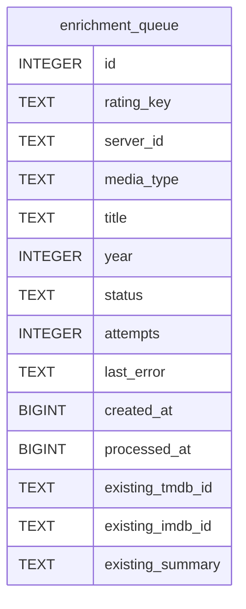

# enrichment_queue

## Description

<details>
<summary><strong>Table Definition</strong></summary>

```sql
CREATE TABLE enrichment_queue (
	id INTEGER NOT NULL, 
	rating_key TEXT NOT NULL, 
	server_id TEXT NOT NULL, 
	media_type TEXT NOT NULL, 
	title TEXT NOT NULL, 
	year INTEGER, 
	status TEXT NOT NULL, 
	attempts INTEGER NOT NULL, 
	last_error TEXT, 
	created_at BIGINT NOT NULL, 
	processed_at BIGINT, existing_tmdb_id TEXT, existing_imdb_id TEXT, existing_summary TEXT, 
	PRIMARY KEY (id)
)
```

</details>

## Columns

| Name             | Type    | Default | Nullable | Children | Parents | Comment |
| ---------------- | ------- | ------- | -------- | -------- | ------- | ------- |
| id               | INTEGER |         | false    |          |         |         |
| rating_key       | TEXT    |         | false    |          |         |         |
| server_id        | TEXT    |         | false    |          |         |         |
| media_type       | TEXT    |         | false    |          |         |         |
| title            | TEXT    |         | false    |          |         |         |
| year             | INTEGER |         | true     |          |         |         |
| status           | TEXT    |         | false    |          |         |         |
| attempts         | INTEGER |         | false    |          |         |         |
| last_error       | TEXT    |         | true     |          |         |         |
| created_at       | BIGINT  |         | false    |          |         |         |
| processed_at     | BIGINT  |         | true     |          |         |         |
| existing_tmdb_id | TEXT    |         | true     |          |         |         |
| existing_imdb_id | TEXT    |         | true     |          |         |         |
| existing_summary | TEXT    |         | true     |          |         |         |

## Constraints

| Name | Type        | Definition       |
| ---- | ----------- | ---------------- |
| id   | PRIMARY KEY | PRIMARY KEY (id) |

## Indexes

| Name                 | Definition                                                                          |
| -------------------- | ----------------------------------------------------------------------------------- |
| uix_enrichment_item  | CREATE UNIQUE INDEX uix_enrichment_item ON enrichment_queue (rating_key, server_id) |
| ix_enrichment_status | CREATE INDEX ix_enrichment_status ON enrichment_queue (status)                      |

## Relations



---

> Generated by [tbls](https://github.com/k1LoW/tbls)
