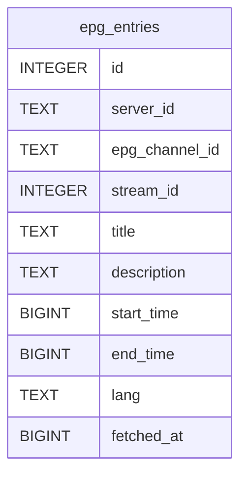

# epg_entries

## Description

<details>
<summary><strong>Table Definition</strong></summary>

```sql
CREATE TABLE epg_entries (
	id INTEGER NOT NULL, 
	server_id TEXT NOT NULL, 
	epg_channel_id TEXT NOT NULL, 
	stream_id INTEGER, 
	title TEXT NOT NULL, 
	description TEXT, 
	start_time BIGINT NOT NULL, 
	end_time BIGINT NOT NULL, 
	lang TEXT, 
	fetched_at BIGINT NOT NULL, 
	PRIMARY KEY (id)
)
```

</details>

## Columns

| Name           | Type    | Default | Nullable | Children | Parents | Comment |
| -------------- | ------- | ------- | -------- | -------- | ------- | ------- |
| id             | INTEGER |         | false    |          |         |         |
| server_id      | TEXT    |         | false    |          |         |         |
| epg_channel_id | TEXT    |         | false    |          |         |         |
| stream_id      | INTEGER |         | true     |          |         |         |
| title          | TEXT    |         | false    |          |         |         |
| description    | TEXT    |         | true     |          |         |         |
| start_time     | BIGINT  |         | false    |          |         |         |
| end_time       | BIGINT  |         | false    |          |         |         |
| lang           | TEXT    |         | true     |          |         |         |
| fetched_at     | BIGINT  |         | false    |          |         |         |

## Constraints

| Name | Type        | Definition       |
| ---- | ----------- | ---------------- |
| id   | PRIMARY KEY | PRIMARY KEY (id) |

## Indexes

| Name                  | Definition                                                                          |
| --------------------- | ----------------------------------------------------------------------------------- |
| uix_epg_dedup         | CREATE UNIQUE INDEX uix_epg_dedup ON epg_entries (server_id, stream_id, start_time) |
| ix_epg_time           | CREATE INDEX ix_epg_time ON epg_entries (start_time, end_time)                      |
| ix_epg_stream_time    | CREATE INDEX ix_epg_stream_time ON epg_entries (stream_id, start_time, end_time)    |
| ix_epg_stream         | CREATE INDEX ix_epg_stream ON epg_entries (stream_id)                               |
| ix_epg_server_channel | CREATE INDEX ix_epg_server_channel ON epg_entries (server_id, epg_channel_id)       |
| ix_epg_server         | CREATE INDEX ix_epg_server ON epg_entries (server_id)                               |
| ix_epg_channel        | CREATE INDEX ix_epg_channel ON epg_entries (epg_channel_id)                         |

## Relations



---

> Generated by [tbls](https://github.com/k1LoW/tbls)
