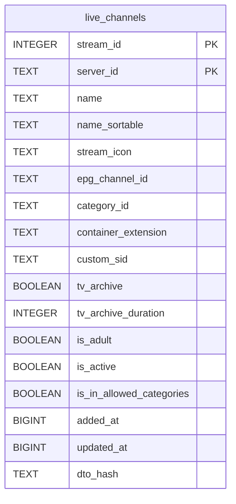

# live_channels

## Description

<details>
<summary><strong>Table Definition</strong></summary>

```sql
CREATE TABLE live_channels (
	stream_id INTEGER NOT NULL, 
	server_id TEXT NOT NULL, 
	name TEXT NOT NULL, 
	name_sortable TEXT NOT NULL, 
	stream_icon TEXT, 
	epg_channel_id TEXT, 
	category_id TEXT, 
	container_extension TEXT, 
	custom_sid TEXT, 
	tv_archive BOOLEAN NOT NULL, 
	tv_archive_duration INTEGER NOT NULL, 
	is_adult BOOLEAN NOT NULL, 
	is_active BOOLEAN NOT NULL, 
	is_in_allowed_categories BOOLEAN NOT NULL, 
	added_at BIGINT NOT NULL, 
	updated_at BIGINT NOT NULL, 
	dto_hash TEXT, 
	PRIMARY KEY (stream_id, server_id)
)
```

</details>

## Columns

| Name                     | Type    | Default | Nullable | Children | Parents | Comment |
| ------------------------ | ------- | ------- | -------- | -------- | ------- | ------- |
| stream_id                | INTEGER |         | false    |          |         |         |
| server_id                | TEXT    |         | false    |          |         |         |
| name                     | TEXT    |         | false    |          |         |         |
| name_sortable            | TEXT    |         | false    |          |         |         |
| stream_icon              | TEXT    |         | true     |          |         |         |
| epg_channel_id           | TEXT    |         | true     |          |         |         |
| category_id              | TEXT    |         | true     |          |         |         |
| container_extension      | TEXT    |         | true     |          |         |         |
| custom_sid               | TEXT    |         | true     |          |         |         |
| tv_archive               | BOOLEAN |         | false    |          |         |         |
| tv_archive_duration      | INTEGER |         | false    |          |         |         |
| is_adult                 | BOOLEAN |         | false    |          |         |         |
| is_active                | BOOLEAN |         | false    |          |         |         |
| is_in_allowed_categories | BOOLEAN |         | false    |          |         |         |
| added_at                 | BIGINT  |         | false    |          |         |         |
| updated_at               | BIGINT  |         | false    |          |         |         |
| dto_hash                 | TEXT    |         | true     |          |         |         |

## Constraints

| Name                             | Type        | Definition                         |
| -------------------------------- | ----------- | ---------------------------------- |
| stream_id                        | PRIMARY KEY | PRIMARY KEY (stream_id)            |
| server_id                        | PRIMARY KEY | PRIMARY KEY (server_id)            |
| sqlite_autoindex_live_channels_1 | PRIMARY KEY | PRIMARY KEY (stream_id, server_id) |

## Indexes

| Name                             | Definition                                                                                          |
| -------------------------------- | --------------------------------------------------------------------------------------------------- |
| ix_live_channels_visible         | CREATE INDEX ix_live_channels_visible ON live_channels (is_in_allowed_categories)                   |
| ix_live_channels_server_visible  | CREATE INDEX ix_live_channels_server_visible ON live_channels (server_id, is_in_allowed_categories) |
| ix_live_channels_server_category | CREATE INDEX ix_live_channels_server_category ON live_channels (server_id, category_id)             |
| ix_live_channels_server          | CREATE INDEX ix_live_channels_server ON live_channels (server_id)                                   |
| ix_live_channels_name            | CREATE INDEX ix_live_channels_name ON live_channels (name_sortable)                                 |
| ix_live_channels_epg             | CREATE INDEX ix_live_channels_epg ON live_channels (epg_channel_id)                                 |
| ix_live_channels_category        | CREATE INDEX ix_live_channels_category ON live_channels (category_id)                               |
| sqlite_autoindex_live_channels_1 | PRIMARY KEY (stream_id, server_id)                                                                  |

## Relations



---

> Generated by [tbls](https://github.com/k1LoW/tbls)
