# media

## Description

<details>
<summary><strong>Table Definition</strong></summary>

```sql
CREATE TABLE media (
	rating_key TEXT NOT NULL, 
	server_id TEXT NOT NULL, 
	filter TEXT NOT NULL, 
	sort_order TEXT NOT NULL, 
	library_section_id TEXT NOT NULL, 
	title TEXT NOT NULL, 
	title_sortable TEXT NOT NULL, 
	page_offset INTEGER NOT NULL, 
	type TEXT NOT NULL, 
	thumb_url TEXT, 
	art_url TEXT, 
	year INTEGER, 
	duration INTEGER, 
	summary TEXT, 
	genres TEXT, 
	content_rating TEXT, 
	view_offset INTEGER NOT NULL, 
	view_count INTEGER NOT NULL, 
	last_viewed_at BIGINT NOT NULL, 
	parent_title TEXT, 
	parent_rating_key TEXT, 
	parent_index INTEGER, 
	grandparent_title TEXT, 
	grandparent_rating_key TEXT, 
	"index" INTEGER, 
	parent_thumb TEXT, 
	grandparent_thumb TEXT, 
	media_parts TEXT NOT NULL, 
	guid TEXT, 
	imdb_id TEXT, 
	tmdb_id TEXT, 
	rating FLOAT, 
	audience_rating FLOAT, 
	unification_id TEXT NOT NULL, 
	history_group_key TEXT NOT NULL, 
	server_ids TEXT, 
	rating_keys TEXT, 
	added_at BIGINT NOT NULL, 
	updated_at BIGINT NOT NULL, 
	display_rating FLOAT NOT NULL, 
	scraped_rating FLOAT, 
	resolved_thumb_url TEXT, 
	resolved_art_url TEXT, 
	resolved_base_url TEXT, 
	alternative_thumb_urls TEXT, 
	stream_error_count INTEGER NOT NULL, 
	last_stream_check BIGINT, 
	is_broken BOOLEAN NOT NULL, 
	tmdb_match_confidence FLOAT, content_hash TEXT, dto_hash TEXT, is_in_allowed_categories INTEGER NOT NULL DEFAULT 1, "cast" TEXT, is_adult INTEGER NOT NULL DEFAULT 0, original_title TEXT, tagline TEXT, premiered TEXT, status TEXT, studio TEXT, country TEXT, tvdb_id TEXT, wikidata_id TEXT, imdb_rating REAL, imdb_votes INTEGER, tmdb_rating REAL, tmdb_votes INTEGER, cast_json TEXT, file_size BIGINT, 
	PRIMARY KEY (rating_key, server_id, filter, sort_order)
)
```

</details>

## Columns

| Name                     | Type    | Default | Nullable | Children | Parents | Comment |
| ------------------------ | ------- | ------- | -------- | -------- | ------- | ------- |
| rating_key               | TEXT    |         | false    |          |         |         |
| server_id                | TEXT    |         | false    |          |         |         |
| filter                   | TEXT    |         | false    |          |         |         |
| sort_order               | TEXT    |         | false    |          |         |         |
| library_section_id       | TEXT    |         | false    |          |         |         |
| title                    | TEXT    |         | false    |          |         |         |
| title_sortable           | TEXT    |         | false    |          |         |         |
| page_offset              | INTEGER |         | false    |          |         |         |
| type                     | TEXT    |         | false    |          |         |         |
| thumb_url                | TEXT    |         | true     |          |         |         |
| art_url                  | TEXT    |         | true     |          |         |         |
| year                     | INTEGER |         | true     |          |         |         |
| duration                 | INTEGER |         | true     |          |         |         |
| summary                  | TEXT    |         | true     |          |         |         |
| genres                   | TEXT    |         | true     |          |         |         |
| content_rating           | TEXT    |         | true     |          |         |         |
| view_offset              | INTEGER |         | false    |          |         |         |
| view_count               | INTEGER |         | false    |          |         |         |
| last_viewed_at           | BIGINT  |         | false    |          |         |         |
| parent_title             | TEXT    |         | true     |          |         |         |
| parent_rating_key        | TEXT    |         | true     |          |         |         |
| parent_index             | INTEGER |         | true     |          |         |         |
| grandparent_title        | TEXT    |         | true     |          |         |         |
| grandparent_rating_key   | TEXT    |         | true     |          |         |         |
| index                    | INTEGER |         | true     |          |         |         |
| parent_thumb             | TEXT    |         | true     |          |         |         |
| grandparent_thumb        | TEXT    |         | true     |          |         |         |
| media_parts              | TEXT    |         | false    |          |         |         |
| guid                     | TEXT    |         | true     |          |         |         |
| imdb_id                  | TEXT    |         | true     |          |         |         |
| tmdb_id                  | TEXT    |         | true     |          |         |         |
| rating                   | FLOAT   |         | true     |          |         |         |
| audience_rating          | FLOAT   |         | true     |          |         |         |
| unification_id           | TEXT    |         | false    |          |         |         |
| history_group_key        | TEXT    |         | false    |          |         |         |
| server_ids               | TEXT    |         | true     |          |         |         |
| rating_keys              | TEXT    |         | true     |          |         |         |
| added_at                 | BIGINT  |         | false    |          |         |         |
| updated_at               | BIGINT  |         | false    |          |         |         |
| display_rating           | FLOAT   |         | false    |          |         |         |
| scraped_rating           | FLOAT   |         | true     |          |         |         |
| resolved_thumb_url       | TEXT    |         | true     |          |         |         |
| resolved_art_url         | TEXT    |         | true     |          |         |         |
| resolved_base_url        | TEXT    |         | true     |          |         |         |
| alternative_thumb_urls   | TEXT    |         | true     |          |         |         |
| stream_error_count       | INTEGER |         | false    |          |         |         |
| last_stream_check        | BIGINT  |         | true     |          |         |         |
| is_broken                | BOOLEAN |         | false    |          |         |         |
| tmdb_match_confidence    | FLOAT   |         | true     |          |         |         |
| content_hash             | TEXT    |         | true     |          |         |         |
| dto_hash                 | TEXT    |         | true     |          |         |         |
| is_in_allowed_categories | INTEGER | 1       | false    |          |         |         |
| cast                     | TEXT    |         | true     |          |         |         |
| is_adult                 | INTEGER | 0       | false    |          |         |         |
| original_title           | TEXT    |         | true     |          |         |         |
| tagline                  | TEXT    |         | true     |          |         |         |
| premiered                | TEXT    |         | true     |          |         |         |
| status                   | TEXT    |         | true     |          |         |         |
| studio                   | TEXT    |         | true     |          |         |         |
| country                  | TEXT    |         | true     |          |         |         |
| tvdb_id                  | TEXT    |         | true     |          |         |         |
| wikidata_id              | TEXT    |         | true     |          |         |         |
| imdb_rating              | REAL    |         | true     |          |         |         |
| imdb_votes               | INTEGER |         | true     |          |         |         |
| tmdb_rating              | REAL    |         | true     |          |         |         |
| tmdb_votes               | INTEGER |         | true     |          |         |         |
| cast_json                | TEXT    |         | true     |          |         |         |
| file_size                | BIGINT  |         | true     |          |         |         |

## Constraints

| Name                     | Type        | Definition                                              |
| ------------------------ | ----------- | ------------------------------------------------------- |
| rating_key               | PRIMARY KEY | PRIMARY KEY (rating_key)                                |
| server_id                | PRIMARY KEY | PRIMARY KEY (server_id)                                 |
| filter                   | PRIMARY KEY | PRIMARY KEY (filter)                                    |
| sort_order               | PRIMARY KEY | PRIMARY KEY (sort_order)                                |
| sqlite_autoindex_media_1 | PRIMARY KEY | PRIMARY KEY (rating_key, server_id, filter, sort_order) |

## Indexes

| Name                       | Definition                                                                                                                                            |
| -------------------------- | ----------------------------------------------------------------------------------------------------------------------------------------------------- |
| uix_media_pagination       | CREATE UNIQUE INDEX uix_media_pagination ON media (server_id, library_section_id, filter, sort_order, page_offset)                                    |
| ix_media_updated           | CREATE INDEX ix_media_updated ON media (updated_at)                                                                                                   |
| ix_media_unification       | CREATE INDEX ix_media_unification ON media (unification_id)                                                                                           |
| ix_media_type_rating       | CREATE INDEX ix_media_type_rating ON media (type, display_rating)                                                                                     |
| ix_media_type_added        | CREATE INDEX ix_media_type_added ON media (type, added_at)                                                                                            |
| ix_media_tvdb              | CREATE INDEX ix_media_tvdb ON media(tvdb_id)                                                                                                          |
| ix_media_tmdb              | CREATE INDEX ix_media_tmdb ON media (tmdb_id)                                                                                                         |
| ix_media_title_sort        | CREATE INDEX ix_media_title_sort ON media (title_sortable)                                                                                            |
| ix_media_stream_validation | CREATE INDEX ix_media_stream_validation<br />                ON media(server_id, type, is_in_allowed_categories, last_stream_check)<br />             |
| ix_media_server_visible    | CREATE INDEX ix_media_server_visible ON media(server_id, is_in_allowed_categories)                                                                    |
| ix_media_server_type       | CREATE INDEX ix_media_server_type ON media(server_id, type)                                                                                           |
| ix_media_server_lib        | CREATE INDEX ix_media_server_lib ON media (server_id, library_section_id)                                                                             |
| ix_media_parent_visible    | CREATE INDEX ix_media_parent_visible ON media(parent_rating_key, is_in_allowed_categories)                                                            |
| ix_media_parent            | CREATE INDEX ix_media_parent ON media (parent_rating_key)                                                                                             |
| ix_media_imdb              | CREATE INDEX ix_media_imdb ON media (imdb_id)                                                                                                         |
| ix_media_guid              | CREATE INDEX ix_media_guid ON media (guid)                                                                                                            |
| ix_media_grandparent       | CREATE INDEX ix_media_grandparent ON media(grandparent_rating_key)                                                                                    |
| ix_media_category_visible  | CREATE INDEX ix_media_category_visible<br />                ON media(is_in_allowed_categories)<br />                                                  |
| ix_media_broken            | CREATE INDEX ix_media_broken ON media (is_broken)                                                                                                     |
| ix_media_adult             | CREATE INDEX ix_media_adult<br />                ON media(is_adult)<br />                                                                             |
| sqlite_autoindex_media_1   | PRIMARY KEY (rating_key, server_id, filter, sort_order)                                                                                               |

## Relations

```mermaid
erDiagram


"media" {
  TEXT rating_key PK
  TEXT server_id PK
  TEXT filter PK
  TEXT sort_order PK
  TEXT library_section_id
  TEXT title
  TEXT title_sortable
  INTEGER page_offset
  TEXT type
  TEXT thumb_url
  TEXT art_url
  INTEGER year
  INTEGER duration
  TEXT summary
  TEXT genres
  TEXT content_rating
  INTEGER view_offset
  INTEGER view_count
  BIGINT last_viewed_at
  TEXT parent_title
  TEXT parent_rating_key
  INTEGER parent_index
  TEXT grandparent_title
  TEXT grandparent_rating_key
  INTEGER index
  TEXT parent_thumb
  TEXT grandparent_thumb
  TEXT media_parts
  TEXT guid
  TEXT imdb_id
  TEXT tmdb_id
  FLOAT rating
  FLOAT audience_rating
  TEXT unification_id
  TEXT history_group_key
  TEXT server_ids
  TEXT rating_keys
  BIGINT added_at
  BIGINT updated_at
  FLOAT display_rating
  FLOAT scraped_rating
  TEXT resolved_thumb_url
  TEXT resolved_art_url
  TEXT resolved_base_url
  TEXT alternative_thumb_urls
  INTEGER stream_error_count
  BIGINT last_stream_check
  BOOLEAN is_broken
  FLOAT tmdb_match_confidence
  TEXT content_hash
  TEXT dto_hash
  INTEGER is_in_allowed_categories
  TEXT cast
  INTEGER is_adult
  TEXT original_title
  TEXT tagline
  TEXT premiered
  TEXT status
  TEXT studio
  TEXT country
  TEXT tvdb_id
  TEXT wikidata_id
  REAL imdb_rating
  INTEGER imdb_votes
  REAL tmdb_rating
  INTEGER tmdb_votes
  TEXT cast_json
  BIGINT file_size
}
```



---

> Generated by [tbls](https://github.com/k1LoW/tbls)
