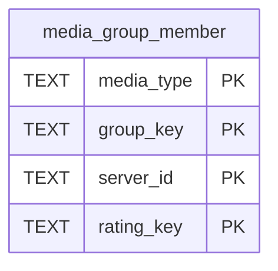

# media_group_member

## Description

<details>
<summary><strong>Table Definition</strong></summary>

```sql
CREATE TABLE media_group_member (
	media_type TEXT NOT NULL, 
	group_key TEXT NOT NULL, 
	server_id TEXT NOT NULL, 
	rating_key TEXT NOT NULL, 
	PRIMARY KEY (media_type, group_key, server_id, rating_key)
)
```

</details>

## Columns

| Name       | Type | Default | Nullable | Children | Parents | Comment |
| ---------- | ---- | ------- | -------- | -------- | ------- | ------- |
| media_type | TEXT |         | false    |          |         |         |
| group_key  | TEXT |         | false    |          |         |         |
| server_id  | TEXT |         | false    |          |         |         |
| rating_key | TEXT |         | false    |          |         |         |

## Constraints

| Name                                  | Type        | Definition                                                 |
| ------------------------------------- | ----------- | ---------------------------------------------------------- |
| media_type                            | PRIMARY KEY | PRIMARY KEY (media_type)                                   |
| group_key                             | PRIMARY KEY | PRIMARY KEY (group_key)                                    |
| server_id                             | PRIMARY KEY | PRIMARY KEY (server_id)                                    |
| rating_key                            | PRIMARY KEY | PRIMARY KEY (rating_key)                                   |
| sqlite_autoindex_media_group_member_1 | PRIMARY KEY | PRIMARY KEY (media_type, group_key, server_id, rating_key) |

## Indexes

| Name                                  | Definition                                                 |
| ------------------------------------- | ---------------------------------------------------------- |
| sqlite_autoindex_media_group_member_1 | PRIMARY KEY (media_type, group_key, server_id, rating_key) |

## Relations



---

> Generated by [tbls](https://github.com/k1LoW/tbls)
