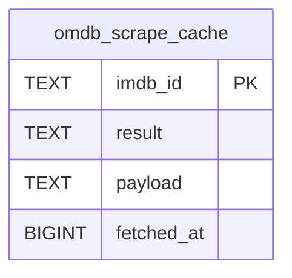

# omdb_scrape_cache

## Description

<details>
<summary><strong>Table Definition</strong></summary>

```sql
CREATE TABLE omdb_scrape_cache (
	imdb_id TEXT NOT NULL, 
	result TEXT NOT NULL, 
	payload TEXT, 
	fetched_at BIGINT NOT NULL, 
	PRIMARY KEY (imdb_id)
)
```

</details>

## Columns

| Name       | Type   | Default | Nullable | Children | Parents | Comment |
| ---------- | ------ | ------- | -------- | -------- | ------- | ------- |
| imdb_id    | TEXT   |         | false    |          |         |         |
| result     | TEXT   |         | false    |          |         |         |
| payload    | TEXT   |         | true     |          |         |         |
| fetched_at | BIGINT |         | false    |          |         |         |

## Constraints

| Name                                 | Type        | Definition            |
| ------------------------------------ | ----------- | --------------------- |
| imdb_id                              | PRIMARY KEY | PRIMARY KEY (imdb_id) |
| sqlite_autoindex_omdb_scrape_cache_1 | PRIMARY KEY | PRIMARY KEY (imdb_id) |

## Indexes

| Name                                 | Definition                                                                     |
| ------------------------------------ | ------------------------------------------------------------------------------ |
| ix_omdb_scrape_cache_fetched_at      | CREATE INDEX ix_omdb_scrape_cache_fetched_at ON omdb_scrape_cache (fetched_at) |
| sqlite_autoindex_omdb_scrape_cache_1 | PRIMARY KEY (imdb_id)                                                          |

## Relations



---

> Generated by [tbls](https://github.com/k1LoW/tbls)
