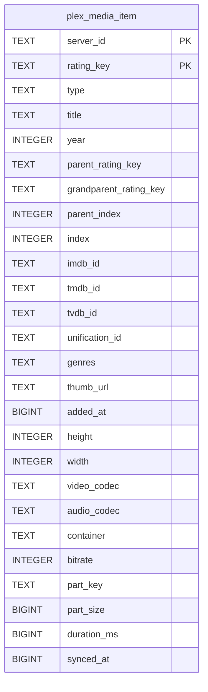

# plex_media_item

## Description

<details>
<summary><strong>Table Definition</strong></summary>

```sql
CREATE TABLE plex_media_item (
	server_id TEXT NOT NULL, 
	rating_key TEXT NOT NULL, 
	type TEXT NOT NULL, 
	title TEXT NOT NULL, 
	year INTEGER, 
	parent_rating_key TEXT, 
	grandparent_rating_key TEXT, 
	parent_index INTEGER, 
	"index" INTEGER, 
	imdb_id TEXT, 
	tmdb_id TEXT, 
	tvdb_id TEXT, 
	unification_id TEXT, 
	genres TEXT, 
	thumb_url TEXT, 
	added_at BIGINT, 
	height INTEGER, 
	width INTEGER, 
	video_codec TEXT, 
	audio_codec TEXT, 
	container TEXT, 
	bitrate INTEGER, 
	part_key TEXT, 
	part_size BIGINT, 
	duration_ms BIGINT, 
	synced_at BIGINT NOT NULL, 
	PRIMARY KEY (server_id, rating_key)
)
```

</details>

## Columns

| Name                   | Type    | Default | Nullable | Children | Parents | Comment |
| ---------------------- | ------- | ------- | -------- | -------- | ------- | ------- |
| server_id              | TEXT    |         | false    |          |         |         |
| rating_key             | TEXT    |         | false    |          |         |         |
| type                   | TEXT    |         | false    |          |         |         |
| title                  | TEXT    |         | false    |          |         |         |
| year                   | INTEGER |         | true     |          |         |         |
| parent_rating_key      | TEXT    |         | true     |          |         |         |
| grandparent_rating_key | TEXT    |         | true     |          |         |         |
| parent_index           | INTEGER |         | true     |          |         |         |
| index                  | INTEGER |         | true     |          |         |         |
| imdb_id                | TEXT    |         | true     |          |         |         |
| tmdb_id                | TEXT    |         | true     |          |         |         |
| tvdb_id                | TEXT    |         | true     |          |         |         |
| unification_id         | TEXT    |         | true     |          |         |         |
| genres                 | TEXT    |         | true     |          |         |         |
| thumb_url              | TEXT    |         | true     |          |         |         |
| added_at               | BIGINT  |         | true     |          |         |         |
| height                 | INTEGER |         | true     |          |         |         |
| width                  | INTEGER |         | true     |          |         |         |
| video_codec            | TEXT    |         | true     |          |         |         |
| audio_codec            | TEXT    |         | true     |          |         |         |
| container              | TEXT    |         | true     |          |         |         |
| bitrate                | INTEGER |         | true     |          |         |         |
| part_key               | TEXT    |         | true     |          |         |         |
| part_size              | BIGINT  |         | true     |          |         |         |
| duration_ms            | BIGINT  |         | true     |          |         |         |
| synced_at              | BIGINT  |         | false    |          |         |         |

## Constraints

| Name                               | Type        | Definition                          |
| ---------------------------------- | ----------- | ----------------------------------- |
| server_id                          | PRIMARY KEY | PRIMARY KEY (server_id)             |
| rating_key                         | PRIMARY KEY | PRIMARY KEY (rating_key)            |
| sqlite_autoindex_plex_media_item_1 | PRIMARY KEY | PRIMARY KEY (server_id, rating_key) |

## Indexes

| Name                               | Definition                                                                            |
| ---------------------------------- | ------------------------------------------------------------------------------------- |
| ix_plex_item_type_unif             | CREATE INDEX ix_plex_item_type_unif ON plex_media_item (type, unification_id)         |
| ix_plex_item_type_title            | CREATE INDEX ix_plex_item_type_title ON plex_media_item (type, title)                 |
| ix_plex_item_type_added            | CREATE INDEX ix_plex_item_type_added ON plex_media_item (type, added_at)              |
| ix_plex_item_show                  | CREATE INDEX ix_plex_item_show ON plex_media_item (server_id, grandparent_rating_key) |
| sqlite_autoindex_plex_media_item_1 | PRIMARY KEY (server_id, rating_key)                                                   |

## Relations



---

> Generated by [tbls](https://github.com/k1LoW/tbls)
