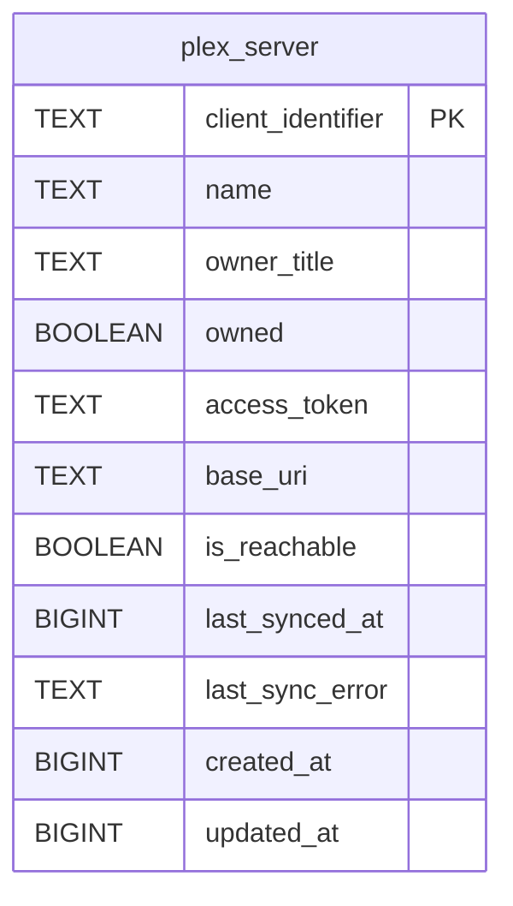

# plex_server

## Description

<details>
<summary><strong>Table Definition</strong></summary>

```sql
CREATE TABLE plex_server (
	client_identifier TEXT NOT NULL, 
	name TEXT NOT NULL, 
	owner_title TEXT, 
	owned BOOLEAN NOT NULL, 
	access_token TEXT, 
	base_uri TEXT, 
	is_reachable BOOLEAN NOT NULL, 
	last_synced_at BIGINT, 
	last_sync_error TEXT, 
	created_at BIGINT NOT NULL, 
	updated_at BIGINT NOT NULL, 
	PRIMARY KEY (client_identifier)
)
```

</details>

## Columns

| Name              | Type    | Default | Nullable | Children | Parents | Comment |
| ----------------- | ------- | ------- | -------- | -------- | ------- | ------- |
| client_identifier | TEXT    |         | false    |          |         |         |
| name              | TEXT    |         | false    |          |         |         |
| owner_title       | TEXT    |         | true     |          |         |         |
| owned             | BOOLEAN |         | false    |          |         |         |
| access_token      | TEXT    |         | true     |          |         |         |
| base_uri          | TEXT    |         | true     |          |         |         |
| is_reachable      | BOOLEAN |         | false    |          |         |         |
| last_synced_at    | BIGINT  |         | true     |          |         |         |
| last_sync_error   | TEXT    |         | true     |          |         |         |
| created_at        | BIGINT  |         | false    |          |         |         |
| updated_at        | BIGINT  |         | false    |          |         |         |

## Constraints

| Name                           | Type        | Definition                      |
| ------------------------------ | ----------- | ------------------------------- |
| client_identifier              | PRIMARY KEY | PRIMARY KEY (client_identifier) |
| sqlite_autoindex_plex_server_1 | PRIMARY KEY | PRIMARY KEY (client_identifier) |

## Indexes

| Name                           | Definition                      |
| ------------------------------ | ------------------------------- |
| sqlite_autoindex_plex_server_1 | PRIMARY KEY (client_identifier) |

## Relations



---

> Generated by [tbls](https://github.com/k1LoW/tbls)
