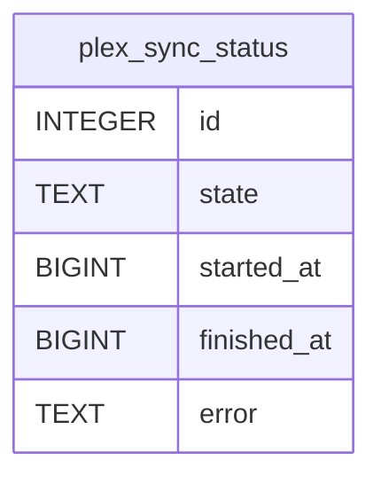

# plex_sync_status

## Description

<details>
<summary><strong>Table Definition</strong></summary>

```sql
CREATE TABLE plex_sync_status (
	id INTEGER NOT NULL, 
	state TEXT NOT NULL, 
	started_at BIGINT, 
	finished_at BIGINT, 
	error TEXT, 
	PRIMARY KEY (id), 
	CONSTRAINT ck_plex_sync_status_singleton CHECK (id = 1)
)
```

</details>

## Columns

| Name        | Type    | Default | Nullable | Children | Parents | Comment |
| ----------- | ------- | ------- | -------- | -------- | ------- | ------- |
| id          | INTEGER |         | false    |          |         |         |
| state       | TEXT    |         | false    |          |         |         |
| started_at  | BIGINT  |         | true     |          |         |         |
| finished_at | BIGINT  |         | true     |          |         |         |
| error       | TEXT    |         | true     |          |         |         |

## Constraints

| Name | Type        | Definition       |
| ---- | ----------- | ---------------- |
| id   | PRIMARY KEY | PRIMARY KEY (id) |
| -    | CHECK       | CHECK (id = 1)   |

## Relations



---

> Generated by [tbls](https://github.com/k1LoW/tbls)
