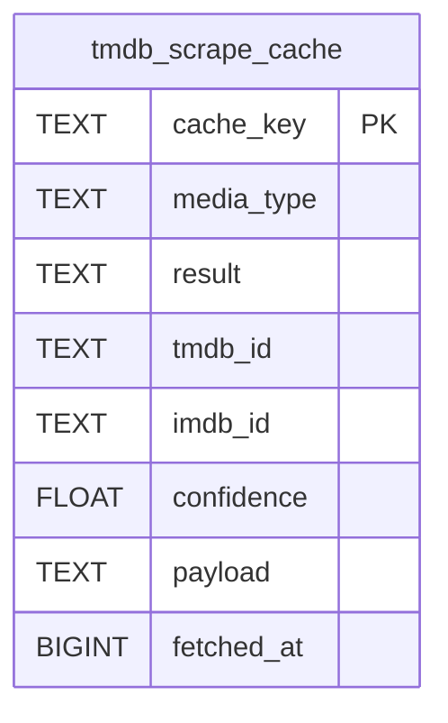

# tmdb_scrape_cache

## Description

<details>
<summary><strong>Table Definition</strong></summary>

```sql
CREATE TABLE tmdb_scrape_cache (
	cache_key TEXT NOT NULL, 
	media_type TEXT NOT NULL, 
	result TEXT NOT NULL, 
	tmdb_id TEXT, 
	imdb_id TEXT, 
	confidence FLOAT, 
	payload TEXT, 
	fetched_at BIGINT NOT NULL, 
	PRIMARY KEY (cache_key)
)
```

</details>

## Columns

| Name       | Type   | Default | Nullable | Children | Parents | Comment |
| ---------- | ------ | ------- | -------- | -------- | ------- | ------- |
| cache_key  | TEXT   |         | false    |          |         |         |
| media_type | TEXT   |         | false    |          |         |         |
| result     | TEXT   |         | false    |          |         |         |
| tmdb_id    | TEXT   |         | true     |          |         |         |
| imdb_id    | TEXT   |         | true     |          |         |         |
| confidence | FLOAT  |         | true     |          |         |         |
| payload    | TEXT   |         | true     |          |         |         |
| fetched_at | BIGINT |         | false    |          |         |         |

## Constraints

| Name                                 | Type        | Definition              |
| ------------------------------------ | ----------- | ----------------------- |
| cache_key                            | PRIMARY KEY | PRIMARY KEY (cache_key) |
| sqlite_autoindex_tmdb_scrape_cache_1 | PRIMARY KEY | PRIMARY KEY (cache_key) |

## Indexes

| Name                                 | Definition                                                                |
| ------------------------------------ | ------------------------------------------------------------------------- |
| ix_scrape_cache_fetched_at           | CREATE INDEX ix_scrape_cache_fetched_at ON tmdb_scrape_cache (fetched_at) |
| sqlite_autoindex_tmdb_scrape_cache_1 | PRIMARY KEY (cache_key)                                                   |

## Relations



---

> Generated by [tbls](https://github.com/k1LoW/tbls)
