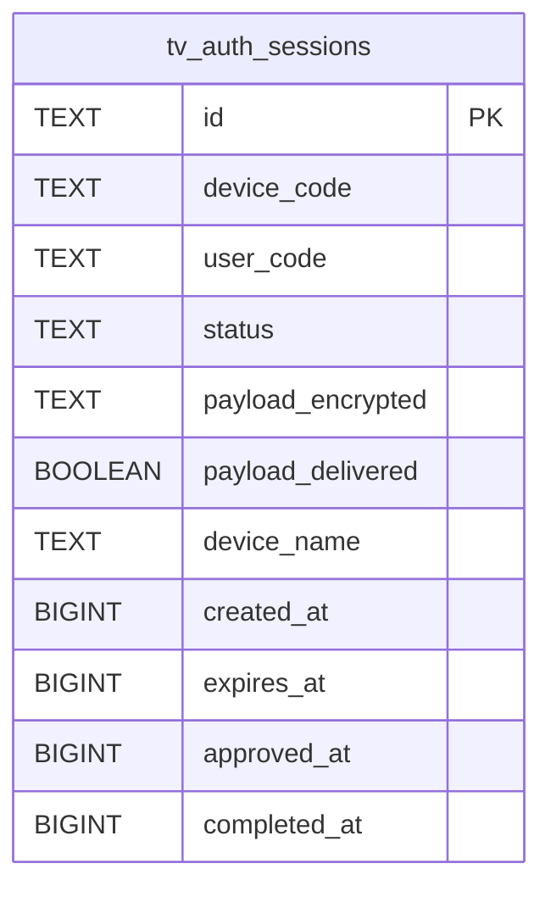

# tv_auth_sessions

## Description

<details>
<summary><strong>Table Definition</strong></summary>

```sql
CREATE TABLE tv_auth_sessions (
	id TEXT NOT NULL, 
	device_code TEXT NOT NULL, 
	user_code TEXT NOT NULL, 
	status TEXT NOT NULL, 
	payload_encrypted TEXT, 
	payload_delivered BOOLEAN NOT NULL, 
	device_name TEXT, 
	created_at BIGINT NOT NULL, 
	expires_at BIGINT NOT NULL, 
	approved_at BIGINT, 
	completed_at BIGINT, 
	PRIMARY KEY (id)
)
```

</details>

## Columns

| Name              | Type    | Default | Nullable | Children | Parents | Comment |
| ----------------- | ------- | ------- | -------- | -------- | ------- | ------- |
| id                | TEXT    |         | false    |          |         |         |
| device_code       | TEXT    |         | false    |          |         |         |
| user_code         | TEXT    |         | false    |          |         |         |
| status            | TEXT    |         | false    |          |         |         |
| payload_encrypted | TEXT    |         | true     |          |         |         |
| payload_delivered | BOOLEAN |         | false    |          |         |         |
| device_name       | TEXT    |         | true     |          |         |         |
| created_at        | BIGINT  |         | false    |          |         |         |
| expires_at        | BIGINT  |         | false    |          |         |         |
| approved_at       | BIGINT  |         | true     |          |         |         |
| completed_at      | BIGINT  |         | true     |          |         |         |

## Constraints

| Name                                | Type        | Definition       |
| ----------------------------------- | ----------- | ---------------- |
| id                                  | PRIMARY KEY | PRIMARY KEY (id) |
| sqlite_autoindex_tv_auth_sessions_1 | PRIMARY KEY | PRIMARY KEY (id) |

## Indexes

| Name                                | Definition                                                                    |
| ----------------------------------- | ----------------------------------------------------------------------------- |
| uix_tv_auth_user_code               | CREATE UNIQUE INDEX uix_tv_auth_user_code ON tv_auth_sessions (user_code)     |
| uix_tv_auth_device_code             | CREATE UNIQUE INDEX uix_tv_auth_device_code ON tv_auth_sessions (device_code) |
| ix_tv_auth_status                   | CREATE INDEX ix_tv_auth_status ON tv_auth_sessions (status)                   |
| ix_tv_auth_expires                  | CREATE INDEX ix_tv_auth_expires ON tv_auth_sessions (expires_at)              |
| sqlite_autoindex_tv_auth_sessions_1 | PRIMARY KEY (id)                                                              |

## Relations



---

> Generated by [tbls](https://github.com/k1LoW/tbls)
