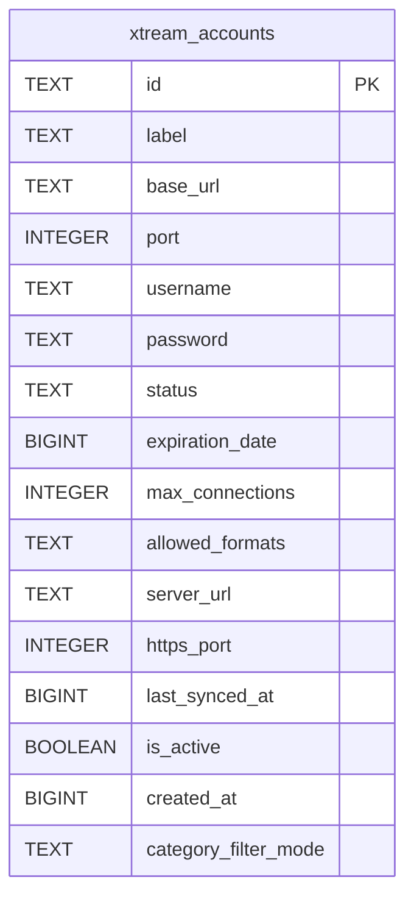

# xtream_accounts

## Description

<details>
<summary><strong>Table Definition</strong></summary>

```sql
CREATE TABLE xtream_accounts (
	id TEXT NOT NULL, 
	label TEXT NOT NULL, 
	base_url TEXT NOT NULL, 
	port INTEGER NOT NULL, 
	username TEXT NOT NULL, 
	password TEXT NOT NULL, 
	status TEXT NOT NULL, 
	expiration_date BIGINT, 
	max_connections INTEGER NOT NULL, 
	allowed_formats TEXT NOT NULL, 
	server_url TEXT, 
	https_port INTEGER, 
	last_synced_at BIGINT NOT NULL, 
	is_active BOOLEAN NOT NULL, 
	created_at BIGINT NOT NULL, category_filter_mode TEXT NOT NULL DEFAULT 'all', 
	PRIMARY KEY (id)
)
```

</details>

## Columns

| Name                 | Type    | Default | Nullable | Children | Parents | Comment |
| -------------------- | ------- | ------- | -------- | -------- | ------- | ------- |
| id                   | TEXT    |         | false    |          |         |         |
| label                | TEXT    |         | false    |          |         |         |
| base_url             | TEXT    |         | false    |          |         |         |
| port                 | INTEGER |         | false    |          |         |         |
| username             | TEXT    |         | false    |          |         |         |
| password             | TEXT    |         | false    |          |         |         |
| status               | TEXT    |         | false    |          |         |         |
| expiration_date      | BIGINT  |         | true     |          |         |         |
| max_connections      | INTEGER |         | false    |          |         |         |
| allowed_formats      | TEXT    |         | false    |          |         |         |
| server_url           | TEXT    |         | true     |          |         |         |
| https_port           | INTEGER |         | true     |          |         |         |
| last_synced_at       | BIGINT  |         | false    |          |         |         |
| is_active            | BOOLEAN |         | false    |          |         |         |
| created_at           | BIGINT  |         | false    |          |         |         |
| category_filter_mode | TEXT    | 'all'   | false    |          |         |         |

## Constraints

| Name                               | Type        | Definition       |
| ---------------------------------- | ----------- | ---------------- |
| id                                 | PRIMARY KEY | PRIMARY KEY (id) |
| sqlite_autoindex_xtream_accounts_1 | PRIMARY KEY | PRIMARY KEY (id) |

## Indexes

| Name                               | Definition       |
| ---------------------------------- | ---------------- |
| sqlite_autoindex_xtream_accounts_1 | PRIMARY KEY (id) |

## Relations



---

> Generated by [tbls](https://github.com/k1LoW/tbls)
