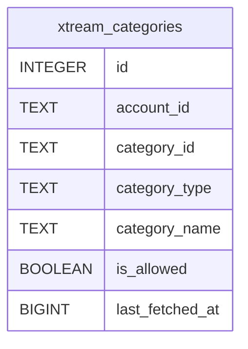

# xtream_categories

## Description

<details>
<summary><strong>Table Definition</strong></summary>

```sql
CREATE TABLE xtream_categories (
	id INTEGER NOT NULL, 
	account_id TEXT NOT NULL, 
	category_id TEXT NOT NULL, 
	category_type TEXT NOT NULL, 
	category_name TEXT NOT NULL, 
	is_allowed BOOLEAN NOT NULL, 
	last_fetched_at BIGINT NOT NULL, 
	PRIMARY KEY (id)
)
```

</details>

## Columns

| Name            | Type    | Default | Nullable | Children | Parents | Comment |
| --------------- | ------- | ------- | -------- | -------- | ------- | ------- |
| id              | INTEGER |         | false    |          |         |         |
| account_id      | TEXT    |         | false    |          |         |         |
| category_id     | TEXT    |         | false    |          |         |         |
| category_type   | TEXT    |         | false    |          |         |         |
| category_name   | TEXT    |         | false    |          |         |         |
| is_allowed      | BOOLEAN |         | false    |          |         |         |
| last_fetched_at | BIGINT  |         | false    |          |         |         |

## Constraints

| Name | Type        | Definition       |
| ---- | ----------- | ---------------- |
| id   | PRIMARY KEY | PRIMARY KEY (id) |

## Indexes

| Name                         | Definition                                                                                                   |
| ---------------------------- | ------------------------------------------------------------------------------------------------------------ |
| uix_xtream_categories_item   | CREATE UNIQUE INDEX uix_xtream_categories_item ON xtream_categories (account_id, category_id, category_type) |
| ix_xtream_categories_type    | CREATE INDEX ix_xtream_categories_type ON xtream_categories (category_type)                                  |
| ix_xtream_categories_account | CREATE INDEX ix_xtream_categories_account ON xtream_categories (account_id)                                  |

## Relations



---

> Generated by [tbls](https://github.com/k1LoW/tbls)
