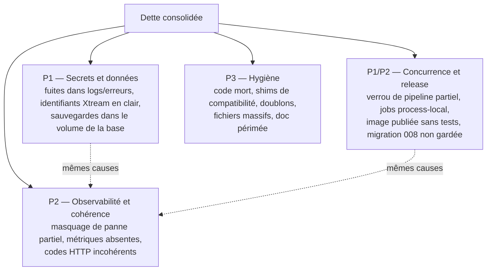
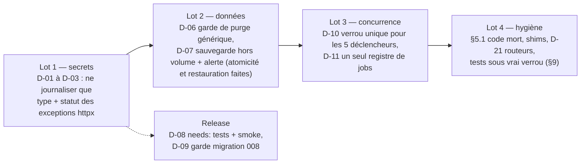

# Dette technique consolidée — PlexHub Backend

**Reconstitué le** : 2026-09-26 · recalé le 2026-10-02 (Lot 10) · **HEAD** : `aa3270f` (branche `develop`, backend v1.10.9) · **Méthode** : `/retro-spec technique dette` — 3 lecteurs `Explore` (`sonnet`) en lecture seule : (1) écarts des 24 fiches fonctionnelles et des 4 volets techniques, (2) code mort, marqueurs, doublons, fichiers massifs, (3) tests manquants et contrat TV. Rédaction par la session principale. **Preuves rouvertes par la session principale** (7) : l'import mort de `calculate_display_rating`, l'alias `assert_public_redirect_host` sans appelant, `resolve_job_url` appelé par les seuls tests, le parsing manuel de `server_id` dans `stream.py`, la génération du `jobId` par le routeur de synchro, l'appel de l'audit de routes au boot, le log d'exception TMDB de l'enrichissement ; plus les sites `write_with_retry` et les trois magasins de jobs en mémoire. **Une affirmation de lecteur corrigée** : l'écart « fuite Xtream » du volet sécurité ne se situe pas sur la ligne `raise` de `xtream_service` mais chez les appelants qui journalisent l'exception relancée (§3, D-03).
**Sources** : l'inventaire [`../_genere/inventaire.md`](../_genere/inventaire.md), les fiches [`../fonctionnel/`](../fonctionnel/) (on renvoie aux FR, on ne les recopie pas), les volets [C4](00-c4.md), [contrat d'API](contrat-api.md), [sécurité](securite.md), [build-release](build-release.md), et le registre de dette historique `docs/context/etat-reel.md` (recalé §10) ; côté TV (lecture seule) PlexHubTV, preuves `tv:`.
**Règle** : aucune valeur secrète, aucune donnée réelle. Un mécanisme de fuite est décrit, jamais son contenu.

---

## 1. Vue d'ensemble

Les 24 fiches recensent environ **1 065 exigences** : 934 *implémenté*, **80 *partiel***, **11 *mort***, **18 *absent***, **22 *retiré*** (comptage par grep sur les statuts, recalé au Lot 10 ; avant le Lot 10 : 926 / 81 / 34 / 24). *Retiré* = exigence gardée pour la traçabilité dont le code mort a été supprimé. La dette de code proprement dite est faible en marqueurs (**0 `TODO`/`FIXME`/`HACK`** dans `app/`), mais elle se concentre dans quatre familles transverses.

| Priorité | Critère | Nombre d'entrées (§3-§4) |
|---|---|---|
| **P1** | exposition d'un secret, perte ou corruption de données, publication d'un artefact non vérifié | 9 |
| **P2** | double exécution, état incohérent entre surfaces, panne silencieuse, dette d'architecture qui bloque un correctif | 14 |
| **P3** | code mort, doublon, doc périmée : coût de maintenance, sans effet utilisateur | §5-§10 |

## 2. Registre historique : ce qui est périmé

Avant de citer une dette, croiser avec ce tableau : le registre `docs/context/etat-reel.md` (recalé le 2026-07-26) et `CLAUDE.md` présentent encore comme **ouverts** des points fermés depuis. C'est la même cause de péremption que celle d'AUDIT-P7-003.

| Finding annoncé ouvert | État mesuré à `8b3e7da` | Preuve |
|---|---|---|
| AUDIT-P5-001 — `jobId` des triggers `/api/sync/*` mort | **fermé** : l'id est créé une seule fois par le routeur et enregistré avant le lancement | `app/api/sync.py:20-26`, `app/api/sync.py:37-44` |
| AUDIT-P4-001 / CR-A04 — assertion de boot « not done » | **fermé** : appelée en dernier dans le bloc de montage | `app/main.py:754-755` |
| AUDIT-P4-005 — deux écrivains de `display_rating` qui oscillent | **fermé** : l'import NFO passe par `rating_blend` ; l'ancienne formule ne survit que comme import mort (§5) | `app/services/nfo_import_service.py:536-544` |
| AUDIT-P3-003 — `DatabaseSource` agrège sur la boucle | **fermé** : agrégation via `asyncio.to_thread` | `app/plex_generator/source.py:179` |
| CR-T02 — aucun test de rejet d'authentification | **fermé** : tests 401 paramétrés par routeur | `tests/test_auth_guard.py:67` |
| AUDIT-P5-004 — client TV legacy sans `server_id` sur `/api/media/episodes` | **fermé côté TV** : paramètre non nullable | `tv:core/network/src/main/java/com/chakir/plexhubtv/core/network/backend/BackendApiService.kt:37` |
| CLAUDE.md §3 — le générateur écrit « directement sur la boucle » (CR-C01) | corrigé (thread), voir CAP-BE-16 | — |
| CLAUDE.md §9 piège 10 — `/metrics` non authentifié | faux, contredit par le piège 19b et le code | voir [sécurité](securite.md) |
| CLAUDE.md §2 et `flux-cles.md` §5.1 — le Backend annonce une synchro EPG, et le QR d'appairage une page d'approbation | **résolu au Lot 10** : page publique `GET /api/tv-auth/approve` (FR-BE-075) et synchro XMLTV en masse `epg_sync` (FR-BE-222), **désactivée par défaut**, mesure à l'échelle de la production non faite | `app/api/tv_auth.py:436-469`, `app/services/epg_sync_service.py:583-648`, `app/main.py:441-462` |
| Registre de dette (`etat-reel.md`) — sauvegardes sans restauration ni contrôle d'intégrité, écriture non atomique | **fermé au Lot 10** (reste : volume partagé avec la base, alerte, copie hors hôte) | `app/scripts/backup_db.py:137-154`, `app/scripts/restore_db.py:129-205` |

Les autres références périmées (numéros de ligne CLAUDE.md §2/§3, bandeau « develop en retard sur main », APP_VERSION 1.10.0 dans CLAUDE.md §2, `docs/30-ops-plex-webdav.md` qui annonce un HEAD paresseux non implémenté, PRD Plex qui dit le NFO sidecar non livré, défaut de debounce dans l'ADR 0005) sont listées dans les fiches concernées ; elles relèvent de `/sync-context`, pas du code.

## 3. Dette P1 — secrets, données, release

| ID | Constat | Preuve / renvoi | Pourquoi P1 |
|---|---|---|---|
| D-01 | Une erreur HTTP TMDB (hors 404) est journalisée avec le texte de l'exception, qui embarque l'URL de requête et donc la clé d'API — violation directe de CLAUDE.md §9 piège 21c. Même motif sur le repli trailer et sur `find_by_imdb_id`. | `app/workers/enrichment_worker.py:318`, `app/workers/enrichment_worker.py:321` ; FR-BE-377, FR-BE-462 ; [sécurité](securite.md) S2 | secret dans les logs |
| D-02 | Le 400 de création/test d'un compte Xtream peut renvoyer le texte d'une exception httpx contenant l'URL `player_api.php` avec les identifiants. | FR-BE-152 ([CAP-BE-04](../fonctionnel/CAP-BE-04-comptes-xtream-categories.md)) | secret renvoyé au client |
| D-03 | Les erreurs HTTP Xtream sont relancées telles quelles (`raise`) puis journalisées par les appelants avec l'URL à identifiants. | `app/services/xtream_service.py:91-92` ; [sécurité](securite.md) S1 | secret dans les logs |
| D-04 | Identifiants Xtream en clair hors base : dans chaque `.strm`, dans `.plex_mapping.json`, et dans la réponse de `/api/stream` à toute clé utilisateur (aucune portée, aucune expiration). Choix de conception, jamais documenté comme risque accepté. | RG-BE-10.2, FR-BE-410 ; [CAP-BE-16](../fonctionnel/CAP-BE-16-generation-bibliotheque-plex-jellyfin.md) écart 1 ; [sécurité](securite.md) S5 | exposition de secret fournisseur |
| D-05 | Sans clé de chiffrement configurée, mots de passe Xtream et jetons PMS stockés en clair (fail-open) ; les deux clés Fernet dérivent par défaut du secret maître, dont la rotation rend les secrets illisibles. | [sécurité](securite.md) S3, S4 (résidu CR-S03) | secret au repos |
| D-06 | Génération de bibliothèque : aucun garde-fou de purge sur les chemins API/CLI — un `accountId` inconnu vide l'arbre mappé de tous les comptes ; une erreur sur `tvshow.nfo` supprime les épisodes déjà mappés ; le dry-run persiste le mapping. | FR-BE-734, FR-BE-735, FR-BE-738 | perte de bibliothèque Jellyfin |
| D-07 | Sauvegardes par défaut dans le volume de la base, sans copie hors hôte, sans contrôle d'espace libre ni alerte. (Restauration outillée, contrôle d'intégrité et écriture atomique : **faits au Lot 10**, FR-BE-874 à FR-BE-876.) | FR-BE-877, FR-BE-878 ; [CAP-BE-24](../fonctionnel/CAP-BE-24-sauvegarde-maintenance-base.md) ; [build-release](build-release.md) écart 3 | perte de données |
| D-08 | Un push sur `main` publie une image sans smoke ni dépendance aux tests. | [build-release](build-release.md) écart 1 | artefact non vérifié |
| D-09 | Migration 008 (sqlite-vec) sans garde : extension absente ⇒ boot en échec au lieu du 503 IA prévu. | [build-release](build-release.md) écart 2 | indisponibilité totale |

## 4. Dette P2 — concurrence, cohérence, observabilité, architecture

| ID | Constat | Preuve / renvoi |
|---|---|---|
| D-10 | **Verrou de pipeline partiel** : `_PIPELINE_LOCK` ne couvre que 2 des 5 déclencheurs ; `/api/sync/full-pipeline`, `/xtream/all`, l'enrichissement manuel et la génération peuvent tourner deux fois en parallèle (double budget TMDB, écritures concurrentes). | FR-BE-236, FR-BE-381, FR-BE-740, FR-BE-741 ; [C4](00-c4.md) E11 |
| D-11 | **Quatre magasins de jobs en mémoire process-local**, chacun réimplémenté (dict ou `OrderedDict` + plafond + éviction) : perdus au redémarrage, invisibles d'un autre process. | `app/services/job_registry.py:46`, `app/workers/embedding_worker.py:29`, `app/workers/enrichment_backfill_worker.py:73`, `app/workers/manual_scrape_batch_worker.py:85` |
| D-12 | **Masquage de panne fournisseur incohérent** : appliqué aux listes du catalogue, absent du détail par clé, du live, de `/api/stream`, de `/dav`, de la génération ; `total` du chemin snapshot sur-compte ; la TV n'en connaît pas l'état. | FR-BE-316, FR-BE-334, FR-BE-510 ; RG-BE-11.2 |
| D-13 | **Import NFO** : retry maison sur la même session (pas `write_with_retry`), commit par paquets de 50 non atomique, toute l'E/S synchrone sur la boucle, XML parsé sans limite de taille. | FR-BE-842, FR-BE-843, FR-BE-847, FR-BE-828 |
| D-14 | L'enrichissement utilise le pool de connexions de l'API au lieu du pool worker dédié ; en pratique seuls la validation et la panne fournisseur utilisent ce pool. | FR-BE-378 ; [C4](00-c4.md) E3 |
| D-15 | Endpoints LLM sans limite de débit ni de taille de prompt (120-240 s par appel) ; rôle `system` libre côté assistant. | [CAP-BE-14](../fonctionnel/CAP-BE-14-generation-llm-assistant.md) écarts |
| D-16 | Validation de flux : un flux cassé repasse sain sur un échec transitoire ; aucun détecteur de fichier tronqué (point ouvert n° 1 du bandeau CLAUDE.md). | FR-BE-276 ; [CAP-BE-07](../fonctionnel/CAP-BE-07-validation-des-flux.md) |
| D-17 | Observabilité : lot de scraping, proxy poster, téléchargements, relais DAV, OMDb sans métriques ; `trailer_cache_purge` hors des jobs suivis ; la fraîcheur des jobs compte un retour anticipé comme un succès ; `status` de santé toujours `"ok"`. | FR-BE-038, FR-BE-059, FR-BE-461, FR-BE-869 ; AUDIT-P8-001/002 |
| D-18 | Pas de gestionnaire d'exceptions global : 500 non enveloppés ; codes HTTP incohérents pour un même concept (id inconnu, `server_id` invalide). `int()` non protégé sur un id de flux non numérique ⇒ 500. | [contrat d'API](contrat-api.md) écarts 2-3 ; FR-BE-404 |
| D-19 | `/api/ai/*` répond 503 (sqlite-vec) avant 401, y compris pour les routes LLM et sous-titres qui n'utilisent aucun vecteur. | [contrat d'API](contrat-api.md) écart 1 ; CLAUDE.md §9 piège 12 |
| D-20 | `/dav` : `DAV_ENABLED=false` contrôlé **après** l'authentification (401 au lieu du 503 documenté) ; l'exclusion du tunnel public reste procédurale. | FR-BE-794 ; [CAP-BE-17](../fonctionnel/CAP-BE-17-relais-webdav.md) |
| D-21 | Logique d'accès aux données dans les routeurs : 13 requêtes `select`/`execute` directes dans `live.py`, parsing manuel de `server_id` dans `stream.py` au lieu de `parse_server_id`. | `app/api/stream.py:20-23` ; [C4](00-c4.md) E4 (résidu CR-A01) |
| D-22 | Couplage bidirectionnel `services ⇄ dav` : `tree_builder` importe `stream_service` au chargement, `plex_generation_service` importe `dav.vfs` en différé. | `app/services/plex_generation_service.py:144` ; [C4](00-c4.md) E5 |
| D-23 | Clients HTTP : Ollama ouvre un `AsyncClient` par appel (4 sites) alors que TMDB/OMDb sont poolés ; `omdb_service`/`plex_api_service` jamais fermés à l'arrêt. | `app/services/ollama_service.py:28` ; [C4](00-c4.md) E2 |

## 5. Code mort

### 5.1 Symboles backend (vérifiés par grep sur `app/`, `scripts/`, `tests/`)

| Symbole | Définition | Verdict |
|---|---|---|
| `calculate_display_rating` | `app/utils/unification.py:40` | **mort** : importé par `app/workers/sync_worker.py:22`, jamais appelé nulle part ; sa docstring le dit encore utilisé par la synchro |
| alias `assert_public_redirect_host` | `app/services/download_service.py:379` | **mort** : aucun appelant ; le relais DAV utilise désormais `app.utils.ssrf` |
| `resolve_job_url` (singulier) | supprimé (Lot 10) | **retiré** : il ne reste que `resolve_job_urls` (`app/services/plex_download_service.py:414-465`) — FR-BE-1043 |
| `_record_sync_job`, `get_sync_job`, `get_all_sync_jobs` | supprimés (Lot 10) | **retirés** : les tests passent par `job_registry` (`set_job`, `get_job`, `get_all_jobs`, `app/services/job_registry.py:61-140`) |
| `get_key`, `parse_title_and_year`, `is_pipeline_active`, `list_series_seasons`, `resolve_review`, `MappingStore.purge_stale`, `series_episode_nfo_path`, `read_strm`, `get_xmltv` | supprimés ou remplacés (Lot 10) | **retirés** (voir FR-BE-115, FR-BE-751, FR-BE-973, FR-BE-560) |
| `ssrf.clear_cache` | `app/utils/ssrf.py:78` | **tests seulement** (acceptable : utilitaire de test, à renommer ou documenter) |

Colonnes et champs **conservés volontairement** (hors du retrait du Lot 10) : `tv_auth_sessions.created_at`/`approved_at`/`completed_at`/`device_name` (FR-BE-098), `live_channels.is_active`/`tv_archive`/`tv_archive_duration` (FR-BE-535, FR-BE-553 : champs requis par le DTO de l'app TV), et les endpoints `POST`/`PUT`/`DELETE /api/accounts`, `GET /api/sync/status/{job_id}`, `GET /api/live/channels/{stream_id}` (FR-BE-187, FR-BE-240, FR-BE-538 : API publique testée, le code mort est côté TV).

Vérifiés **vivants** malgré leur nom (ne pas supprimer) : `commit_with_retry` (appels réels dans la synchro), `resolve_movie_names`/`resolve_series_names` (arbre DAV), `DryRunStorage` (génération à blanc). Aucune clé de `Settings` n'est morte, aucun module d'`app/` n'est jamais importé.

### 5.2 Exigences au statut *mort* ou *retiré* (11 *mort*, 22 *retiré* ; détail dans les fiches)

| Nature | FR |
|---|---|
| *Retiré* au Lot 10 — paramètres acceptés jamais lus | FR-BE-192 (`force`), FR-BE-571 (`mediaId`/`ratingKey` sous-titres), FR-BE-699 (`allAccounts`), FR-BE-811 (`account_ids` import NFO), FR-BE-899 (`tab`) |
| *Retiré* au Lot 10 — branches sans appelant | FR-BE-285, FR-BE-322, FR-BE-507, FR-BE-508 (options `include_broken`/`include_filtered`/`apply_outage_mask`), FR-BE-008 (portée `series_seasons`), FR-BE-035 (préfixe adulte des téléchargements) |
| *Retiré* au Lot 10 — fonctions/routes sans appelant | FR-BE-115, FR-BE-751, FR-BE-973, FR-BE-1043 ; routes admin héritées FR-BE-918, FR-BE-919 |
| *Retiré* au Lot 10 — champs/colonnes écrits jamais relus | FR-BE-852, FR-BE-853, FR-BE-900, FR-BE-904, FR-BE-815 |
| Reste *mort* — conservé volontairement (champs requis par le DTO de l'app TV, ou colonnes d'audit) | FR-BE-098, FR-BE-535, FR-BE-553 |
| Reste *mort* — autres | FR-BE-410 (`expiresAt`), FR-BE-917 (`POST /admin/movies/{rk}/rescrape` hérité) |
| Résolu autrement | FR-BE-560 (`get_xmltv` remplacé par `download_xmltv`, utilisé par la synchro EPG) |
| Côté TV (déclaré, jamais appelé par un écran) | FR-BE-187, FR-BE-240, FR-BE-538, FR-BE-565, FR-BE-605, FR-BE-696 |

### 5.3 Contrat : endpoints non appelés par la TV

La TV appelle 31 routes (deux interfaces Retrofit backend + une IA, aucun appel OkHttp direct vers `/api`). Toutes les routes restantes sont **vivantes par un autre consommateur** : UI admin (`/admin*`, stats et rescrape du catalogue), opérateur (`/api/sync/*` hors `xtream`, `/api/plex/generate`, `/api/admin/*`), rclone (`/dav`), page d'approbation (`GET /api/tv-auth/approve`, servie par le backend et ouverte depuis le QR : FR-BE-075 *implémenté* au Lot 10). Pas de route backend morte ; en revanche 6 routes LLM et `/api/ai/search` n'ont **ni client TV ni test de bout en bout** (FR-BE-696).

## 6. Marqueurs dans le code

Aucun `TODO`, `FIXME` ni `HACK` dans `app/` et `scripts/` (les `XXX` sont la balise de contenu adulte). La dette est signalée autrement : **28 commentaires** « legacy / deprecated / back-compat / knowingly NOT ideal ». Les plus lourds :

- shims de compatibilité à retirer une fois les tests migrés — `app/plex_generator/models.py:36-37`, `app/services/embedding_service.py:39` (les shims de `sync_worker` ont été retirés au Lot 10) ;
- contrat hérité maintenu vivant : `device_code` en snake_case — `app/api/tv_auth.py:552-557` ; `accountId` seul pour restreindre la génération (`allAccounts` retiré au Lot 10) — `app/api/plex.py:95-98` ;
- choix admis comme imparfait : schéma de remplissage de l'identité — `app/services/media_identity_writer.py:20`.

Côté TV, deux `TODO` seulement, aucun ne touche le contrat backend.

## 7. Doublons

| Doublon | Preuve | Statut |
|---|---|---|
| Retry HTTP TMDB recopié ligne à ligne dans OMDb | `app/services/tmdb_service.py:317` | assumé par la docstring OMDb ; à factoriser |
| Magasins de jobs en mémoire ×4 | voir D-11 | réimplémentations indépendantes |
| Parsing de `server_id` | `app/api/stream.py:23` contre `app/utils/server_id.py:6-10` | helper existant ignoré |
| Dédup Plex en SQL (`GROUP BY unification_id`) contre dédup Xtream en mémoire (`aggregation_service`) | `app/services/plex_catalog_service.py:1-8` | assumé (CR-F05) |
| Auto-provision Xtream qui recopie `account_service` | FR-BE-156 | à factoriser |
| Deux « formules » de `display_rating` | §5.1 | une seule active ; l'autre est morte |

## 8. Fichiers massifs et couplages

| Fichier | Lignes | Remarque |
|---|---|---|
| `app/workers/sync_worker.py` | 1 775 | CR-A03 ouvert |
| `app/services/manual_scrape_service.py` | 1 557 | né au lot §5.14, non tracké |
| `app/services/download_service.py` | 1 411 | 4 responsabilités, non tracké |
| `app/db/migrations.py` | 1 399 | croissance par construction (28 migrations rejouées) |
| `app/api/ai.py` | 1 246 | logique métier dans le routeur |
| `app/services/tmdb_service.py` | 1 067 | — |
| `app/api/admin.py` | 918 | routes héritées mortes retirées au Lot 10 (§5.2) |
| `app/main.py` | 761 | CR-A05 : 661 → 689 → 734 → 761 lignes, la trajectoire reste à la hausse (job `epg_sync`, Lot 10) |

## 9. Tests manquants

Seuil de couverture `--cov-fail-under=70`, jamais relevé alors que la couverture mesurée dépasse 80 % — `pyproject.toml:30`. Pas de `skip`/`xfail` injustifié (trois `skipif` de plateforme). Aucun test de bout en bout côté backend (pas de `.maestro/` ; les parcours Maestro sont côté TV).

| Trou | Preuve |
|---|---|
| Script sans aucun test : `backfill_certifications` (pagination, commits par lots) | `app/scripts/backfill_certifications.py:4` |
| Tests indirects seulement : `stream_service` (via HTTP), `request_context` (un seul en-tête vérifié) | — |
| Écrivains `write_with_retry` **non testés sous vrai verrou WAL** (règle CLAUDE.md §9 piège 8) : expiration de session TV, deux écrivains de panne fournisseur, écriture du trailer, et 4 des 5 écrivains du scraper manuel (`unlock`, `clear_ids`, revue) | `app/api/tv_auth.py:235`, `app/services/account_outage_service.py:99`, `app/services/account_outage_service.py:148`, `app/services/trailer_service.py:269`, `app/services/manual_scrape_service.py:985`, `app/services/manual_scrape_service.py:1018`, `app/services/manual_scrape_service.py:1478`, `app/services/manual_scrape_service.py:1499` |
| Chemins d'erreur HTTP (401/403/503, bornes, formats) : constat récurrent dans les 24 fiches (Basic Auth à secret vide, parseur Range DAV, routes admin, cache 45 s) | fiches, rubrique « Tests » |
| Chiffrement effectif du jeton Plex en base, dégradation sans sqlite-vec, délai TV (15 s) contre démarrage à froid IA (~30 s) | CAP-BE-19 ; [build-release](build-release.md) Q2 ; [contrat d'API](contrat-api.md) écart 9 |

## 10. Plan de résorption suggéré

---

## Écarts et risques

| # | Constat | Preuve | Nature | Gravité |
|---|---|---|---|---|
| 1 | Clé TMDB journalisée via le texte d'exception httpx (enrichissement, trailer, `find_by_imdb_id`). | `app/workers/enrichment_worker.py:318` ; FR-BE-377 | secret dans les logs | haute |
| 2 | Identifiants Xtream exposés : 400 de création de compte, logs d'erreur Xtream, `.strm`, `/api/stream`. | FR-BE-152 ; `app/services/xtream_service.py:91-92` | secret | haute |
| 3 | Purge de bibliothèque sans garde-fou hors du chemin automatique. | FR-BE-735 | perte de données | haute |
| 4 | Sauvegardes dans le volume de la base, sans copie hors hôte ni alerte (l'atomicité, le contrôle d'intégrité et la restauration sont faits au Lot 10). | FR-BE-877, FR-BE-878 | perte de données | moyenne |
| 5 | Image publiée sans tests ni smoke ; migration 008 non gardée. | [build-release](build-release.md) écarts 1-2 | release / disponibilité | haute |
| 6 | Verrou de pipeline couvrant 2 déclencheurs sur 5. | FR-BE-236, FR-BE-741 | double exécution | moyenne |
| 7 | Quatre registres de jobs en mémoire, perdus au redémarrage. | `app/services/job_registry.py:46` | fiabilité / doublon | moyenne |
| 8 | Masquage de panne appliqué à une partie des lectures seulement. | FR-BE-510, FR-BE-316 | incohérence | moyenne |
| 9 | Import NFO : retry sur la même session, E/S bloquante, commits partiels. | FR-BE-843, FR-BE-847 | perte d'écriture silencieuse | moyenne |
| 10 | 8 écrivains `write_with_retry` jamais testés sous vrai verrou. | `app/services/account_outage_service.py:99` | trou de test | moyenne |
| 11 | Registre de dette et CLAUDE.md présentent 6 findings fermés comme ouverts. | §2 | doc périmée (ancrage) | moyenne |
| 12 | Endpoints LLM sans limite de débit ni de taille. | [CAP-BE-14](../fonctionnel/CAP-BE-14-generation-llm-assistant.md) | coût / abus | moyenne |
| 13 | Fichiers massifs en croissance (`main.py` 761, `sync_worker.py` 1 775, deux non trackés). | §8 | dette d'architecture | basse |
| 14 | Code mort et shims (`calculate_display_rating`, alias SSRF ; `resolve_job_url` et les 3 shims de synchro retirés au Lot 10 ; 11 FR *mort* restantes sur 33). | `app/utils/unification.py:40` | hygiène | basse |
| 15 | Retry TMDB/OMDb dupliqué, parsing `server_id` dupliqué. | `app/api/stream.py:20-23` | doublon | basse |
| 16 | Seuil de couverture à 70 % pour une couverture mesurée au-dessus de 80 %. | `pyproject.toml:30` | filet de régression lâche | basse |

## Questions ouvertes (à vérifier par test)

1. **Fuite de clé TMDB** : provoquer un 500 TMDB simulé (respx) pendant `enrichment_worker.run()` et vérifier qu'aucun enregistrement de log ne contient le paramètre de clé — le test doit échouer aujourd'hui (écart 1).
2. **400 Xtream** : `POST /api/accounts` vers un panel simulé qui répond 401 — le corps de réponse contient-il l'URL à identifiants (écart 2) ?
3. **Purge** : `POST /api/plex/generate` avec un `accountId` inconnu sur un arbre peuplé — combien de dossiers supprimés (écart 3) ?
4. **Double pipeline** : deux `POST /api/sync/full-pipeline` rapprochés — deux exécutions concurrentes observées dans le registre de jobs (écart 6) ?
5. **Vrai verrou** : `record_trip` et `unlock` sous `BEGIN IMMEDIATE` tenu 2 s par une autre connexion — l'écriture aboutit-elle après libération (écart 10) ?
6. **Import NFO sous verrou** : un import pendant qu'une connexion tient le verrou d'écriture — lignes perdues sans erreur (écart 9, piège 8) ?
7. **Suppression du code mort** : retirer `calculate_display_rating` et l'alias SSRF — la suite passe-t-elle sans modification (écart 14) ? (Les shims de synchro l'ont été au Lot 10 après migration des tests vers `job_registry`.)
8. **Seuil de couverture** : la suite passe-t-elle avec `--cov-fail-under=80` sur les deux versions de Python de la matrice (écart 16) ?
