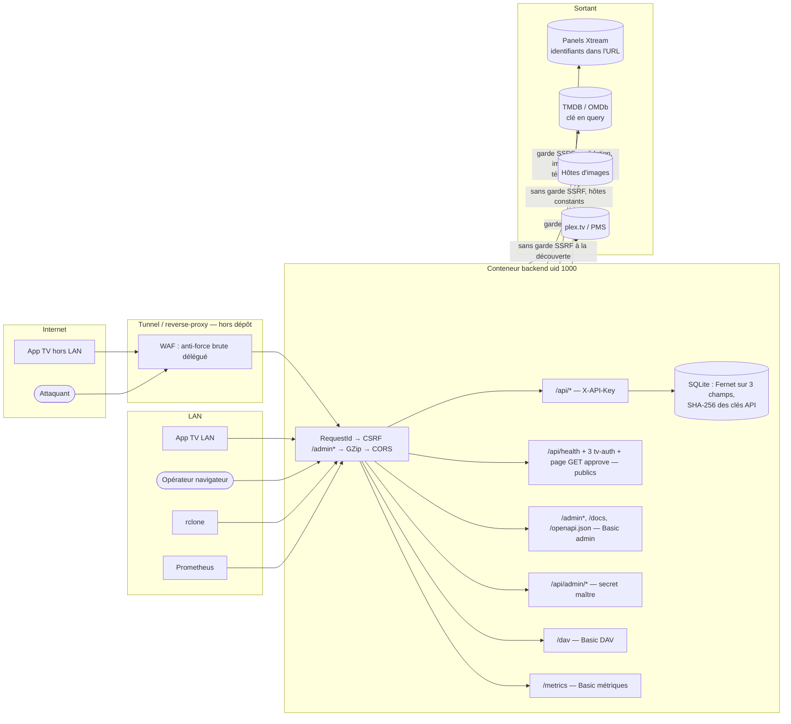
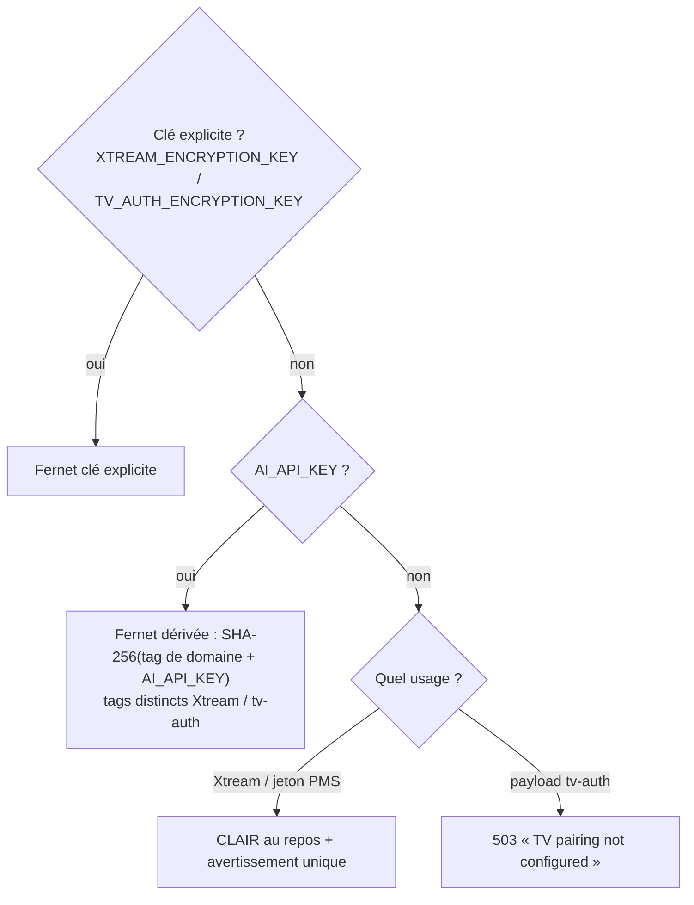

# Sécurité — PlexHub Backend (mécanismes, jamais de valeurs)

**Reconstitué le** : 2026-09-26 · recalé le 2026-10-02 (Lot 10 : page d'approbation, synchro EPG, sauvegarde) · **HEAD** : `aa3270f` (branche `develop`, backend v1.10.9) · **Méthode** : `/retro-spec technique securite` — 3 lecteurs `Explore` (`sonnet`) en lecture seule (secrets et chiffrement ; SSRF, CSRF, confinement ; app TV), rédaction par la session principale, **12 preuves rouvertes dans le code**, dont une affirmation de lecteur corrigée (le client OkHttp « ai » de la TV masque bien `X-API-Key` dans ses journaux, `tv:core/network/src/main/java/com/chakir/plexhubtv/core/network/ai/AiNetworkModule.kt:35`).
**Sources** : le code, l'inventaire [`../_genere/inventaire.md`](../_genere/inventaire.md), les fiches CAP-BE (on y renvoie), le [contrat d'API](contrat-api.md) §1.1, le [C4](00-c4.md) ; côté TV (lecture seule) PlexHubTV, preuves `tv:`.
**Règle** : ce volet décrit des **mécanismes**. Aucune valeur de secret, aucune adresse privée, aucune donnée réelle ; les secrets sont nommés par leur **variable**. Les gardes d'authentification sont décrites exigence par exigence dans [CAP-BE-02](../fonctionnel/CAP-BE-02-cles-api-authentification.md) (FR-BE-101 à FR-BE-138) : ce volet les situe et les relie, il ne les recopie pas.

---

## 1. Surfaces et frontières de confiance

| Surface | Garde | Échec | Détail |
|---|---|---|---|
| `/api/*` (accounts, categories, live, media, stream, sync, plex) | `verify_backend_secret` : secret maître **ou** clé utilisateur active | 401 | FR-BE-101 à FR-BE-106 |
| `/api/ai/*` | `verify_api_key` : garde sqlite-vec **puis** clé | 503 avant 401 | FR-BE-107, FR-BE-108 |
| `/api/admin/*` (clés, miroirs téléchargements, enrichissement) | `verify_master_key` | 503 si secret vide, sinon 401 | FR-BE-123 à FR-BE-125 |
| `/admin*`, `/docs`, `/openapi.json` | Basic Auth admin + CSRF `Sec-Fetch-Site` | 503 / 401 / 403 | FR-BE-126 à FR-BE-128, FR-BE-134 |
| `/dav` | Basic Auth DAV dédiée | 503 / 401 | FR-BE-129, FR-BE-130 ; [CAP-BE-17](../fonctionnel/CAP-BE-17-relais-webdav.md) |
| `/metrics` | Basic Auth métriques dédiée (`METRICS_PUBLIC` la lève) | 503 / 401 | FR-BE-131 |
| `/api/health`, `/api/tv-auth/start|status|complete`, **`GET /api/tv-auth/approve`** (page HTML) | aucune (liste publique figée à 5 couples (méthode, chemin), `app/api/route_audit.py:66-99`) ; la page ne lit ni la base ni la clé de chiffrement et porte une CSP à nonce | — | FR-BE-104, FR-BE-133, FR-BE-075 ; [CAP-BE-03](../fonctionnel/CAP-BE-03-appairage-tv.md) RG-BE-03.8…11 |
| `POST /api/tv-auth/approve` | `verify_backend_secret` (clé maître ou clé utilisateur active), **gardé à l'endpoint** et attrapé par l'audit de boot (pas dans l'allow-list) | 503 / 401 / 422 / 404 / 410 / 409 | FR-BE-076 à FR-BE-081 |
| Démarrage | `assert_api_routes_authenticated` refuse une route `/api/*` non gardée | `RuntimeError` | FR-BE-132 |

Le montage (trois conventions) et l'ordre des middlewares sont décrits dans le [contrat d'API §1.1](contrat-api.md) ; l'ordre d'empilement est prouvé par `app/main.py:627-642`.

## 2. Secrets : inventaire par nom

Tous les secrets sont lus par la classe `Settings` maison (`os.getenv` + `python-dotenv`), injectés par `env_file: .env` dans le conteneur (`docker-compose.yml:40-42`) ; le bloc `environment:` du compose ne porte **aucun** secret (`docker-compose.yml:43-50`). `.env` est ignoré par git (`.gitignore:3-7`) ; `.env.example` liste les noms avec des valeurs vides (non lu ici, comme l'exige la méthode).

| Variable | Rôle | Si vide | Journalisé au démarrage | Preuve |
|---|---|---|---|---|
| `AI_API_KEY` | secret maître `X-API-Key` ; **aussi** graine de dérivation des deux clés Fernet | API JSON et IA : 401 ; `/api/admin/*` : 503 | jamais | `app/config.py:39` |
| `ADMIN_USERNAME` / `ADMIN_PASSWORD` | Basic Auth `/admin`, `/docs`, `/openapi.json` | 503 (fail-closed) | jamais | `app/config.py:43-45` |
| `METRICS_USERNAME` / `METRICS_PASSWORD` / `METRICS_PUBLIC` | Basic Auth `/metrics` ; échappatoire | 503 ; `METRICS_PUBLIC=true` → avertissement au boot | avertissement seul, pas la valeur | `app/config.py:54-62`, `app/config.py:528-536` |
| `DAV_ENABLED` / `DAV_USERNAME` / `DAV_PASSWORD` | Basic Auth `/dav` (rclone) | 503 | jamais | `app/config.py:306-310` |
| `TV_AUTH_ENCRYPTION_KEY` | clé Fernet du payload d'appairage | dérivée de `AI_API_KEY` ; les deux vides → tv-auth 503 | jamais | `app/config.py:68`, `app/api/tv_auth.py:181-186` |
| `XTREAM_ENCRYPTION_KEY` | clé Fernet des mots de passe Xtream et jetons PMS | dérivée de `AI_API_KEY` ; les deux vides → **stockage en clair** (fail-open) | avertissement une fois | `app/config.py:114`, `app/utils/crypto_fields.py:102-108` |
| `TMDB_API_KEY` | enrichissement TMDB | enrichissement désactivé | **4 premiers caractères** | `app/config.py:33`, `app/config.py:461-464` |
| `OMDB_API_KEY` | notes IMDb | validateur désactivé | **4 premiers caractères** | `app/config.py:36`, `app/config.py:466-469` |
| `PLEX_ACCOUNT_TOKEN` | découverte des serveurs Plex partagés | feature « Télécharger Plex » inactive | jamais (seul un préfixe de l'identifiant client) | `app/config.py:275`, `app/config.py:524-526` |
| `XTREAM_BASE_URL` / `XTREAM_USERNAME` / `XTREAM_PASSWORD` | auto-provision d'un compte au boot | auto-provision ignorée | jamais directement — mais voir §4.3 | `app/config.py:219-222`, `app/config.py:434-435` |

Quatre familles cloisonnées (`X-API-Key`, admin, DAV, métriques), chaque garde ne lit que la sienne (RG-BE-02.3). Le secret maître n'est pas une ligne de `api_keys` : il ne se révoque qu'en changeant la variable (RG-BE-02.2).

## 3. Chiffrement et empreintes au repos

| Donnée | Mécanisme | Clé | En cas d'échec | Preuve |
|---|---|---|---|---|
| `xtream_accounts.password` | `EncryptedString` (TypeDecorator Fernet) | `get_xtream_fernet` | pas de clé : clair ; jeton illisible : renvoie le chiffré brut + log `error` sans contenu | `app/models/database.py:153`, `app/utils/crypto_fields.py:112-158` |
| `plex_server.access_token` | `EncryptedString` (même clé) | idem | idem | `app/models/database.py:602` |
| `tv_auth_sessions.payload_encrypted` | Fernet **applicatif** (colonne `Text` brute) | `get_fernet` | `PayloadDecryptError` → 503 propre | `app/models/database.py:285`, `app/utils/payload_crypto.py:64-99`, `app/api/tv_auth.py:584-591` |
| `api_keys.key_hash` | SHA-256 du jeton `phk_…`, clair montré une seule fois | — | — | `app/services/api_key_service.py:32` ; FR-BE-109, FR-BE-110 |

- **Idempotence** : un préfixe de jeton Fernet (`looks_encrypted`) évite le double chiffrement, à l'écriture comme en migration (`app/utils/crypto_fields.py:76`). La migration 016 chiffre rétroactivement les mots de passe, saute les lignes déjà chiffrées et **laisse en clair** sans échouer si aucune clé n'existe (`app/db/migrations.py:662-722`).
- **Séparation de domaine** : deux tags de dérivation distincts, de sorte qu'un jeton tv-auth ne se déchiffre pas avec la clé Xtream (`app/utils/payload_crypto.py:57`, `app/utils/crypto_fields.py:71` ; test `tests/test_payload_crypto.py:52`).
- **Couplage** : sans clé explicite, les deux clés Fernet **dérivent de `AI_API_KEY`**. Faire tourner le secret maître rend les mots de passe Xtream et les jetons PMS illisibles (le code renvoie alors le chiffré comme mot de passe) — voir Écarts.
- **Payload d'appairage** : il porte la clé API backend, un jeton Plex et l'URL du backend destinés à la TV ; il est livré **une seule fois** par une mise à jour conditionnelle, puis effacé à `complete` et à l'expiration (`app/api/tv_auth.py:231`, `app/api/tv_auth.py:689`). Détail fonctionnel : [CAP-BE-03](../fonctionnel/CAP-BE-03-appairage-tv.md).

## 4. Secrets en transit et dans les journaux

### 4.1 URL Xtream : le secret est dans l'URL

Les URL de flux et d'API Xtream portent l'identifiant et le mot de passe du compte (chemin pour les flux, paramètres de requête pour `player_api.php`, `app/services/xtream_service.py:54-70`). Conséquences :

| Chemin | Traitement | Preuve |
|---|---|---|
| Téléchargement physique | URL re-dérivée au worker, jamais persistée ni journalisée ; erreurs réduites à des messages typés (`_safe_error`) | `app/workers/download_worker.py:415`, test `tests/test_download_security.py:64` |
| Relais `/dav` | invariant « aucun message ni log ne contient l'URL ou un `Location` » | `app/dav/relay.py:26-28`, test `tests/test_dav_relay.py:385` |
| Logger `httpx` | épinglé à `WARNING` pour ne jamais journaliser les URL de requête | `app/main.py:109` |
| `GET /api/stream/{rating_key}` | **renvoie l'URL complète avec identifiants** au client authentifié (lecture directe par la TV — c'est le contrat) | `app/api/stream.py:32-36` ; [CAP-BE-10](../fonctionnel/CAP-BE-10-resolution-url-lecture.md) |
| Synchronisation Xtream | les exceptions sont journalisées par `{e}` ; pour une `HTTPStatusError` (401/403/404…) ré-levée par `_get`, le texte contient l'URL **avec paramètres `username`/`password`** | `app/services/xtream_service.py:91-92`, `app/workers/sync_worker.py:1099`, `app/workers/sync_worker.py:1248` |
| Auto-provision au boot | même motif sur l'échec d'authentification | `app/main.py:220-221` |

### 4.2 Clés TMDB / OMDb en paramètre de requête

TMDB et OMDb reçoivent leur clé en query (`app/services/tmdb_service.py:270-272`, `app/services/omdb_service.py:186-188`). `omdb_service` et `tmdb_service.get_match_extras` ne journalisent que le type d'exception et le statut ; **`find_by_imdb_id` journalise l'exception brute** (`app/services/tmdb_service.py:516`), ce que le docstring d'`omdb_service` signale lui-même (`app/services/omdb_service.py:17-22`). Aucun utilitaire de masquage partagé : chaque module applique sa discipline.

### 4.3 Corrélation

`RequestIdMiddleware` pose `X-Request-ID` (écho ou généré) et l'injecte dans chaque ligne de log ; il ne transporte aucun secret (`app/utils/request_context.py:18-37`).

## 5. SSRF (requêtes sortantes)

Garde partagée `app/utils/ssrf.py` : toute adresse résolue doit être globale (refus privé, loopback, lien-local — donc l'adresse de métadonnées cloud —, réservé, multicast, IPv4 et IPv6 confondus) ; échec de résolution = refus (`app/utils/ssrf.py:97-129`). Exemption opérateur `SSRF_ALLOW_PRIVATE_HOSTS` ; cache de verdict `SSRF_DNS_CACHE_SECONDS`, qui **élargit** la fenêtre de rebinding DNS documentée comme non fermée (`app/utils/ssrf.py:26-46`). Appliquée en `event_hooks` httpx, donc à chaque saut de redirection suivi (`app/utils/ssrf.py:189`), ou à la main sur chaque `Location` quand les redirections sont désactivées.

| Client | Garde | Redirections | Origine de l'hôte | Preuve |
|---|---|---|---|---|
| Téléchargement physique | chaque `Location` vérifié | désactivées, suivies à la main, bornées | compte Xtream en base | `app/services/download_service.py:345`, `app/services/download_service.py:452` |
| Relais `/dav` | chaque `Location` vérifié | désactivées, suivies à la main | compte Xtream en base | `app/dav/relay.py:126` |
| Validation des flux | `event_hooks` | suivies | compte Xtream en base | `app/workers/health_check_worker.py:43` |
| Images de la bibliothèque générée | `event_hooks` + vérification explicite | suivies | URL fournisseur | `app/plex_generator/storage.py:61-65` |
| Posters du scraper | `event_hooks`, client dédié **sans paramètres** (jamais celui de TMDB) | suivies, 5 max | URL lue en base | `app/services/poster_match_service.py:355-359` |
| TMDB, OMDb, Ollama, Xtream API, plex.tv | aucune | non suivies (défaut httpx) | constante ou configuration opérateur | `app/services/tmdb_service.py:250`, `app/services/xtream_service.py:28` |

Pour le téléchargement et le relais, **la première requête n'est pas vérifiée** : seuls les sauts le sont (hôte de départ = compte saisi par l'opérateur).

## 6. UI d'administration dans le navigateur

- **CSRF** : `AdminCsrfMiddleware` refuse `POST/PUT/PATCH/DELETE /admin*` en `Sec-Fetch-Site: cross-site` ; en-tête absent accepté (FR-BE-134, `app/api/csrf.py:85-113`).
- **Rendu** : `Jinja2Templates` de Starlette (échappement automatique des `.html`, non surchargé) ; aucun filtre `|safe` dans `app/templates` (grep, 0 résultat).
- **Scripts tiers** : Tailwind et htmx chargés depuis des CDN **sans `integrity`** (`app/templates/admin/base.html:7-8`).
- **En-têtes** : aucun middleware global d'en-têtes de sécurité ; la **page d'approbation** `GET /api/tv-auth/approve` (Lot 10) pose les siens : `Content-Security-Policy` à nonce (`default-src 'none'`, scripts et styles limités aux deux blocs inline portant le nonce, `connect-src 'self'`, `form-action 'none'`, `base-uri 'none'`, `frame-ancestors 'none'`), `X-Frame-Options: DENY`, `Cache-Control: no-store`, `Referrer-Policy: no-referrer`, `X-Content-Type-Options: nosniff` (`app/api/tv_auth.py:417-433` ; test `tests/test_tv_auth_approve_page.py:113-158`). L'UI admin n'a toujours aucune CSP, aucun `X-Frame-Options`, aucun HSTS ; `nosniff` n'y est posé que sur le proxy de poster (`app/api/admin.py:490`).
- **Page d'approbation** : gabarit Jinja2 à échappement automatique (jamais `|safe`), aucune ressource externe ni gestionnaire inline ; le `userCode` de l'URL n'est jamais reflété tel quel (réaffiché seulement s'il respecte le format, reconstruit depuis l'alphabet) ; la clé saisie n'est envoyée qu'en en-tête `X-API-Key` par `fetch` same-origin, jamais en URL, cookie ou stockage web (`app/templates/pairing/approve.html:240-246` ; tests `tests/test_tv_auth_approve_page.py:161-208`).
- **Proxy de poster** `GET /admin/media/{sid}/{rk}/poster` : URL lue en base, jamais fournie par le client ; SVG refusé (`app/services/poster_match_service.py:125`), formats Pillow bornés à JPEG/PNG/WEBP/GIF (`app/services/poster_match_service.py:122`), taille et pixels plafonnés, bombe de décompression interceptée, toute erreur → 404 générique ([CAP-BE-22](../fonctionnel/CAP-BE-22-scraper-manuel-a-verifier.md), `CLAUDE.md` §9 piège 21 c-d).

## 7. Limiteurs et force brute

- `POST /api/tv-auth/start` est limité : deux fenêtres glissantes par IP + un **plafond global de sessions `pending`** compté en base, qui tient même si l'IP est usurpée (`app/utils/rate_limit.py:226`, `app/api/tv_auth.py:267-281`, FR-BE-071, FR-BE-072). La **page d'approbation** `GET /api/tv-auth/approve` a son propre limiteur par IP (30 requêtes / 60 s par défaut, `TV_AUTH_APPROVE_PAGE_RATE_LIMIT_*`, `app/api/tv_auth.py:436-469`, `app/utils/rate_limit.py:247-249`). `status` n'est jamais limité (la TV sonde en boucle). **`POST /api/tv-auth/approve` n'a aucun limiteur de débit** (observation ouverte, aveu en docstring `app/api/tv_auth.py:490-491`).
- L'IP client vient de `CF-Connecting-IP` puis `X-Forwarded-For` : usurpable hors tunnel (`app/utils/rate_limit.py:210`) ; même source pour « dernière IP » des clés (RG-BE-02.7).
- Aucun limiteur ni verrouillage sur les échecs `X-API-Key` et Basic Auth : délégué à l'ingress (RG-BE-02.5).

## 8. Système de fichiers et entrées structurées

| Mécanisme | Portée | Preuve |
|---|---|---|
| `resolve_confined` (realpath sous `DOWNLOAD_DIR`, aucun chemin client) | téléchargements | `app/services/download_service.py:287` ; tests `tests/test_download_confinement.py:184` (lien symbolique) ; [CAP-BE-18](../fonctionnel/CAP-BE-18-telechargement-physique-xtream.md) |
| `is_valid_youtube_id` puis `resolve_confined_cache_path` | fichier de bande-annonce servi par `cache_key` | `app/services/trailer_service.py:129`, `app/services/trailer_service.py:143` |
| `LocalStorage._resolve` = simple jointure, **sans realpath** (chemins construits côté serveur depuis les titres) | bibliothèque générée | `app/plex_generator/storage.py:111-112` |
| `prune_orphan_dirs` ne supprime que des fichiers générés connus | bibliothèque générée | `app/plex_generator/storage.py:194-220` |
| XML sortant DAV construit par `ElementTree` (échappement) ; corps `PROPFIND` jamais lu | `/dav` | `app/dav/propfind.py:75-103` |
| XML entrant : `.nfo` locaux parsés par `xml.etree` standard, sans `defusedxml` | import NFO ([CAP-BE-23](../fonctionnel/CAP-BE-23-import-metadonnees-nfo.md)) | `app/services/nfo_import_service.py:387` |
| SQL : quelques `text(f"…")` n'interpolent que des littéraux de code ou des noms de paramètres liés générés | global | `app/db/migrations.py:82`, `app/services/recommendation_service.py:78` |
| Tailles : sous-titres 413 au-delà de `SUBTITLE_MAX_BYTES`/`SUBTITLE_MAX_CUES` ; `limit` bornés par `Query(le=…)` ; aucune limite de corps globale | API | `app/services/subtitle_service.py:500-526` ; [CAP-BE-15](../fonctionnel/CAP-BE-15-traduction-sous-titres.md) |

## 9. CORS et déploiement

- **CORS** : origines par `CORS_ORIGINS`, défaut `*` avec avertissement au boot ; méthodes et en-têtes explicites ; `allow_credentials` non activé (`app/main.py:621-636`). L'auth par en-tête `X-API-Key` n'est pas ambiante : l'origine `*` n'ouvre pas l'API à un site tiers sans clé.
- **Documentation OpenAPI** : désactivée aux URL par défaut, ré-exposée sous Basic Auth admin (`app/main.py:613-618`, FR-BE-128).
- **Image** : utilisateur non-root uid/gid 1000, `HEALTHCHECK` sur l'endpoint public (`Dockerfile:45-47`, `Dockerfile:62-65`). Prérequis ops : `chown` des volumes, sinon bascule esclave silencieuse (`CLAUDE.md` §9 piège 19f).
- **Réseau** : le compose publie le port sur toutes les interfaces de l'hôte (`docker-compose.yml:5-6`). `/dav` partage ce port : son exclusion du tunnel public est un **prérequis d'activation hors code** (`CLAUDE.md` §9 piège 18b).
- **Dépendance crypto** : `cryptography` bornée (`requirements.txt:25`).

## 10. Côté app TV (lecture seule)

| Mécanisme | Constat | Preuve |
|---|---|---|
| Stockage de la clé et de l'URL backend | `EncryptedSharedPreferences` (clé maître AES-256-GCM du Keystore) ; en cas d'échec, pas de repli en clair (opérations inertes + drapeau dégradé) | `tv:core/datastore/src/main/java/com/chakir/plexhubtv/core/datastore/SecurePreferencesManager.kt:86-114` ; FR-BE-136 |
| Pose de `X-API-Key` | filtrée par hôte backend connu (client par défaut), non filtrée sur le client « ai » (URL unique saisie) | FR-BE-135 ; `tv:core/network/src/main/java/com/chakir/plexhubtv/core/network/ai/AiAuthInterceptor.kt:28-35` |
| Journaux HTTP | `BASIC` en debug, `NONE` en release ; `X-API-Key` masqué sur les deux clients | `tv:core/network/src/main/java/com/chakir/plexhubtv/core/network/NetworkModule.kt:416-425`, `tv:core/network/src/main/java/com/chakir/plexhubtv/core/network/ai/AiNetworkModule.kt:33-42` |
| URL de flux | journalisée **en entier** par `Timber.d` (identifiants Xtream inclus) ; invisible en release, en clair dans logcat en debug | `tv:data/src/main/java/com/chakir/plexhubtv/data/repository/BackendRepositoryImpl.kt:401`, `tv:app/src/main/java/com/chakir/plexhubtv/handler/CrashReportingTree.kt:43` |
| Transport | trafic en clair autorisé par défaut ; HTTPS imposé pour une liste de domaines publics où le backend ne figure pas (hôte saisi librement) ; épinglage de certificat désactivé et, de toute façon, non câblé sur le client backend | `tv:app/src/main/res/xml/network_security_config.xml:26`, `tv:core/network/src/main/java/com/chakir/plexhubtv/core/network/CertificatePins.kt:68` |
| Sauvegarde Android | `allowBackup=false` + exclusions des préférences chiffrées | `tv:app/src/main/AndroidManifest.xml:44`, `tv:app/src/main/res/xml/data_extraction_rules.xml:8-19` |
| Export `.phbx` | contient **en clair** la clé API backend, l'URL backend et les mots de passe Xtream (choix assumé, avertissement dans l'UI) | `tv:core/datastore/src/main/java/com/chakir/plexhubtv/core/datastore/SecurePreferencesManager.kt:622-629`, `tv:data/src/main/java/com/chakir/plexhubtv/data/backup/BackupFormat.kt:23-25` |
| Appairage | seul le `userCode` est affiché ; `toString()` du payload expurgé | `tv:app/src/main/java/com/chakir/plexhubtv/feature/pairing/PairingScreen.kt:265`, `tv:domain/src/main/java/com/chakir/plexhubtv/domain/model/TvPairing.kt:49-52` |
| `/dav`, `/metrics`, `/admin` | aucun appel depuis la TV (grep, 0 résultat) | — |

---

## Écarts et risques

| # | Écart / risque | Nature | Gravité estimée | Preuve | Suite proposée |
|---|---|---|---|---|---|
| S1 | Les erreurs HTTP de l'API Xtream (401/403/404…) sont journalisées avec leur texte, qui contient l'URL `player_api.php` **avec identifiant et mot de passe** en paramètres ; idem à l'auto-provision. Contraste avec l'invariant testé du téléchargement et du relais | fuite de secret dans `plexhub.log` | haute | `app/services/xtream_service.py:91-92`, `app/workers/sync_worker.py:1248`, `app/main.py:221` | Journaliser type + statut seulement (modèle `_safe_error`) ; test de non-fuite calqué sur `tests/test_download_security.py` |
| S2 | `find_by_imdb_id` journalise l'exception TMDB brute (clé API en query) | fuite de secret | moyenne | `app/services/tmdb_service.py:516` | Aligner sur `get_match_extras` |
| S3 | Sans `XTREAM_ENCRYPTION_KEY` ni `AI_API_KEY`, mots de passe Xtream et jetons PMS stockés **en clair** (fail-open assumé, avertissement unique) | chiffrement au repos | moyenne | `app/utils/crypto_fields.py:102-108` | Accepté par conception (CR-S03) ; le signaler dans la santé ou l'admin |
| S4 | Les deux clés Fernet dérivent par défaut de `AI_API_KEY` : faire tourner le secret maître rend les secrets chiffrés illisibles, et le code sert alors le **chiffré comme mot de passe** au lieu d'échouer | rotation / disponibilité | moyenne | `app/utils/crypto_fields.py:153-158` | Documenter une procédure de rotation ; recommander des clés explicites |
| S5 | `GET /api/stream/{rating_key}` renvoie l'URL Xtream avec identifiants à tout porteur d'une clé ; une clé utilisateur n'a aucune portée (RG-BE-02.1) | exposition par contrat | moyenne | `app/api/stream.py:32-36` | Accepté (lecture directe) ; relier à la question des portées de CAP-BE-02 |
| S6 | UI admin sans CSP, `X-Frame-Options` ni HSTS ; scripts CDN sans `integrity` alors que la page porte une Basic Auth ambiante | durcissement navigateur | moyenne | `app/templates/admin/base.html:7-8` | Servir htmx/Tailwind localement ou ajouter SRI ; en-têtes via un middleware `/admin*` |
| S7 | Aucun limiteur sur les échecs d'authentification ; IP client tirée d'en-têtes usurpables | force brute | moyenne (dépend de l'ingress) | `app/utils/rate_limit.py:210` ; RG-BE-02.5 | Accepté si WAF en place ; compteur Prometheus des 401 |
| S8 | Port publié sur toutes les interfaces ; `/dav` sur le même port, exclusion du tunnel uniquement procédurale | exposition réseau | moyenne | `docker-compose.yml:5-6` | Bind explicite ou règle d'ingress vérifiée au runbook DAV |
| S9 | `.nfo` parsés sans `defusedxml` (fichiers locaux, éventuellement écrits par un outil tiers). La synchro EPG (Lot 10) a, elle, un garde d'entités maison sur l'XMLTV téléchargé (refus de tout `<!ENTITY` dans le fichier entier, refus des documents UTF-16/UTF-32, plafond d'octets décompressés) : `app/services/epg_sync_service.py:217-245` | XML (entités) | basse | `app/services/nfo_import_service.py:387` | `defusedxml` (dépendance légère) |
| S10 | `LocalStorage._resolve` ne vérifie pas le confinement (contrairement aux téléchargements et aux bandes-annonces) | défense en profondeur | basse | `app/plex_generator/storage.py:111-112` | Réutiliser le motif `resolve_confined` |
| S11 | Première requête du téléchargement et du relais non vérifiée par la garde SSRF | SSRF | basse (hôte = config opérateur) | `app/services/download_service.py:452` | Vérifier aussi l'hôte initial |
| S12 | TV : URL de flux (identifiants Xtream) écrite par `Timber.d` ; un extrait logcat du dépôt TV (dossier d'audit daté du 2026-05-04) contient une telle URL en clair | fuite (builds debug, artefacts) | moyenne | `tv:data/src/main/java/com/chakir/plexhubtv/data/repository/BackendRepositoryImpl.kt:401` | Masquer via `LogRedactor` ; vérifier si l'extrait est versionné et le purger |
| S13 | TV : export `.phbx` non chiffré contenant la clé backend et les mots de passe Xtream | fuite par fichier | moyenne (choix assumé, averti) | `tv:core/datastore/src/main/java/com/chakir/plexhubtv/core/datastore/SecurePreferencesManager.kt:622-629` | Chiffrement par mot de passe de l'archive, ou exclure la clé backend |
| S14 | TV : backend joignable en HTTP (clé en clair sur le réseau) sans avertissement à la saisie ; pas d'épinglage | transport | moyenne hors LAN | `tv:app/src/main/res/xml/network_security_config.xml:26` | Avertir quand l'URL est `http://` et non privée |
| S15 | Lecteur TV : « client ai sans `redactHeader` » — **faux**, le masquage existe | brouillon corrigé | — | `tv:core/network/src/main/java/com/chakir/plexhubtv/core/network/ai/AiNetworkModule.kt:35` | Aucune |
| S16 | `CLAUDE.md` §9 piège 10 dit encore /metrics non authentifié (dette CR-S02) alors que la garde existe ; `CLAUDE.md` §9 piège 19e liste `plex_api_service` comme non couvert par la garde SSRF, ce qui n'est vrai qu'à la découverte (le téléchargement Plex passe par `download_service`) | doc périmée / imprécise | — | FR-BE-131 | `/sync-context` |
| S17 | `POST /api/tv-auth/approve` sans limiteur de débit (31^8 codes possibles mais une clé valide est exigée) ; la page d'approbation n'impose pas HTTPS : la clé saisie circule en clair si l'adresse affichée par la TV est en `http://` | force brute / transport | basse à moyenne (dépend de l'ingress) | `app/api/tv_auth.py:476-491`, `app/templates/pairing/approve.html:240-246` | Limiteur par IP sur le POST ; avertissement ou refus hors HTTPS ; FR-BE-075 *implémenté* ne couvre pas ces deux points |

## Questions ouvertes (à vérifier par test)

- S1 : une synchro contre un panel répondant 403 écrit-elle l'identifiant et le mot de passe Xtream dans `plexhub.log` ? — test `respx` renvoyant 403 sur `player_api.php` + `caplog`, assertion d'absence du mot de passe.
- S2 : même test sur `tmdb_service.find_by_imdb_id` avec un 401 TMDB : la clé apparaît-elle dans le log ?
- S4 : après changement de `AI_API_KEY` sans clé explicite, `GET /api/stream/...` renvoie-t-il une URL contenant le jeton Fernet à la place du mot de passe ? — test ORM avec deux clés successives.
- Lecture d'une ligne `plex_server` avec jeton en clair (créée avant chiffrement) puis réécrite : est-elle chiffrée à la première écriture ? — test `EncryptedString` sur `PlexServer`.
- `GET /api/media/trailer/file/{cache_key}` avec `cache_key` contenant `..` ou encodé : 404 attendu au niveau route (seul le service est testé aujourd'hui).
- Une réponse du proxy de poster en `image/svg+xml` servie via redirection depuis un hôte public : bien refusée après le saut ? — test `respx` redirection → SVG.
- `.nfo` contenant une déclaration d'entité externe : `nfo_import_service` lit-il un fichier local ? — test avec un `.nfo` piégé dans un répertoire temporaire. (Côté XMLTV, le garde d'entités est couvert par `tests/test_epg_sync_service.py:417-426` et `tests/test_epg_sync_service.py:671-717`.)
- Le logcat du dépôt TV contenant une URL de flux est-il versionné (`git ls-files`) ? — vérification à faire par Chakir, dépôt TV en lecture seule ici.
- `/admin` servi dans une `iframe` d'une autre origine : la Basic Auth ambiante permet-elle un détournement de clic sur « Révoquer » ? — test navigateur (aucun `X-Frame-Options`).
